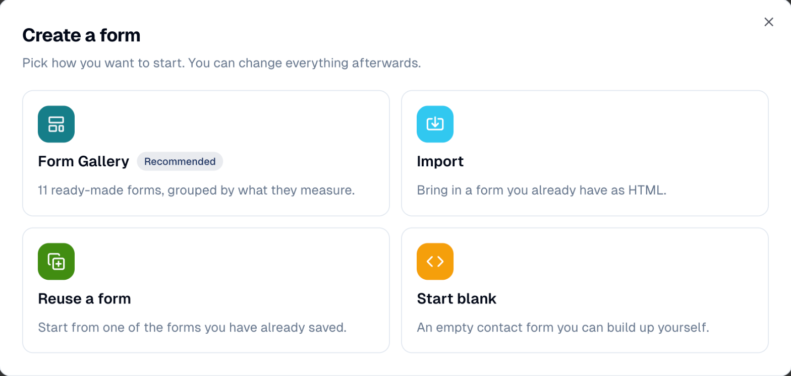
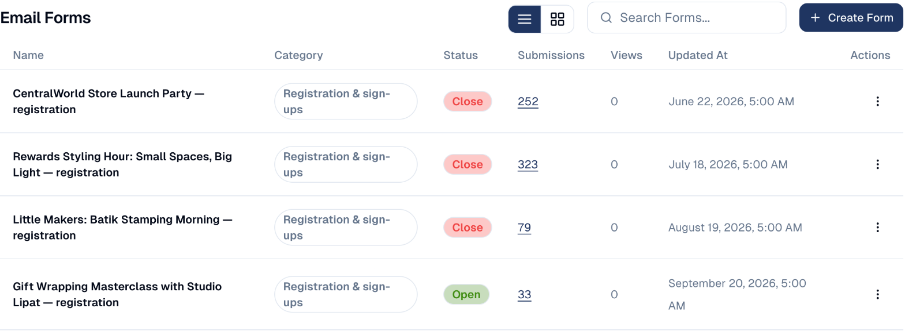
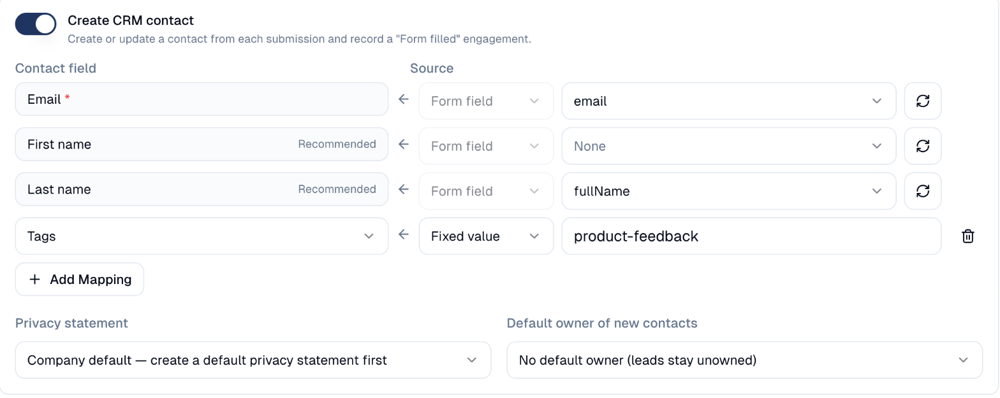

# Forms

Collect sign-ups, registrations and feedback, and have the responses flow into
your audience automatically.

## What it's for

A form is how people tell you something: registering for an event, asking to be
contacted, or rating an experience. Responses land in GoodBards rather than in a
spreadsheet, so the people who reply become contacts you can market to.

Forms are also how you run satisfaction surveys (NPS, CSAT and similar) without
a separate survey tool.

## Before you start

- A **privacy statement**, if you collect personal data: **Brand & Context →
  General Information → Privacy Statements**. Mark one as the company default and
  every form uses it unless you pick another.

## How to create a form

1. In the sidebar, choose **Marketing → Forms**, then **Create Form**.
2. Choose how to start:

    

    - **Form Gallery** (recommended): ready-made forms grouped by what they
      measure, such as *Contact / demo request*, *Net Promoter Score (NPS)*,
      *Event registration* or *Newsletter signup*.
    - **Reuse a form**: a copy of one of your own forms.
    - **Import**: paste the HTML of a form you already have.
    - **Start blank**: an empty contact form.
3. Fill in **Core definition**: the **Name**, a **Category** and a
   **Description**.
4. Choose **Edit form** to change the fields (see below).
5. Choose **Create**. Set the form to **Open** when it should accept responses.

### Change the fields

**Edit form** opens the visual builder.

- **Add a field**: drag it from **Forms** in the left panel: *Text field*, *Email
  field*, *Phone field*, *Multi-line text*, *Dropdown*, *Checkbox*, *Consent*.
- **Reorder**: drag a field to its new place.
- **Make a field required**: select it, open its settings (the gear icon on the
  right) and tick **Required**.
- Choose **Apply** to keep your changes.

### Turn responses into contacts

In the **Customer Data Platform** block:

1. Switch on **Create CRM contact**.
2. Check the mapping table. **Email** must point to the field that holds the
   person's email address. **First name** and **Last name** are recommended.
3. To fill more of the contact, choose **Add Mapping** and pick a contact field
   (**Phone**, **Job title**, **Tags** or one of your custom fields). Fill it from a
   **Form field**, or with a **Fixed value** (for example, tag everyone who replies
   with *webinar-oct*).
4. Under **Privacy statement**, keep **Company default** or pick another statement.

### Use a form to register for an event

Open the event, then **Registration → Registration form**. Pick your form, or
choose **Create new** to start from the event registration template. The event
then manages the form's confirmation email and thank-you page, under
**Registration → Confirmation**. See [Event Management](event-management.md).

## Sharing a form

From a form's menu in the list:

- **Copy Link** copies the form's short link, to share in a post, a message or a
  QR code.
- **Embed form** gives you a code to paste into your own website, so visitors fill
  in the form without leaving your site. Set the **height** you want; the form
  keeps its own design and adapts its height to the page.

## Categories and status

| Category | Use it for |
| --- | --- |
| **Registration & sign-ups** | Event registration, newsletter and webinar sign-ups. |
| **Experience metrics** | Satisfaction surveys: NPS, CSAT, CES, star ratings. |
| **Feedback & research** | Event and product feedback, general surveys. |
| **Data capture** | Contact and demo requests. |

A form is a **Draft** while you build it and **Open** when it accepts responses.

## Reading the answers

In a form's menu, choose **View Analytics** to open its results: views
and submissions over time, then every submission with its answers and date.

- **Download Raw CSV**: every answer, one row per submission, for your own
  analysis.
- **Download Contact CSV**: the people who answered, as contacts.

A view is one display of the form, whether people come from its link, an email
button or your website. Your own clicks on **Open Form** and visits by robots
are not counted.

Many views and few submissions usually means the form asks too much.

## Good to know

- **Consent is only recorded when the box is ticked.** A form records a person's
  acceptance of your privacy statement only if it has a **Consent** field and they
  tick it. Without one, the editor warns you: drag the **Consent** block in.
- **A form must be Open to collect anything**, even if you have shared the link.
- **Responses update existing contacts.** A submission with an email address you
  already hold fills in that contact's empty fields; it never overwrites what is
  there.
- **Renaming a field is safe.** The contact mapping follows the new name.
- **One form, one event.** Picking a form already used by another event links a
  copy, so the two events never share answers.

---

*Still stuck? [Contact support](../contact.md).*
