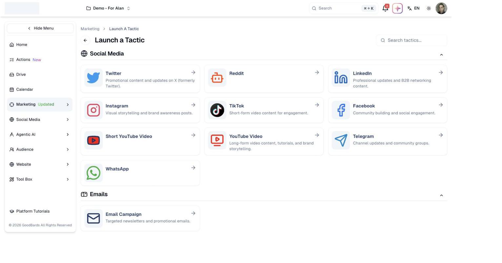

# Launch a Tactic

Put out a single piece of marketing — one post, one email — without setting up a
whole campaign first.

## What it's for

A **tactic** is one piece of marketing activity on one channel: a LinkedIn post, a
TikTok video, an email newsletter. It is the smallest thing you can publish.

Most of the time you do not need a campaign. If you simply want something out on
Instagram this afternoon, start here. Campaigns are for when several tactics work
towards the same goal over a period of time — see [Campaigns](campaigns.md).

## How to launch a tactic

1. In the sidebar, choose **Marketing → Launch a Tactic**.
2. Pick the channel you want to publish on.

Channels are grouped by type, and each says what it is best suited to — LinkedIn
for professional and B2B content, TikTok for short-form video, and so on. Once you
have picked one, follow the steps for that channel to write your content and
publish or schedule it.

!!! tip "Not sure which channel?"
    The short description under each one is a reminder of what that audience
    expects. Match the content to the channel rather than posting the same
    message everywhere.

## Available channels

| Group | Channels |
| --- | --- |
| **Social Media** | Twitter, Reddit, LinkedIn, Instagram, TikTok, Facebook, Short YouTube Video, YouTube Video, Telegram, WhatsApp |
| **Emails** | Email Campaign — targeted newsletters and promotional emails |

Use **Search tactics…** at the top right to jump straight to one.

## Good to know

- **You need the channel connected first.** A social channel you have not linked
  cannot publish. Set these up in **Settings → Connections**.
- **A tactic can be added to a campaign later.** Starting with a single tactic does
  not lock you out of organising it into a campaign afterwards.
- **Each channel has its own rules** on length, images and video. The tactic screen
  for that channel will tell you what it accepts.

---

*Still stuck? [Contact support](../contact.md).*
