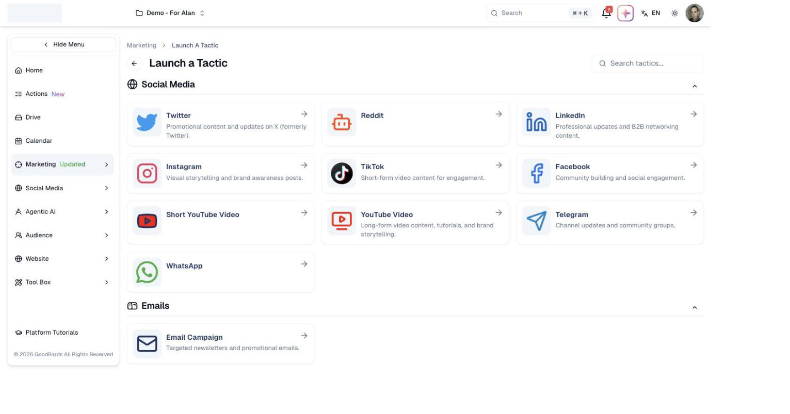

# Launch a Tactic

Put out a single piece of marketing, one post or one email, without setting up
a whole campaign first.

## What it's for

A **tactic** is one piece of marketing activity on one channel: a LinkedIn post, a
TikTok video, an email newsletter. It is the smallest thing you can publish.

Most of the time you do not need a campaign. If you simply want something out on
Instagram this afternoon, start here. Campaigns are for when several tactics work
towards the same goal over a period of time: see [Campaigns](campaigns.md).

## Before you start

- **The channel connected.** A social channel you have not linked cannot
  publish. Set it up in **Settings → Connections**; see
  [Connections](../settings/connections.md).

## How to launch a tactic

1. In the sidebar, choose **Marketing → Launch a Tactic**.
2. Pick the channel you want to publish on.

<!-- screenshot stale: channels now grouped as Social Media / Emails / Articles / Events / Ads with a filter row on top; Reddit gone, Twitter is now X, Short YouTube Video is now YouTube Shorts; Blog Post, Press Release, Events, Marketing Automation and Ads (Coming soon) added -->

Channels are grouped by type, and each says what it is best suited to: LinkedIn
for professional and B2B content, TikTok for short-form video, and so on. To see
one group only, choose it in the row of buttons above the channels; **All**
shows everything again. Once you have picked a channel, follow the steps for it
to write your content and publish or schedule it.

!!! tip "Not sure which channel?"
    The short description under each one is a reminder of what that audience
    expects. Match the content to the channel rather than posting the same
    message everywhere.

## Available channels

| Group | Channels |
| --- | --- |
| **Social Media** | Facebook, Instagram, LinkedIn, TikTok, X, YouTube, YouTube Shorts |
| **Emails** | **Email Campaign** for newsletters and promotional emails; **Marketing Automation** for a flow of emails that runs on its own (see [Automations](automations.md)) |
| **Articles** | Blog Post, Press Release |
| **Events** | Events: in person, virtual or hybrid |
| **Ads** | Ads (marked **Coming soon**) |

Use **Search tactics…** at the top right to jump straight to one.

## Good to know

!!! info "A tactic can join a campaign later"
    Starting with a single tactic does not lock you out of organising it into a
    campaign afterwards.

- **Each channel has its own rules** on length, images and video. The tactic screen
  for that channel will tell you what it accepts.

---

*Still stuck? [Contact support](../contact.md).*
