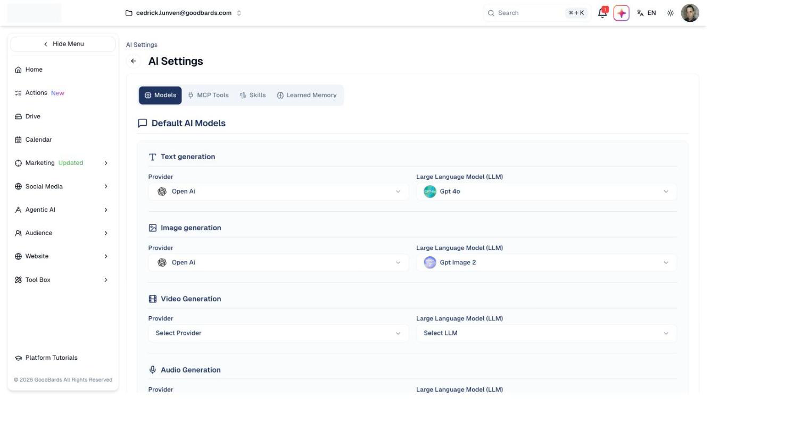

# AI Settings

Choose which AI models your team uses, and what the AI is allowed to do.

## What it's for

GoodBards can use different AI providers and models for different jobs. Most
teams never need to change this — the defaults are sensible. It matters when you
have a preference about which provider handles your content, or want a
higher-quality model for one kind of work.

Changing a model here affects everyone in your company.

## How to change a default model

1. In the sidebar, choose **Settings → AI Settings**.
2. On the **Models** tab, find the type of generation you want to change.
3. Pick a **Provider**, then a **Large Language Model (LLM)** from that provider.

## The four generation types

| Type | Used for |
| --- | --- |
| **Text generation** | Writing — email copy, social posts, agent replies. |
| **Image generation** | Images created from a description. |
| **Video Generation** | Short video clips. |
| **Audio Generation** | Text to speech. |

Each is set independently, so you can use one provider for writing and another
for images.

!!! note "Not every type needs to be set"
    A generation type showing **Select Provider** has no model configured. Those
    features will not work until you choose one.

## The other tabs

| Tab | What it holds |
| --- | --- |
| **Models** | Default model per generation type, as above. |
| **MCP Tools** | External tools your agents may use. |
| **Skills** | Capabilities available to your agents. |
| **Learned Memory** | What the AI has remembered about your business over time. |

## Good to know

- **These are company-wide defaults.** Changing a model changes it for every
  colleague, not just you.
- **Models differ in cost as well as quality.** A more capable model consumes
  credits faster — see [Usage & Billing](tenant-usage.md).
- **Test after changing.** Generate a sample piece of content and check the tone
  still matches your brand before your team relies on it.
- **Leave it alone if unsure.** The defaults are chosen to work well; this screen
  is for teams with a specific reason to change them.

---

*Still stuck? [Contact support](../contact.md).*
