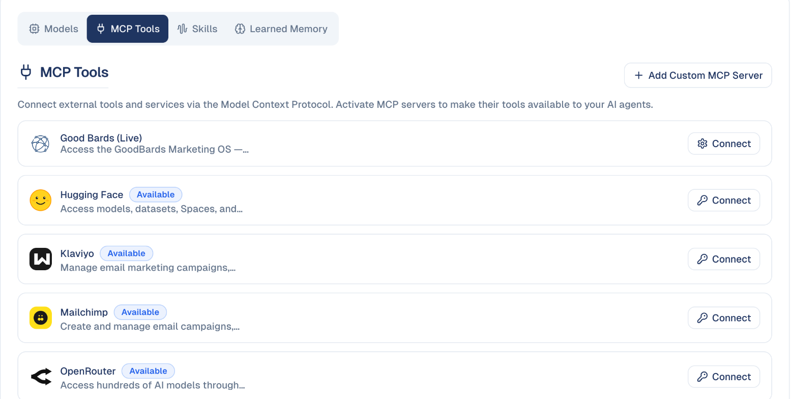

# AI Settings

Choose which AI models your team uses, and what the AI is allowed to do.

## What it's for

GoodBards can use different AI providers and models for different jobs. Most
teams never need to change this — the defaults are sensible. It matters when you
have a preference about which provider handles your content, or want a
higher-quality model for one kind of work.

Changing a model here affects everyone in your company.

## How to change a default model

1. Open your account menu (your picture, top right), then choose **AI Settings**.
2. On the **Models** tab, find the type of generation you want to change.
3. Pick a **Provider**, then a **Large Language Model (LLM)** from that provider.

## The four generation types

| Type | Used for |
| --- | --- |
| **Text generation** | Writing — email copy, social posts, agent replies. |
| **Image generation** | Images created from a description. |
| **Video Generation** | Short video clips. |
| **Audio Generation** | Text to speech. |

Each is set independently, so you can use one provider for writing and another
for images.

!!! note "Not every type needs to be set"
    A generation type showing **Select Provider** has no model configured. Those
    features will not work until you choose one.

## The other tabs

| Tab | What it holds |
| --- | --- |
| **Models** | Default model per generation type, as above. |
| **MCP Tools** | External tools your agents may use. |
| **Skills** | Capabilities available to your agents. |
| **Learned Memory** | What the AI has remembered about your business over time. See [How the AI knows your brand](brand-voice-memory.md). |

## MCP Tools: give your agents outside tools

MCP (Model Context Protocol) servers let your AI agents use other services:
read your Mailchimp or Klaviyo campaigns, post in Slack, manage a Wix or
WordPress.com site, or reach thousands of apps through Zapier.

1. On the **MCP Tools** tab, choose **Connect** on a service and sign in to it,
   or paste the key or URL it asks for (Zapier asks for your personal Zapier MCP
   URL).
2. Once connected, its tools are available to your agents. Choose which agent
   uses them in the agent's settings.

**Add Custom MCP Server** connects any other MCP server by its address.

## Skills: ready-made expertise

Skills are packaged know-how an agent can use, for example **AI Search
Optimization (GEO)**, **Content Strategy Planner**, **Marketing Ideas**,
**Marketing Plan Builder** or **Public Relations & Earned Media**, each tuned for
Southeast Asian markets. The tab lists the skills available to your company;
you give a skill to an agent in the agent's configuration.

## Good to know

- **These are company-wide defaults.** Changing a model changes it for every
  colleague, not just you.
- **Models differ in cost as well as quality.** A more capable model consumes
  credits faster — see [Usage & Billing](tenant-usage.md).
- **Test after changing.** Generate a sample piece of content and check the tone
  still matches your brand before your team relies on it.
- **Leave it alone if unsure.** The defaults are chosen to work well; this screen
  is for teams with a specific reason to change them.

---

*Still stuck? [Contact support](../contact.md).*
