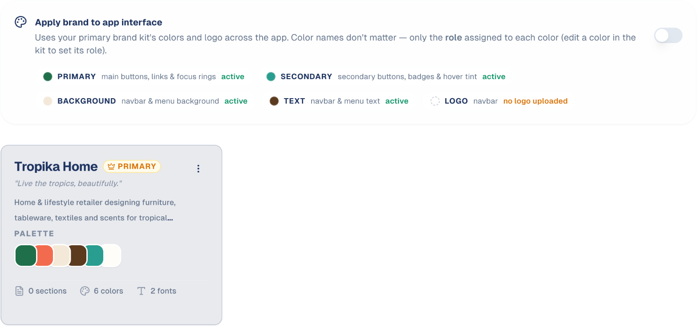

# Brand Kit

Your colours, fonts and logos, in one place — so everything GoodBards produces
looks like it came from you.

## What it's for

A brand kit is the visual half of your identity. Once set up, emails, social
posts and generated images pick up your colours and logo without you specifying
them each time.

It sits alongside the **Voices Bank**, which covers how your brand *sounds*.
Together they are what makes AI output look and read like your brand rather than
a generic template.

## How to set up your brand kit

1. In the sidebar, choose **Settings → Brand & Context**.
2. Open the **Brand Kit** tab.
3. Choose **+ Add Brand Kit**.
4. Add your colours, fonts and logo.
5. Mark one kit as **primary**.

## Colour roles matter more than colour names

When you add a colour, you give it a **role** — what the colour is *for*, not what
it is called. A colour named "Ocean Blue" means nothing to the platform; a colour
assigned the role of *primary* or *accent* can be applied correctly everywhere.

If your generated designs use your colours in odd places, check the roles rather
than the colours themselves.

## Applying your brand to the platform itself

**Apply brand to app interface** restyles GoodBards in your own colours and logo.
Useful if your team should see their own branding rather than the GoodBards
default.

This requires a **primary** brand kit. Until you mark one, the toggle explains
that there is no primary kit yet.

## More than one kit

You can hold several — useful for sub-brands or for an agency running different
clients. The **primary** kit is the one used by default and the one that drives
the interface.

## Good to know

- **Set this up early.** Brand-aware content is only brand-aware from the moment
  the kit exists.
- **Use your real assets.** Upload the actual logo files your designer produced,
  not screenshots of them.
- **Primary is the one that counts.** With several kits, anything not explicitly
  told otherwise uses the primary.

---

*Still stuck? [Contact support](../contact.md).*
