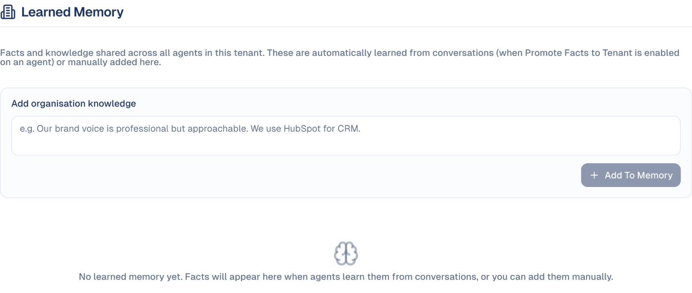

# How the AI knows your brand

Three things shape everything the AI writes for you: your **Brand Context**, the
**Brand Voice** you pick, and what it has **learned** from working with you. This
page explains what each one does and how to keep them right.

## What it's for

Without them, an agent writes generic copy and you re-explain your business in
every request. With them, the same request comes back with your company's facts,
in your style, following the rules you set.

| | What it is | Who sets it | When the AI uses it |
| --- | --- | --- | --- |
| **Brand Context** | Facts about your company: what you do, who you serve, how you are positioned, what never to say. Plus your primary Brand Kit (tone, keywords, hashtags). | Your company admins, once. | **Every** request, by every agent. |
| **Brand Voice** | A writing style learned from real samples, such as your founder's posts. | Anyone builds voices; each person picks a default. | Only when a voice is **selected** for the conversation. |
| **Memory** | Short facts learned from your conversations, or added by hand. | Learned automatically, reviewed by you. | In conversations with agents that have memory on. |

**Example.** You ask: *"Write a LinkedIn post announcing our webinar."*

- With nothing set up, you get a generic announcement.
- With **Brand Context**, it names your product correctly, speaks to your target
  audience and never mentions pricing, because **Guardrails** says so.
- With a **Brand Voice** selected, it sounds like your founder: short sentences,
  a question to open, no exclamation marks.
- With **Memory**, it remembers you always add the registration link in the
  first comment, because you told it last week.

## Before you start

- To edit Brand Context, you need to be an administrator of your company account.

## How to set up your Brand Context

1. Go to **Brand & Context → General Information**.
2. Choose **Populate with AI** and enter your **Website URL**: GoodBards reads your
   home page and a few key pages, and fills in the fields as drafts. This takes
   about a minute.
3. Review each field. AI drafts are **Hidden from AI** until you choose **Show to
   AI**. A field you edit and **Save** becomes visible to AI.
4. Fill in **Guardrails → Never discuss** with the topics the AI must avoid.
5. On **Marketing Campaigns**, set your campaign defaults (audience, regions,
   objective).

See [Brand & Context](company-settings.md) for every field.

## How to create a Brand Voice

1. Go to **Brand & Context → Voices Bank** and choose **Create Voice**.
2. Give it a name, then add up to 10 samples of real writing: paste text with
   **Add text sample**, or choose documents with **Add from Drive**.
3. The voice goes from **Analyzing** to **Active** in a few minutes. Open
   **Details** to read the profile it built: tone, structure, favourite phrases,
   do's and don'ts.
4. To use it by default, go to **Personal Settings → Preferences → Default brand
   voice**. You can also pick a voice for one conversation from the **Voice** menu
   in the chat box.

## How to review what the AI has learned

- **Company memory**: **AI Settings → Learned Memory**. Facts shared by every agent
  and every user of your company. Each shows whether it was **Learned from
  conversation** or **Added manually**. Edit or delete any of them, or add one with
  **Add To Memory**.
- **Your own memory**: **Personal Settings → My Memory**. Facts about you and how
  you work, seen only in your conversations. Turn **Enable Personal Memory** off to
  stop the AI using and collecting them.

## Good to know

- **Hidden fields never reach the AI.** That includes every AI draft you have not
  reviewed yet. If the AI ignores something, check its badge first.
- **Changes take up to about ten minutes** to reach the agents.
- **Only your primary Brand Kit is used.** Its tone of voice, keywords and
  hashtags apply to every request; a Voices Bank voice applies only when selected.
- **A voice is applied when the conversation starts.** Changing it halfway
  through has no effect; start a new conversation.
- **Company memory is shared with everyone in your company.** Do not put personal
  or confidential details in it. **Clear all memory** cannot be undone.
- **Agents learn company facts only if allowed.** An agent adds to company memory
  only when **Promote Facts to Tenant** is on in its settings (off by default).
  Learning starts after a conversation of several exchanges.

---

*Still stuck? [Contact support](../contact.md).*
