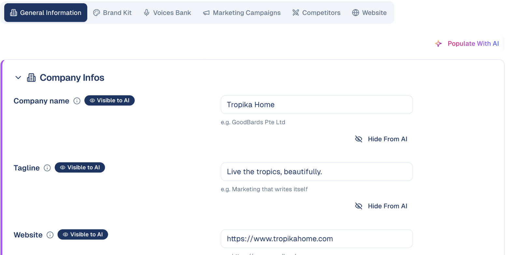
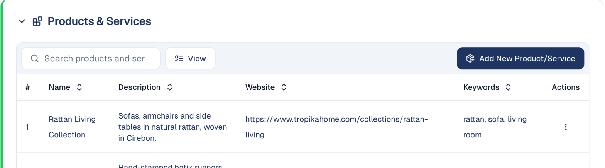

# Brand & Context

Everything GoodBards knows about your business — and what the AI is allowed to
use when it writes for you.

## What it's for

When an agent drafts an email or a social post, it needs to know who you are:
what the company does, how it talks, who it competes with. This is where you tell
it once, so you are not re-explaining your business in every prompt.

Get this right and everything the AI produces improves. Leave it empty and you
get generic copy.

## The six tabs

| Tab | What it holds |
| --- | --- |
| **General Information** | Company name, tagline, website and other basics. |
| **Brand Kit** | Colours, fonts and logos. See [Brand Kit](brand-kit.md). |
| **Voices Bank** | How your brand sounds, so the AI writes in your voice. |
| **Marketing Campaigns** | Context about the campaigns you run. |
| **Competitors** | Who you compete with. |
| **Website** | Your website, as the AI reads it. |

## How to fill in your company details

1. Open your account menu (your picture, top right), then choose **Brand & Context**.
2. On **General Information**, fill in each field. Grey example text under each
   one shows the kind of answer expected.
3. Changes save as you go.

**Populate With AI** fills the fields from your website; check what it wrote.

### The General Information blocks

| Block | What to put |
| --- | --- |
| **Company Infos** | Company name, tagline, website, industry and addresses. |
| **Positioning** | What you do, your value proposition, target audience, mission, elevator pitch and differentiators. The AI reuses these in everything it writes, so be specific. |
| **Guardrails** | **Never discuss**: subjects the AI must stay away from, for example *politics*, *religion* or *competitor bashing*. |
| **Products & Services** | Each product or service with a description, its web page and keywords. The AI links to the right page and uses the right words. |
| **Press Release Information** | The CEO's name and title, your boilerplate in 25, 50 and 100 words, and the media contact. Used for every press release the AI drafts. |
| **Privacy Statements** | The statements contacts accept on your forms; one is the default. A statement is a text (any length, with bold, italic and bullet lists) or a link to a page on your site. See [Adding contacts](../audience/adding-contacts.md). |

## Marketing Campaigns: campaign defaults

Set once the values every new campaign starts from: marketing objective,
budget, customer type, audience, regions and countries, target industry and
campaign duration. The fields marked **Visible to AI** prefill new campaigns, so
**Create New Campaign** opens already filled in. See
[Campaigns](../marketing/campaigns.md).

## Website: what GoodBards knows about your site

- **Search Console property**: which site the Organic Visibility screens read;
  change it under **Connections**.
- **What the site scan found**: GoodBards reads your homepage and detects your
  site type (for example *Online store*), language and target market, with the
  evidence it used. **Scan Again** after a redesign.
- **Site type, language and market**: keep the detected values or choose your
  own, then **Apply**. They decide which ideas rank highest in Research & Plan
  and Page Fixes, and the language content is written in. **Reset To Detected**
  goes back to the scan's values.

## Competitors

List the companies you compete with, and GoodBards analyses their websites.

1. On the **Competitors** tab, choose **Add Competitor** and give its website.
2. GoodBards scans the site. Open a competitor's **Details** for:
    - **Overview**: an AI summary, estimated domain authority, an SEO score
      and estimated monthly traffic, with their key strengths and weaknesses;
    - **SEO Data**, **Content** and **Marketing**: what they rank for, publish
      and promote.
3. Tag competitors (for example *furniture*, *online-first*) with **+ Edit** to
   keep the list readable.

**Active** competitors are given to your AI agents, and feed
[Research & Plan](../content-hub/research-plan.md)'s content gaps. Figures marked
*AI Estimate* are estimates, not measurements.

## Controlling what the AI can see

Every field carries a badge showing whether the AI can use it:

- **Visible to AI** — the agent may use this when writing.
- **Hide From AI** — choose this to keep a field out of AI-generated content.

Most details are safe and useful to share. Hide anything commercially sensitive
that you would not want appearing in a draft.

!!! tip "Populate With AI"
    **Populate With AI**, at the top right, fills these fields in by reading your
    website. It is a fast way to start — but read what it produces before
    accepting it, since everything the AI writes later builds on it.

## Good to know

- **Do this before generating content.** Agents use whatever is here at the time
  they write. Filling it in afterwards does not improve drafts already produced.
- **Be specific.** "We help companies grow" tells the AI nothing. What you sell,
  to whom, and what makes you different is what gets used.
- **Revisit it.** When your positioning changes, update this — otherwise the AI
  keeps writing last year's message.

---

*Still stuck? [Contact support](../contact.md).*
