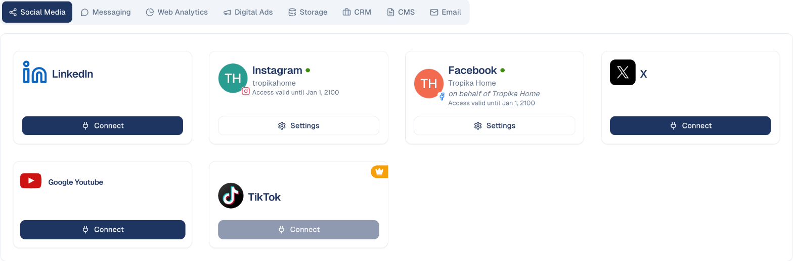

# Connections

Link GoodBards to the outside services your marketing depends on: social
accounts, messaging, analytics, ads, storage and more.

## What it's for

GoodBards can only publish to a social channel, or report on your website
traffic, if you have given it permission to reach that account. A **connector** is
that link.

!!! tip "No data? Check here first"
    Most "why can't I see any data?" problems come back to a missing
    connector, so this is worth setting up early.

## Before you start

- You must be an **administrator** or the **owner** of your company account.
  Other roles see **Connect** greyed out.

## How to connect a service

1. Open your account menu (your picture, top right), then choose **Connections**.
2. Pick the category across the top, for example **Social Media** or
   **Web Analytics**.
3. Find the service and choose **Connect**.
4. Sign in to that service and grant the permissions it asks for. You are taken
   back to GoodBards when it is done.

Use **Search connectors…** to find one by name rather than hunting the tabs.

## Categories

Each connector has its own page: what it lets GoodBards do, what you need before
connecting, and what GoodBards reads or publishes. See
[All connectors](connectors/index.md).

| Category | What it connects |
| --- | --- |
| **Social Media** | LinkedIn, Instagram, Facebook, X, Google Youtube, TikTok. |
| **Messaging** | Telegram and WhatsApp. |
| **Web Analytics** | Google Analytics, Google Search Console, Google Trends, Chartbeat, Google BigQuery. |
| **Digital Ads** | Google Ads and Meta Ads. |
| **Storage** | Google Drive and Google Documents. |
| **CRM** | Pipedrive. |
| **CMS** | WordPress, self-hosted or on WordPress.com. |
| **Email** | The server that sends your email campaigns. |

## How to manage an existing connection

A connected service shows the account it is linked to, plus:

- **Settings**: the options for that connector, such as which page, property or
  account to use. Until you pick one, the button says what is missing, for
  example **Choose Property**. The **Disconnect** button is inside.
- **Disconnect**, directly on the card, for connectors with nothing to set.

!!! warning "Connect the right account"
    The card shows which account is linked. On a shared channel, make sure it is
    the company account and not someone's personal profile: the person who
    connects it is the person whose access is used.

## Good to know

- **A crown means your plan does not include it.** The **Connect** button is
  greyed out; speak to your account contact to enable it.
- **Connect before you build.** Setting up a campaign for a channel you have not
  connected means going back and redoing the setup.
- **Connections can expire.** If a service is failing, check here first: many
  providers require periodic re-authorisation.

!!! info "Disconnecting is not retroactive"
    Posts already published stay published, and contacts already imported stay
    in GoodBards. You simply cannot publish or import more until you reconnect.

---

*Still stuck? [Contact support](../contact.md).*
