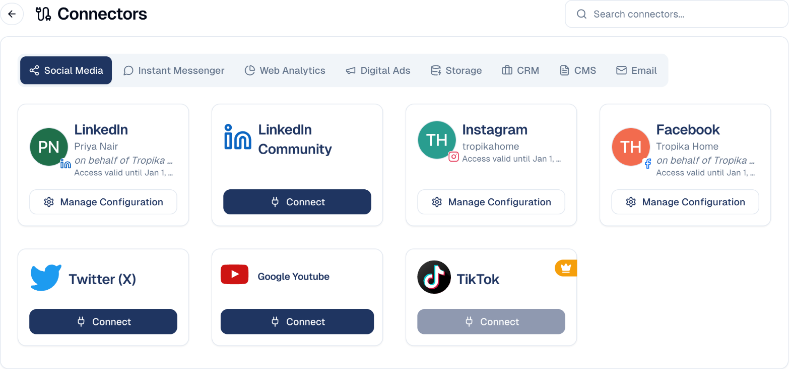

# Connections

Link GoodBards to the outside services your marketing depends on — social
accounts, analytics, storage and more.

## What it's for

GoodBards can only publish to a social channel, or report on your website
traffic, if you have given it permission to reach that account. A **connector** is
that link.

Most "why can't I see any data?" problems come back to a missing connector, so
this is worth setting up early.

## How to connect a service

1. Open your account menu (your picture, top right), then choose **Connections**.
2. Pick the category across the top — for example **Social Media** or
   **Web Analytics**.
3. Find the service and choose **Connect**.
4. Sign in to that service and grant the permissions it asks for. You are taken
   back to GoodBards when it is done.

Use **Search connectors…** to find one by name rather than hunting the tabs.

## Categories

Each connector has its own page: what it lets GoodBards do, what you need before
connecting, and what GoodBards reads or publishes. See
[All connectors](connectors/index.md).

| Category | What it connects |
| --- | --- |
| **Social Media** | LinkedIn, Facebook, Instagram, Twitter (X), YouTube, TikTok. |
| **Instant Messenger** | Messaging platforms. |
| **Web Analytics** | Google Analytics, Search Console and similar. |
| **Digital Ads** | Advertising accounts. |
| **Storage** | External file storage. |
| **CRM** | Your customer relationship system. |
| **CMS** | Your website or content system. |
| **Email** | Email sending and mailbox services. |

## Managing an existing connection

A connected service shows the account it is linked to, plus:

- **Manage Configuration** — settings for that connector, such as which page or
  property to use by default.
- **Disconnect** — removes the link. Anything relying on it stops working.

!!! warning "Connect the right account"
    The card shows which account is linked. On a shared channel, make sure it is
    the company account and not someone's personal profile — the person who
    connects it is the person whose access is used.

## Connectors your plan does not include

Some connectors show a crown and a greyed-out **Connect** button. These are
available on higher plans; speak to your account contact to enable them.

## Good to know

- **Connect before you build.** Setting up a campaign for a channel you have not
  connected means going back and redoing the setup.
- **Connections can expire.** If a service is failing, check here first — many
  providers require periodic re-authorisation.
- **Disconnecting is not retroactive.** Already-published posts stay published;
  you simply cannot publish more until you reconnect.

---

*Still stuck? [Contact support](../contact.md).*
