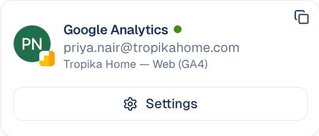

# Google Analytics

Bring your website traffic and conversions from Google Analytics 4 into
GoodBards.

## What it's for

The **Google Analytics** connector reads your GA4 property. GoodBards uses it in:

- **Organic Visibility → Google Analytics**: visits, traffic sources, top pages,
  countries and AI insights. See [Google Analytics](../../website/google-analytics.md).
- **Performance & Report**: the business outcomes (conversions, revenue,
  sessions). See [Performance & Report](../../website/performance-report.md).
- **Momentum**: page views per page. Without Google Analytics, Momentum falls
  back on Search Console data. See [Momentum](../../website/momentum.md).
- **Page Fixes**: pages that convert are given higher priority. See
  [Page Fixes](../../website/page-fixes.md).
- **Digital Ads**: your converting pages, as a signal when you write ads. See
  [Digital Ads](../../marketing/digital-ads.md).
- **The daily summary** on your home page.
- **AI agents** with the Google Analytics tool, which can run reports for you. See
  [Chat agents](../../agentic-ai/chat-agents.md).

## Before you start

- You must be an **administrator** or the **owner** of your GoodBards company
  account.
- You need a **Google Analytics 4** property. Older Universal Analytics
  properties are not supported.
- Use a Google account that can **view** that property.

## How to connect

1. Open your account menu (your picture, top right), then choose **Connections**.
2. On the **Web Analytics** tab, find **Google Analytics** and choose **Connect**.

    { width="30%" }

3. Pick your Google account and allow GoodBards to **see your Google Analytics
   data**.
4. Back in GoodBards, choose **Choose Property** on the card.
5. Under **GA4 Property**, pick the property for your website, then choose **Save
   Settings**.

!!! note "Pick a property, or nothing shows"
    Until a property is chosen, the Google Analytics screens have nothing to
    show. To change it later, choose **Settings** on the card.

## What GoodBards does with it

| GoodBards… | Details |
| --- | --- |
| **Reads** | Your accounts and properties, and reports on visits, users, sessions, page views, events, conversions, transactions and revenue, including real-time figures. |
| **Does not** | Change anything in Google Analytics. |

## Good to know

- **One property per workspace.** Every Google Analytics screen and report uses
  the property you picked.
- **Recent days may be incomplete.** GA4 is still processing the latest data.
- **Revenue is in your GA4 currency.**

## How to disconnect

1. On the Google Analytics card, choose **Settings**.
2. Choose **Disconnect**.

GoodBards forgets the access and the chosen property. To remove access on
Google's side too, do it from your Google Account, under third-party connections.

---

*Still stuck? [Contact support](../../contact.md).*
