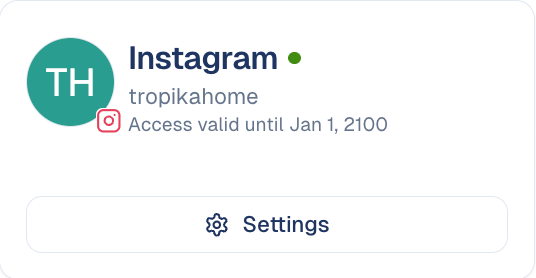

# Instagram

Publish picture posts, carousels, Reels and stories to your Instagram account and
get reports on how it performs.

## What it's for

The **Instagram** connector links GoodBards to your Instagram account. With it you
can:

- **Publish and schedule posts** from a campaign's social tactic. See
  [Launch a tactic](../../marketing/launch-tactic.md) and
  [Social Post](../../social-media/social-post.md).
- **Link a post you published outside GoodBards**, so its results count in the
  campaign report.
- **Analyse your account**: followers, reach, post results and comments. See
  [Social Media Analysis](../../social-media/analysis.md) and
  [Reports](../../social-media/reports.md).
- **Schedule recurring reports** with the [Scheduler](../../tool-box/scheduler.md).
- **Feed the daily summary** on your home page.
- **Let your AI agents** read or create analysis reports.

## Before you start

- You must be an **administrator** or the **owner** of your GoodBards company
  account.
- Use an Instagram **professional account** (Business or Creator). You sign in
  with Instagram directly, not through Facebook.

## How to connect

1. Open your account menu (your picture, top right), then choose **Connections**.
2. On the **Social Media** tab, find **Instagram** and choose **Connect**.

    { width="30%" }

3. Sign in to Instagram with the account you want to publish to, and accept the
   permissions it asks for: your profile, publishing, comments, messages and
   statistics.
4. You are taken back to GoodBards. The card shows the account name.

## What GoodBards does with it

| GoodBards… | Details |
| --- | --- |
| **Publishes** | A picture post (one picture), a carousel (2 to 10 pictures) or a Reel (one video, also shown in your grid), with your caption. Any of them can go out as a 24-hour story instead. |
| **Reads** | Your profile, followers, posts, post statistics, daily reach and views, post comments, and the numbers of the stories published from GoodBards. |
| **Does not** | Mix pictures and videos in a carousel, add stickers to stories, read stories posted directly in the Instagram app, delete posts, or read your messages. |

## Good to know

!!! note "Every Instagram post needs a picture or a video"
    A text-only post fails. Add at least one picture or one video before you
    publish or schedule it.

- **Videos are published as Reels**: MP4 or MOV, up to 300 MB, 3 seconds to 15
  minutes. A video story: up to 100 MB and 60 seconds. See
  [Videos, documents, Reels and stories](../../social-media/social-post.md#videos-documents-reels-and-stories).
- **Pictures are sent as JPEG**, whatever their original format.
- **2,200 characters per caption.**
- **Instagram limits how many posts you can publish per day** (about 50 per
  account).
- **Access is renewed automatically** a week before it expires. If Instagram
  refuses, the connector switches off and the card asks you to reconnect.

!!! info "Media are handed to Instagram by link"
    Instagram fetches pictures and videos itself, so GoodBards gives it a link
    to each one. Pictures stay publicly reachable by that link; videos use a
    link that expires after an hour.

## How to disconnect

1. On the Instagram card, choose **Settings**.
2. Choose **Disconnect**, then confirm.

GoodBards forgets the access. Posts already published stay on Instagram. To remove
GoodBards' access on Instagram's side too, do it from your Instagram settings,
under apps and websites.

---

*Still stuck? [Contact support](../../contact.md).*
