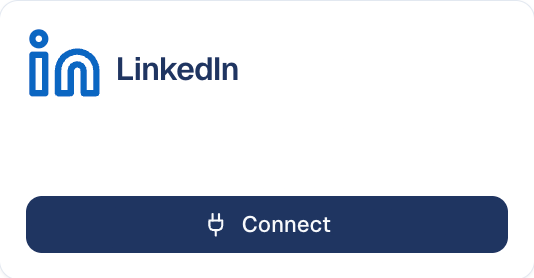

# LinkedIn

Publish posts to your LinkedIn profile or company page, mention people and
companies, and get reports on how your posts perform.

## What it's for

The **LinkedIn** connector lets GoodBards act on LinkedIn for you. With it you
can:

- **Publish and schedule posts** from a campaign's social tactic. See
  [Launch a tactic](../../marketing/launch-tactic.md) and
  [Social Post](../../social-media/social-post.md).
- **Link a post you published outside GoodBards**, so its results count in the
  campaign report.
- **@mention people and companies** in the posts you write for LinkedIn.
- **Analyse your profile or company page**: followers, post results, comments
  and, for a company page, who your audience is. See
  [Social Media Analysis](../../social-media/analysis.md) and
  [Reports](../../social-media/reports.md).
- **Feed the daily summary** on your home page with the latest figures.
- **Let your AI agents** list your pages and read or create analysis reports.

!!! info "One connector for everything"
    Mentions used to need the separate LinkedIn Community connector. The
    **LinkedIn** connector now publishes, reports and finds the people and
    companies you mention.

## Before you start

- You must be an **administrator** or the **owner** of your GoodBards company
  account. Other roles see the **Connect** button greyed out.
- To publish as your company, use a LinkedIn profile that has **administrative
  access to your company page**. The pages you can choose from are the ones
  this profile has an approved role on.

## How to connect

1. Open your account menu (your picture, top right), then choose **Connections**.
2. On the **Social Media** tab, find **LinkedIn** and choose **Connect**.

    { width="30%" }

3. Sign in to LinkedIn and accept the permissions it asks for: your basic
   profile, posting on your behalf and on behalf of your pages, and reading your
   pages' posts, followers and statistics.
4. You are taken back to GoodBards. Your personal profile is ready to use.
5. To add your company page, choose **Settings** on the LinkedIn card, pick the
   page under **Destination (one per tenant)**, then choose **Save
   Configuration**.

The card then shows the profile you connected with and, in italics, the page you
publish *on behalf of*.

## How to mention someone

1. Write a LinkedIn post in the post editor. See
   [Social Post](../../social-media/social-post.md).
2. Open the **Insert** menu and choose **Mention…**.
3. Search for a person or a company, then pick them.

The mention is added to your text and becomes a real LinkedIn mention when the
post is published. **Mention…** only appears once LinkedIn is connected.

## What GoodBards does with it

| GoodBards… | Details |
| --- | --- |
| **Publishes** | Public posts on your profile or the chosen page: text, a link preview, one or several pictures, a video, or a document (PDF, PowerPoint or Word) people swipe through. |
| **Reads** | Your pages, follower numbers, post statistics, follower demographics (seniority, industry, job function, location, company size), post comments, and the people and companies matching a mention search. |
| **Does not** | Delete or edit posts on LinkedIn, or post as anyone other than your profile or the chosen page. |

## Good to know

- **Your profile, plus one company page.** The page you pick in **Settings** is
  used for publishing *and* for the automated reports. Without one, GoodBards
  publishes and reports on your personal profile.
- **Profile reports have fewer figures.** LinkedIn gives no daily clicks and no
  follower demographics for a personal profile.
- **3,000 characters per post**, and up to 20 pictures.
- **One kind of media per post**: pictures, one video or one document. Without
  any, the first link in the text becomes a preview card.
- **Videos**: MP4 only, 75 KB to 500 MB, 3 seconds to 30 minutes.
  **Documents**: up to 100 MB and 300 pages; a PDF with one slide per page is
  how you post a carousel. See
  [Videos, documents, Reels and stories](../../social-media/social-post.md#videos-documents-reels-and-stories).
- **Bold and italic** are kept: GoodBards converts them into characters LinkedIn
  can display.
- **Access is renewed automatically.** The card shows how long access is valid.
  If LinkedIn refuses to renew it, the connector switches off and the card asks
  you to reconnect.

## How to disconnect

1. On the LinkedIn card, choose **Settings**.
2. Choose **Disconnect**, then confirm.

GoodBards forgets the access and the chosen page, and **Mention…** disappears
from the editor. Posts already published stay on LinkedIn. To remove GoodBards' access on LinkedIn's side too, do it from your
LinkedIn account settings.

---

*Still stuck? [Contact support](../../contact.md).*
