# Meta Ads

See the results of your Facebook and Instagram ads in GoodBards.

## What it's for

The **Meta Ads** connector links one Meta ad account to your workspace.
GoodBards uses it in:

- **Digital Ads**: the **Meta Ads** tab shows your ad account's spend,
  impressions, clicks and conversions, and each campaign with its results. See
  [Digital Ads](../../marketing/digital-ads.md).
- **Ad campaign tactics**: link a campaign tactic to an existing Meta campaign
  and follow its results in the campaign report, next to your other tactics.

GoodBards **only reads** your ads. You keep creating and changing them in Meta
Ads Manager.

!!! note "Setting up with us"
    Meta's screens are made for developers: if you would rather not do the setup
    alone, contact support and we do it with you on a short call.

## Before you start

- Meta Ads is included in the **Pro** and **Full** plans.
- You must be an **administrator** or the **owner** of your GoodBards company
  account.
- You need a Facebook account that is an administrator of your company's
  **Meta business portfolio** (business.facebook.com), and the portfolio must own
  the ad account, or have been given access to it.
- Allow 15 to 20 minutes. You do this once.

!!! tip "Already connected WhatsApp?"
    You can reuse the Meta app and the system user you created for WhatsApp: add
    the Marketing API to the app (step 1), then give the system user your ad
    account and create a new token that includes **ads_read** (steps 2 and 3).

## What GoodBards asks for

| Field in GoodBards | What it is | Where Meta shows it | Looks like |
| --- | --- | --- | --- |
| **Access token** | The key that lets GoodBards read your ads. Shown only once. | Business settings → **System users** → **Generate token** (step 3) | A long text starting with `EAA` |
| **App secret** (optional) | Only needed when your Meta app is set to require an app secret proof. | Your app → **App settings → Basic → App secret → Show** | 32 letters and digits |

Both are stored encrypted and are never shown again in GoodBards.

## How to set up Meta Ads in Meta

### 1. Create a Meta app, or reuse yours

1. Go to **developers.facebook.com**, log in, and choose **My Apps**.
2. Open the app you already use for GoodBards, or choose **Create App** and
   connect it to your company's business portfolio.
3. In the app, open **Use cases**, choose **Add use cases**, tick
   **Create & manage ads with Marketing API**, then **Save**.

    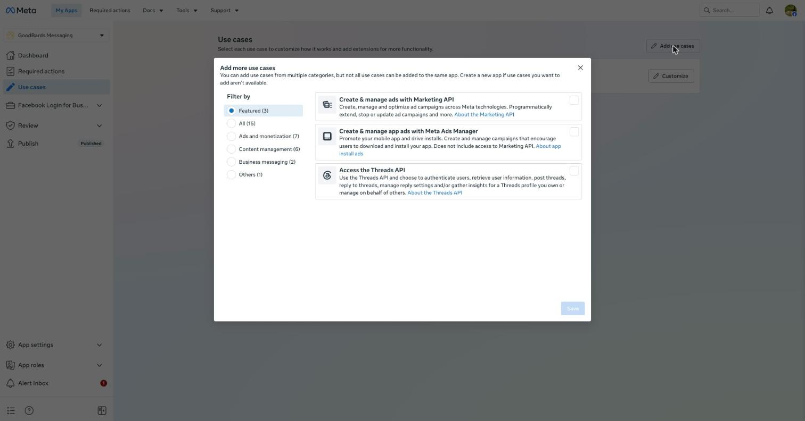

4. The use case now appears in the list. Choose **Customize** to check that
   **ads_read** shows **Ready for testing**: that is all GoodBards needs.

    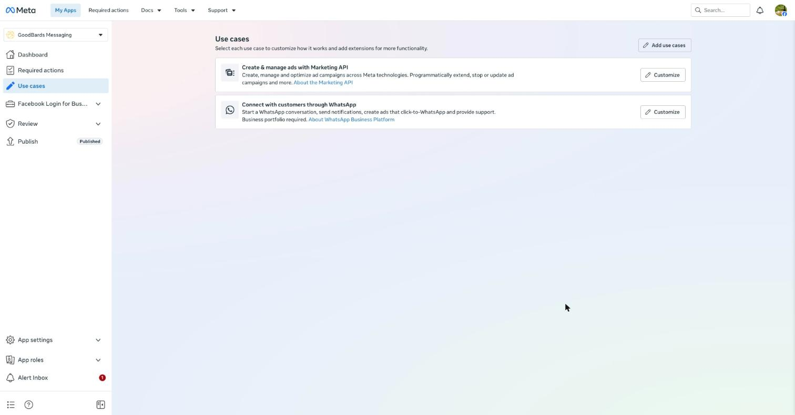

    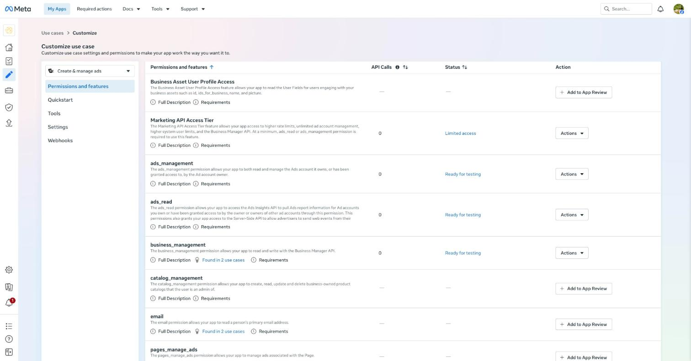

!!! warning "Do not add anything to App Review"
    Leave the **Add to App Review** buttons alone. Meta's App Review is only for
    apps that read other businesses' ad accounts. Here your app reads your own,
    which works with **Ready for testing**.

### 2. Give a system user access to your ad account

1. Open **business.facebook.com**, then **Settings → Users → System users**.
2. Select your system user, or choose **Add** to create one.
3. Open the **…** menu next to **Revoke tokens** and choose **Assign assets**.

    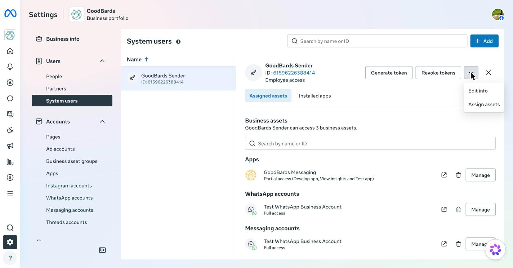

4. Pick **Ad accounts**, tick your ad account, turn on **View performance**,
   then choose **Assign assets**.

    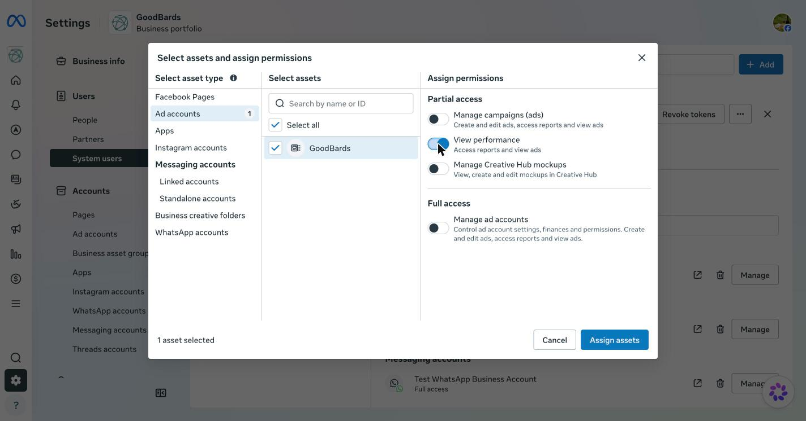

### 3. Create the token

1. Still on the system user, choose **Generate token** and pick your app.

    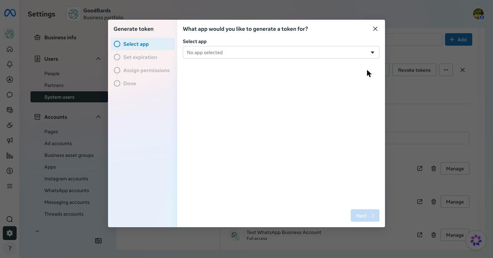

2. Under **Set expiration**, choose **Never**, then **Next**.
3. Under **Assign permissions**, open the list and tick **ads_read**. Leave
   the permissions that are already ticked as they are.

    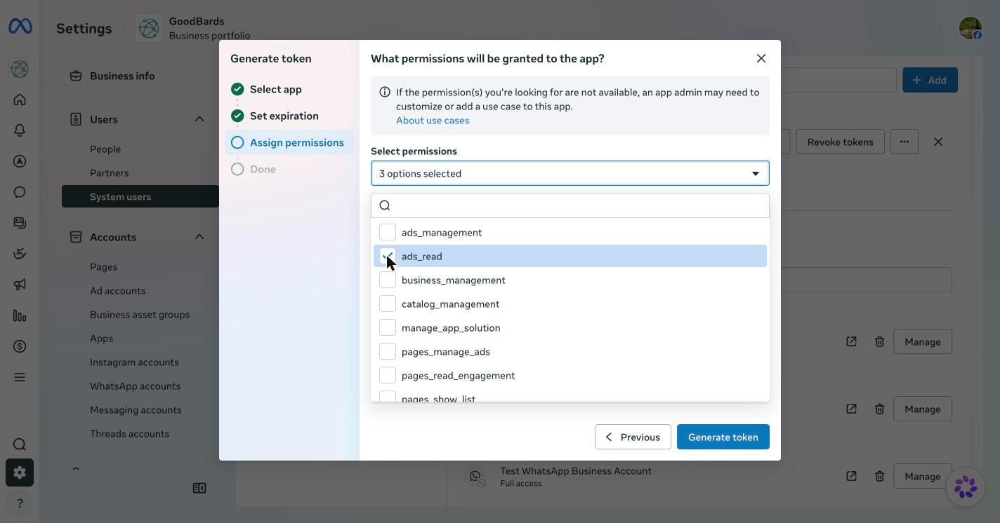

4. Choose **Generate token** and copy the token straight away: Meta shows it
   only once.

## How to connect in GoodBards

1. Open your account menu (your picture, top right), then choose **Connections**.
2. On the **Digital Ads** tab, find **Meta Ads** and choose **Connect**.
3. Paste the **access token** (and the app secret if your app requires it), then
   choose **Check token**. GoodBards asks Meta which ad accounts the token can
   read. If Meta refuses the token, nothing is saved and Meta's reason is shown.

    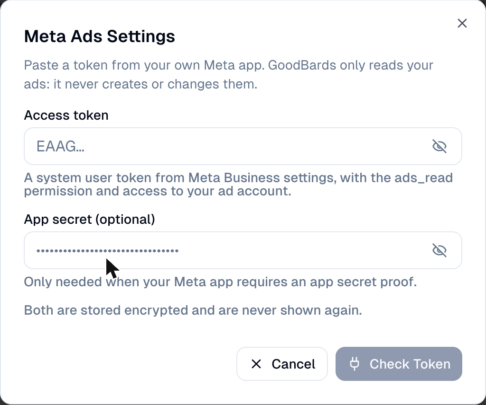

4. Choose your **ad account**, then **Save**.

    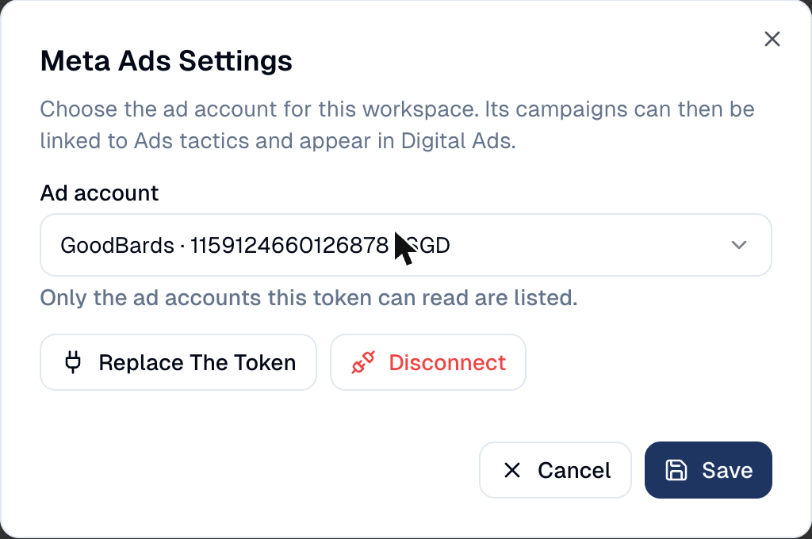

The card then shows the ad account's name, its number and its currency. Until an
ad account is chosen, it shows **No account selected**.

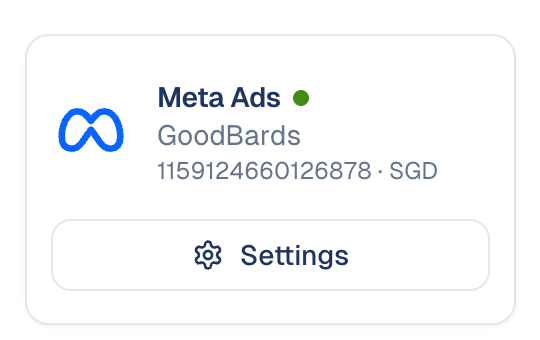

Your ad account now appears in **Marketing → Digital Ads**, on the **Meta Ads**
tab:

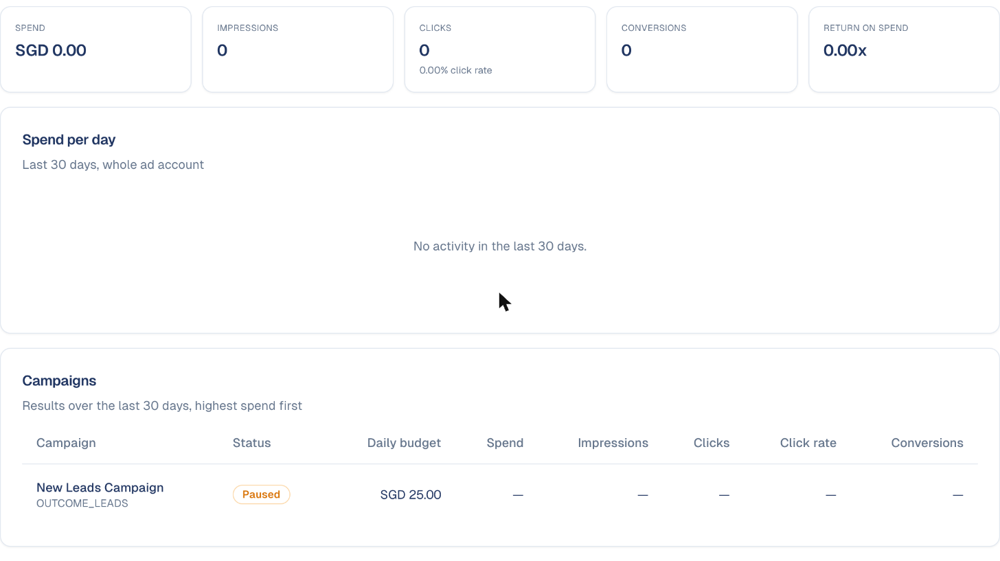

## What GoodBards does with it

| GoodBards… | Details |
| --- | --- |
| **Reads** | Your ad accounts, the campaigns of the chosen ad account, and their daily results (spend, impressions, link clicks, conversions and their value). |
| **Never does** | Create, change, pause or delete anything in your ad account. |

**How the numbers are counted**

- **Clicks** are link clicks: people who clicked through to your destination.
- **Conversions** are purchases, leads and registrations, each counted once.
- **Return on spend** is the value of purchases divided by the spend.
- A campaign whose budget is set on its ad sets shows no daily budget.

!!! info "People who see or click your ads"
    Meta only gives totals. It never says which person saw or clicked an ad, so
    GoodBards cannot attach an ad view or click to one of your contacts.

## Replacing the token or disconnecting

On the **Meta Ads** card, choose **Settings**:

- **Replace the token** when the old one expired or was revoked. Your chosen ad
  account is kept if the new token can still read it.
- **Disconnect** forgets the token and the ad account. Tactics already linked
  keep their link and show that Meta Ads is no longer connected.

## Troubleshooting

| What you see | What to do |
| --- | --- |
| *Meta refused the token* | The token expired or was revoked. Create a new one (step 3) and choose **Replace the token**. |
| *The token may not read ads* | The token lacks **ads_read**, or the system user has no access to the ad account (step 2). |
| *This token reaches no ad account* | Assign your ad account to the system user (step 2), then check the token again. |
| *Meta is limiting calls* | Meta allows a limited number of reads per ad account. Wait a few minutes and reload. |
