# WhatsApp

Send your campaign messages on WhatsApp, from your own WhatsApp Business number.

## What it's for

With the **WhatsApp** connector, GoodBards sends WhatsApp messages
to the contacts who agreed to receive them, from **your** number and under
**your** business name. Everything goes through your own Meta account: Meta bills
you directly for the messages, and GoodBards never pays or sees your Meta bill.

A campaign can then send an approved **message template** to each contact of an
audience, filled with their own details, and show you who received it, who read
it, who clicked and who replied.

!!! note "Setting up with us"
    Meta's screens are made for developers: if you would rather not do the setup
    alone, contact support and we do it with you on a short call.

## Before you start

- WhatsApp is included in the **Pro** and **Full** plans.
- You must be an **administrator** or the **owner** of your GoodBards company
  account.
- You need a Facebook account that is an administrator of your company's
  **Meta business portfolio** (business.facebook.com). Ideally the portfolio is
  already verified by Meta.
- Allow 20 to 30 minutes. You do this once.

## The GoodBards form, field by field

At the end, GoodBards asks for four details. Here is what each one is, in plain
words, and where it comes from. The steps below collect them one by one.

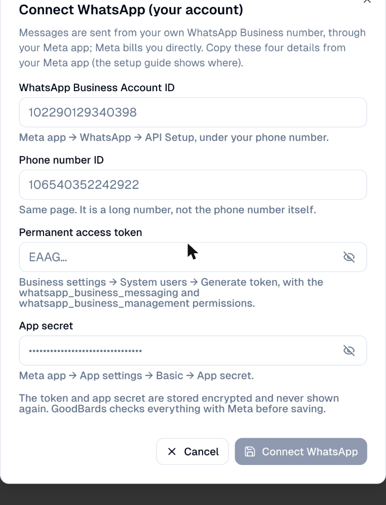

| Field in GoodBards | What it is | Where Meta shows it | Looks like |
| --- | --- | --- | --- |
| **WhatsApp Business Account ID** | Your WhatsApp account at Meta, which holds your number(s) and message templates. Meta now calls it **Messaging account ID**. | Your app's WhatsApp setup page (step 2), or Business settings → **Messaging accounts** → your account → **ID** | 15–16 digits, e.g. `102290129340398` |
| **Phone number ID** | Meta's internal number for your sending phone line. **Not** the phone number itself. | Your app's WhatsApp setup page, next to the number (step 2) | 15–16 digits, e.g. `106540352242922` |
| **Permanent access token** | The key that lets GoodBards send in your name. Shown only once. | Business settings → **System users** → **Generate token** (step 4) | A long text starting with `EAA` |
| **App secret** | Proves that messages and updates really come from your Meta app. | Your app → **App settings → Basic → App secret → Show** (step 3) | 32 letters and digits |

!!! tip "Keep a note open"
    Paste each detail in a private note as you go (your password manager is
    ideal), then copy them into GoodBards at the end.

## How to set up WhatsApp in Meta

### 1. Create a Meta app

The app is your company's "mailbox" at Meta for sending WhatsApp messages.

1. Go to **developers.facebook.com**, log in, and choose **My Apps → Create App**.
2. Give the app a name, for example *Your brand Messaging*. Meta refuses names
   that contain "WhatsApp".

    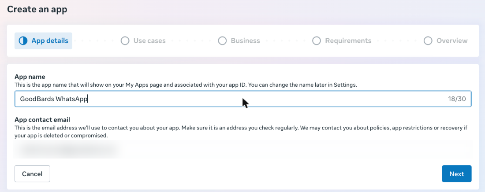

3. Choose **Next**, then tick **Connect with customers through WhatsApp**.

    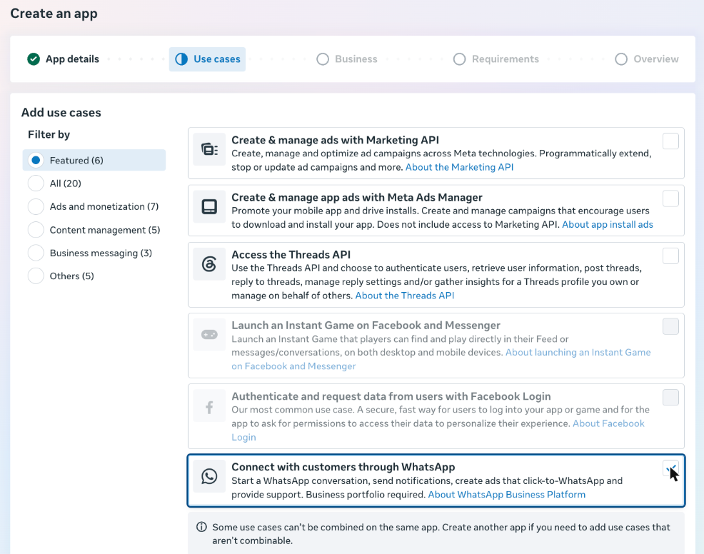

4. Choose **Next** and pick your company's business portfolio.

    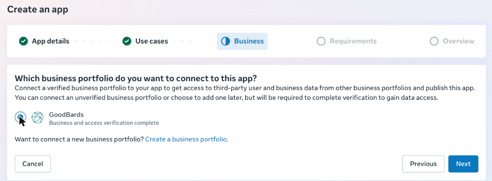

5. Choose **Next** twice. The **Requirements** step lists *Business verification*
   and *App Review*: App Review is only for apps that access other businesses'
   accounts, so it does not stop you from sending from your own number.
6. Check the summary and choose **Create app**. This accepts Meta's Platform
   Terms for your business.

    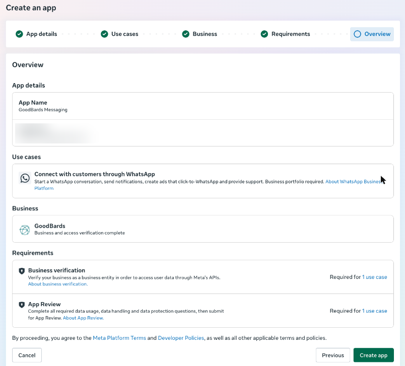

### 2. Copy the Phone number ID and the WhatsApp Business Account ID

1. On the app's dashboard, choose **Customize the Connect with customers through
   WhatsApp use case**.

    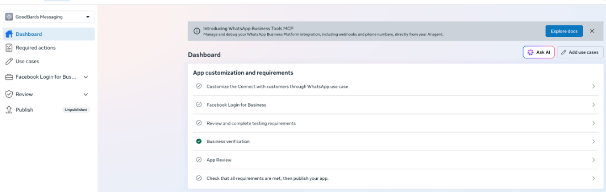

2. Meta shows a guided setup. Choose **Step 1. Try it out**.

    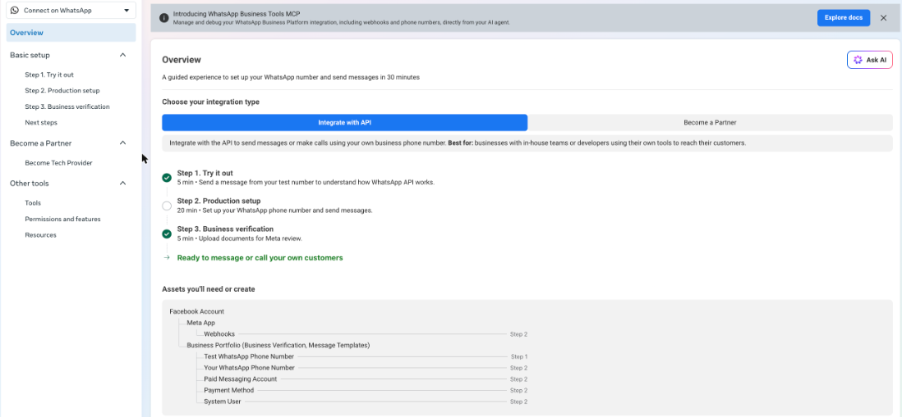

3. Meta gives you a free **test number**. Next to it:
    - **Phone Number ID** → paste it in GoodBards' **Phone number ID**.
    - **Messaging account ID** → paste it in GoodBards' **WhatsApp Business Account ID**.

    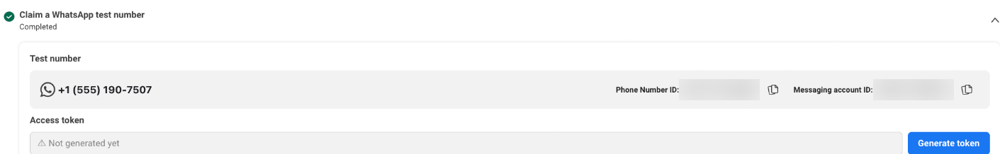

The test number is enough to try GoodBards. To send from your real number, follow
**Step 2. Production setup** on the same page: add your number, then a payment
method. Your real number then has its own Phone number ID, shown in the same place.

### 3. Copy the app secret

1. In the app, open **App settings → Basic** (left menu, near the bottom).
2. Next to **App secret**, choose **Show**. Meta asks for your Facebook password.
3. Copy the secret → GoodBards' **App secret**.

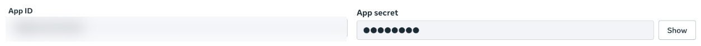

### 4. Create the permanent access token

GoodBards needs a key that does not expire. Meta gives such keys to a **system
user**: a robot account of your company that can only do what you allow. You
create it, give it access to your app **and** to your WhatsApp account, then
generate its key.

**a. Create the system user**

1. Go to **business.facebook.com → Settings → Users → System users** and choose
   **Add**. The first time, Meta asks you to accept its non-discrimination policy.

    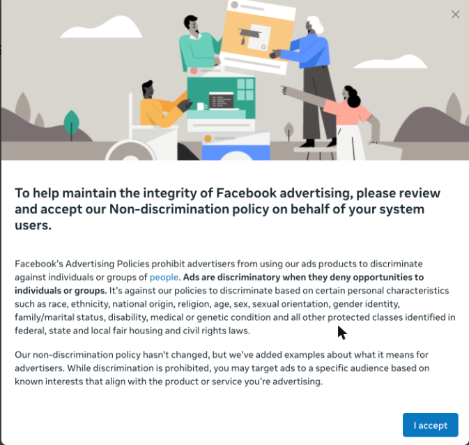

2. Name it, for example *GoodBards Sender*, keep the role **Employee**, and choose
   **Create system user**.

    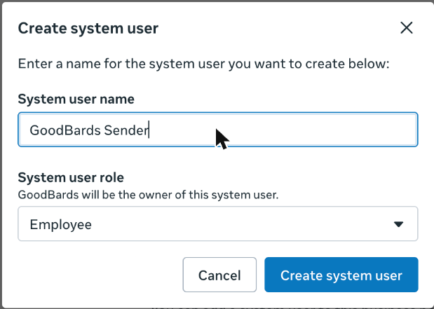

3. With the system user selected, choose **Assign assets → Apps**, tick your new
   app, turn on **Develop app**, and choose **Assign assets**.

**b. Give it access to your WhatsApp account** (the step people miss)

1. Still in Settings, open **Accounts → Messaging accounts** and select your
   WhatsApp account.
2. Choose **Assign people**, tick your system user, turn on **Everything** (full
   access), and choose **Assign**.

    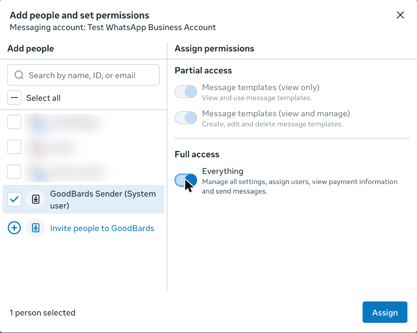

3. On the account's **People** tab, check that your system user is listed under
   **People with full access**.

    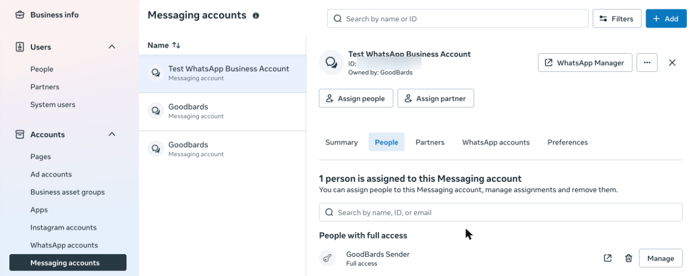

!!! warning "Use Messaging accounts, not WhatsApp accounts"
    Meta also lists your account under **Assign assets → WhatsApp accounts** on
    the system user page. Giving access there is not enough: GoodBards then shows
    "Meta cannot find this WhatsApp Business Account". Always check the **People**
    tab of the messaging account.

**c. Generate the key**

1. Back in **System users**, select your system user and choose **Generate token**.
2. Pick your app.

    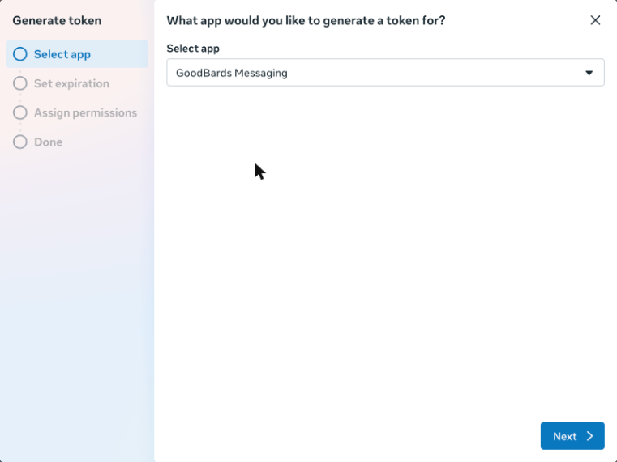

3. Set the expiry to **Never**. With 60 days, your WhatsApp sending would stop
   until you create a new token.

    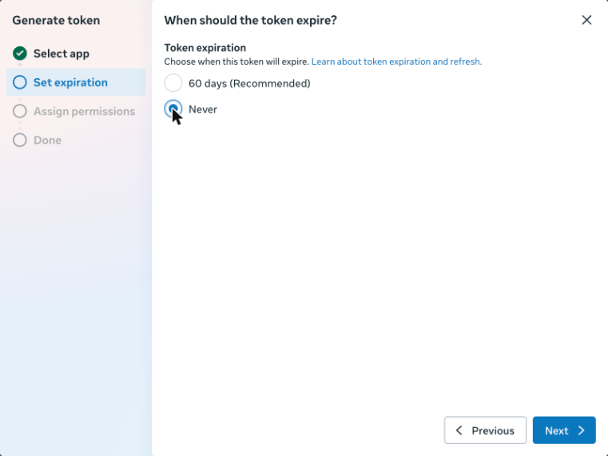

4. Tick **whatsapp_business_management** and **whatsapp_business_messaging**, then
   choose **Generate token**.

    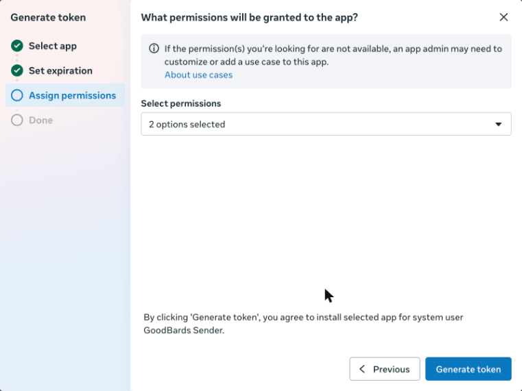

5. **Copy the token right away** → GoodBards' **Permanent access token**. Meta
   shows it only once; if you lose it, generate a new one.

!!! warning "Keep the token secret"
    Anyone with this token can send WhatsApp messages as your business. Paste it
    only in GoodBards, never in an email or a chat.

## How to connect in GoodBards

1. Open your account menu (your picture, top right), then choose **Connections**.
2. On the **Messaging** tab, find **WhatsApp** and choose **Connect**.

    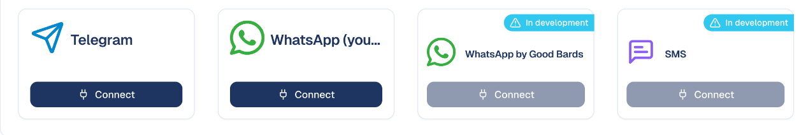

3. Paste the four details (see the table above) and choose **Connect WhatsApp**.

GoodBards checks everything with Meta before saving. If Meta refuses, nothing is
saved and the message says which detail is wrong: see **If it does not work**
below. Once connected, the card shows your business name, your number and your
WhatsApp profile picture (or your initials when you have none); **Number &
webhook** shows Meta's quality rating.

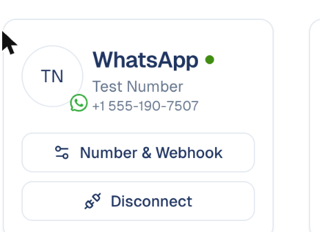

## How to receive delivery updates and replies

Meta tells GoodBards when a message is delivered or read, and when someone replies
or asks to stop, through a **webhook**. You set it once:

1. In GoodBards, on the WhatsApp card, choose **Number & webhook** and copy the
   **Callback URL** and **Verify token**.
2. In your Meta app, open **WhatsApp → Configuration → Webhook → Edit**, paste
   both, and choose **Verify and save**.
3. Under **Webhook fields**, subscribe to **messages** and
   **message_template_status_update**.

Without this step messages are still sent, but GoodBards only knows they were
sent: not delivered, read or answered.

## How to prepare a message template

WhatsApp only lets a business start a conversation with a **template** that Meta
approved. You write it once and reuse it in as many campaigns as you like.

1. In **Content Hub**, create a **WhatsApp message**.
2. Choose **New Template** and fill in:
    - a **name** (lowercase letters, digits and `_`, for example `summer_offer`),
      a **language** and a **category** (Marketing for offers and news, Utility
      for order or booking updates);
    - the **text**, up to 1,024 characters. Put `{{1}}`, `{{2}}`… where something
      changes from one person to the next, and give an example for each: Meta
      reviews the template with your examples;
    - optionally a short **title**, a **footer** and a **link button**.
3. Choose **Submit to Meta**. The template shows as **in review**. Meta usually
   answers within minutes, sometimes a day; you get a notification when it is
   approved or rejected, with Meta's reason.

Meta's rules, checked by GoodBards before sending anything to Meta: variables
are numbered in order without gaps, and the text cannot start or end with a
variable.

!!! note "Not supported yet"
    Templates with a variable in the title, an image as title, or a variable in
    the link button can be created in WhatsApp Manager but cannot be sent from
    GoodBards for now.

## How to send a WhatsApp campaign

1. In a campaign, choose **Add Tactic** and pick **WhatsApp**.
2. In **Recipients**, choose contacts, segments or mailing lists. The **Who
   receives it** box tells you how many can be reached and why the others
   cannot: no usable phone number, no WhatsApp consent, or marked do not contact.
   It also shows how many messages you have used this month.

    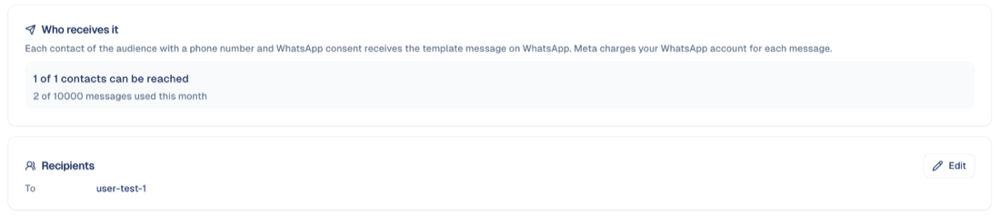

3. Create the message: in **Content Hub**, create a **WhatsApp message**, pick an
   **approved template**, then say what fills each variable:
    - **First name**, **Last name** or **Job title**: taken from each contact. In
      the field on the right, type what a contact with an empty field should get
      (for example `there`). Without it, that contact is skipped.
    - **Fixed text**: the same for everyone. A link typed here is replaced by a
      short link of its own for each contact, so you see who clicked.

    The preview on the right shows the message as the contact will read it.

    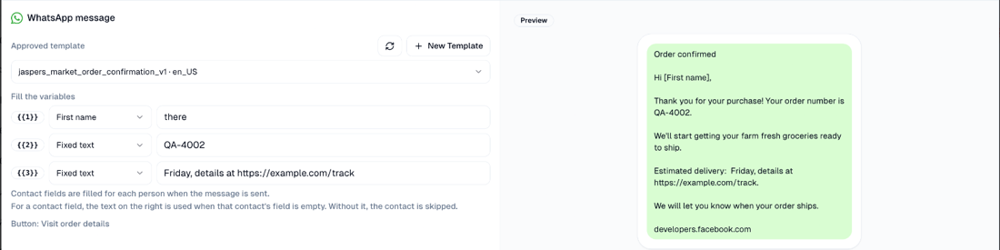

4. Back on the tactic, choose **Import Asset**, pick your message and choose
   **Attach Asset**. Then open the **⋮** menu of that line, choose **Publish** or
   **Schedule**, and pick **Contacts of this tactic**. Messages go out over the
   next minutes.

GoodBards checks the template with Meta again when you publish: if Meta paused or
removed it in the meantime, nothing is sent and the message says why.

!!! tip "A contact needs two things"
    A phone number in international format (for example `+65 9123 4567`) and
    **WhatsApp consent**, recorded on the contact page, by a form, or by an
    import. A contact who only gave an email address is never messaged on
    WhatsApp.

## What happens after sending

On the tactic page, **Delivery status** lists every message: sent, delivered,
read and clicked, each with its time, or the reason it failed (for example *Not
on WhatsApp, or cannot receive this message*). A dash means Meta did not report
that step: a person who turned off read receipts stays at "delivered".

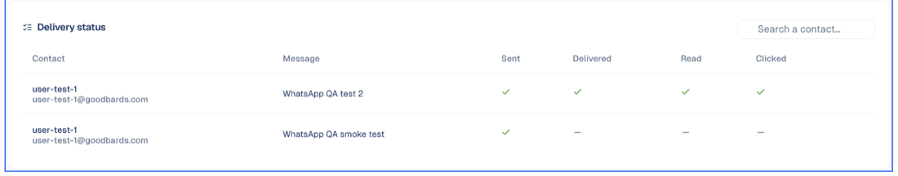

Every step also appears on the contact's own timeline: sent, delivered, read,
clicked, replied, stopped.

- **A reply** appears on the contact's timeline, and its text is kept in the
  contact's **Notes**. Your account gets a notification naming the contact and
  the tactic.
- **You can answer it.** On the contact's page, **Answer on WhatsApp** lets you
  write back in your own words for **24 hours** after the contact's last
  message. That is WhatsApp's rule: inside those 24 hours the answer needs no
  template and Meta does not charge for it; after that, only an approved
  template in a campaign can reach the contact. Your answer is kept in the
  contact's notes, next to their message, and does not count in your monthly
  limit. It is one answer at a time, not a chat window: for a real
  conversation, pick up the phone. The box shows until when you can answer; it
  is not offered for a contact who asked to stop.

    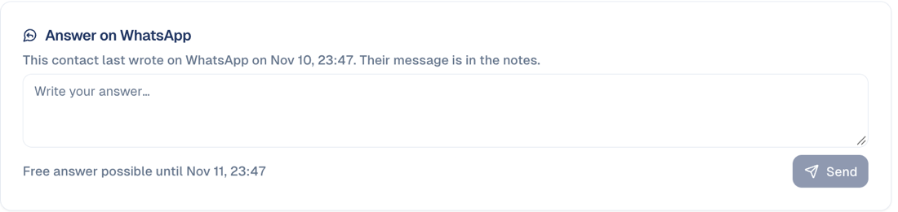

- **"STOP"**, or the **Stop promotions** button, withdraws the contact's WhatsApp
  consent at once. They are left out of your next messages.
- **A failed message** can be sent again: fix the cause, then publish the same
  message again. Only the contacts whose message failed are retried; nobody
  receives it twice.
- A message that could not be sent within a day of publishing (for example
  because of a payment problem in your Meta account) is cancelled rather than
  sent late.

## What you see in reports

In the campaign's **Analytics** tab, WhatsApp tactics are listed under
**Messaging**. Choose a line to open its detail:

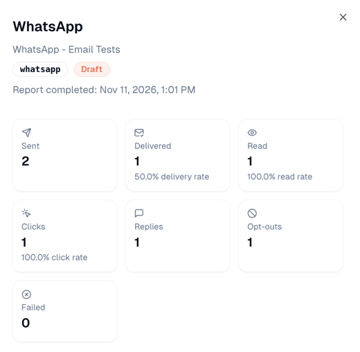

The report is refreshed every night.

| In the campaign report | Meaning |
| --- | --- |
| **Sent** | Messages Meta accepted |
| **Delivered** / **Read** | Reached the phone / opened, with their rates |
| **Clicks** | Clicks on your links, people only (WhatsApp's own link preview is not counted) |
| **Replies** | Contacts who wrote back |
| **Opt-outs** | Contacts who asked to stop |
| **Failed** | Messages that could not be delivered |
| **Billed by Meta** | Delivered messages Meta charges you for. GoodBards shows the count, not the amount: Meta's price depends on each recipient's country, and your invoice is in WhatsApp Manager |

## If it does not work

GoodBards shows Meta's refusal in plain words, with Meta's own text in brackets.

| GoodBards says | Why | What to do |
| --- | --- | --- |
| **Meta cannot find this WhatsApp Business Account or phone number with this token. Most often the system user has no access to the account…** (Meta: *Object with ID … does not exist, cannot be loaded due to missing permissions*) | Most often: the system user has no access to the WhatsApp account. Or an ID was mistyped. | Do step **4b**: Messaging accounts → your account → People → your system user with **Everything**. Check both IDs. Then choose **Connect WhatsApp** again; the same token works. |
| **The access token is not valid or has expired** | The token was copied incompletely, revoked, or set to expire. | Generate a new token (step 4c) with expiry **Never**, and paste it again. |
| **The app secret does not belong to the app that created this token** | The secret comes from another app, or the token was generated for another app. | Copy the secret from the app you picked in step 4c (App settings → Basic). |
| **The token is missing a permission** | One of the two permissions was not ticked. | Generate a new token with **whatsapp_business_management** and **whatsapp_business_messaging**. |
| **The phone number ID is a number…** | The phone number itself was pasted. | Paste the **Phone Number ID** shown next to the number (step 2). |
| **This phone number ID is not part of this WhatsApp Business Account** | The two IDs come from different accounts. | Copy both from the same place (step 2). |
| Messages are sent but never show **Delivered** or **Read**, and replies do not arrive | The webhook is not set, the **messages** field is not subscribed, or your Meta app is still **Unpublished**: Meta says some updates are not sent to an unpublished app. | Check **How to receive delivery updates and replies**. Then publish your Meta app: in **App settings → Basic**, fill in **Privacy policy URL** (your own privacy page) and **Category** (*Business and pages*), choose **Save changes**, then open **Publish** and choose **Publish**. It takes a minute and Meta asks for no review. |

!!! note "You do not need Meta's App Review"
    Your Meta app shows **App Review** and **Facebook Login for Business** as
    steps that are not done. Leave them. They are for apps that connect *other*
    companies' WhatsApp accounts. An app that only sends from your own account
    needs neither, and the two permissions it uses work as they are.

## Good to know

- **Meta bills you**, per marketing message, at Meta's rate for the recipient's
  country. Add a payment method in WhatsApp Manager before sending from your real
  number.
- **The test number** can only message a few phone numbers that you add in Meta
  (up to 5). Use it to try things, not for campaigns.
- **Quality rating.** Meta rates your number from how people react to your
  messages. A low rating lowers how many people you can message per day: only
  message contacts who agreed.
- **Consent.** GoodBards only sends to contacts with WhatsApp consent, and a
  "STOP" reply withdraws it.
- **Monthly limit.** Your plan includes a number of WhatsApp messages per month
  (2,000 on Pro, 10,000 on Full, unless agreed otherwise). It protects your
  number's quality rating. You see what you have used in **Settings → Usage**
  and on each WhatsApp tactic; a send that would go over is refused before
  anything leaves.
- To use a new token or number, choose **Connect** again with the new details:
  your webhook keeps working.

## How to disconnect

1. On the WhatsApp card, choose **Disconnect**.
2. GoodBards forgets the token and app secret. Nothing changes in your Meta
   account; to stop the key completely, remove the system user's token in
   Business settings (**Revoke tokens**).

---

*Still stuck? [Contact support](../../contact.md).*
