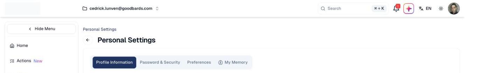

# Personal Settings

Your own profile, password and preferences — the settings that affect you rather
than your whole team.

## What it's for

Everything here is yours alone. Changing your language or your writing
preferences does not affect colleagues, unlike
[AI Settings](ai-settings.md) or [Brand & Context](company-settings.md).

## How to update your profile

1. Choose your profile picture at the top right, then **Personal Settings**.
2. On **Profile Information**, update your details.

## Profile Information

| Field | What it does |
| --- | --- |
| **Profile Image** | Your picture as colleagues see it. |
| **Full name** | Your name as it appears in the app. |
| **Role** | Your job title. |
| **Country** | Your country of residence. |
| **Custom Instruction** | Standing guidance for the AI when it writes for you. |

### Custom Instruction is worth filling in

This is where you tell the AI how you like content written — for example a
preference for bullet points over long paragraphs, or a particular tone. It
applies whenever the AI generates something for you.

It is limited to 300 characters, so be specific rather than exhaustive.

!!! tip "Yours, not your company's"
    Custom Instruction is a personal preference. For how the AI should represent
    your *brand*, use the Voices Bank in
    [Brand & Context](company-settings.md).

## Password & Security

Change your password here, and turn on **Two-Factor Authentication**.

!!! warning "Turn on two-factor authentication"
    With 2FA enabled, signing in needs a verification code as well as your
    password. If your marketing account can email your entire contact database, it
    is worth protecting properly.

## Preferences

Interface preferences, including your language. You can also switch language from
the **EN** control in the top bar.

## My Memory

What the AI has remembered about you and how you work. Review it if the AI's
output drifts from what you expect.

## Good to know

- **These settings follow you, not the workspace.** If you have access to more
  than one workspace, your personal settings apply across all of them.
- **Your name appears to colleagues.** Fill it in properly if you work in a team.

---

*Still stuck? [Contact support](../contact.md).*
