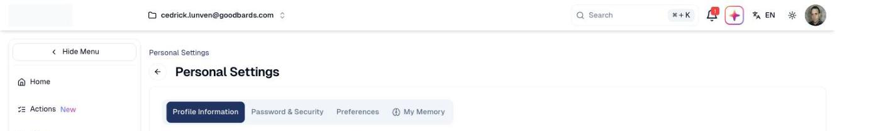

# Personal Settings

Your own profile, password and preferences: the settings that affect you rather
than your whole team.

## What it's for

Everything here is yours alone. Changing your language or your writing
preferences does not affect colleagues, unlike
[AI Settings](ai-settings.md) or [Brand & Context](company-settings.md).

## How to update your profile

1. Open your account menu (your picture, top right), then choose **Personal
   Settings**.
2. On **Profile Information**, update your details.

## Profile Information

| Field | What it does |
| --- | --- |
| **Profile Image** | Your picture as colleagues see it. |
| **Full name** | Your name as it appears in the app. |
| **Role** | Your job title. |
| **Country** | Your country of residence. |
| **Custom Instruction** | Standing guidance for the AI when it writes for you. |

### Custom Instruction is worth filling in

This is where you tell the AI how you like content written, for example a
preference for bullet points over long paragraphs, or a particular tone. It
applies whenever the AI generates something for you.

It is limited to 300 characters, so be specific rather than exhaustive.

!!! note "Yours, not your company's"
    Custom Instruction is a personal preference. For how the AI should represent
    your *brand*, use the Voices Bank in
    [Brand & Context](company-settings.md).

## Password & Security

Change your password here, and turn on **Two-Factor Authentication**.

!!! warning "Turn on two-factor authentication"
    With 2FA enabled, signing in needs a verification code as well as your
    password. If your marketing account can email your entire contact database, it
    is worth protecting properly.

## Preferences

| Setting | What it does |
| --- | --- |
| **Tenant** | The workspace you land on when you sign in. |
| **Language** | The language of the app. You can also switch it from the **EN** control in the top bar. |
| **Timezone** | The time shown on dates and notifications. |
| **Theme** | Light or dark. |
| **Default brand voice** | The voice picked for you in AI conversations. See [How the AI knows your brand](brand-voice-memory.md). |
| **Default content language** | The language picked whenever you generate content. It does not change the app's language. |

Choose **Update Preferences** to save.

!!! note "Two settings are per workspace"
    **Default brand voice** and **Default content language** apply to the
    workspace you are in. Set them again in each workspace you use.

## My Memory

What the AI has remembered about you and how you work. Review it if the AI's
output drifts from what you expect. Turn **Enable Personal Memory** off to stop
the AI using and collecting it.

## Shortcuts

Choose the icons shown in the top bar, before the search: up to six pages or
actions, for example **Scan Business Card** to capture a business card in one
tap, or **Emails** if you send campaigns every day.

1. Tick the entries you want. They are grouped like the menu, plus **Quick
   actions** (Create Contact, Scan Business Card, Create Campaign…).
2. Use the arrows on each one at the top to set the order, left to right.
3. Choose **Update**.

**Reset to default** brings back Content Repository and Calendar. Remove every
entry and only the search is left.

!!! note "Same shortcuts in every workspace"
    Your shortcuts follow you. A shortcut to a screen a workspace does not give
    you access to is simply not shown there; one your plan does not include shows
    a crown.

## Good to know

- **These settings follow you, not the workspace.** If you have access to more
  than one workspace, your personal settings apply across all of them, except
  the default brand voice and content language.
- **Your name appears to colleagues.** Fill it in properly if you work in a team.

---

*Still stuck? [Contact support](../contact.md).*
