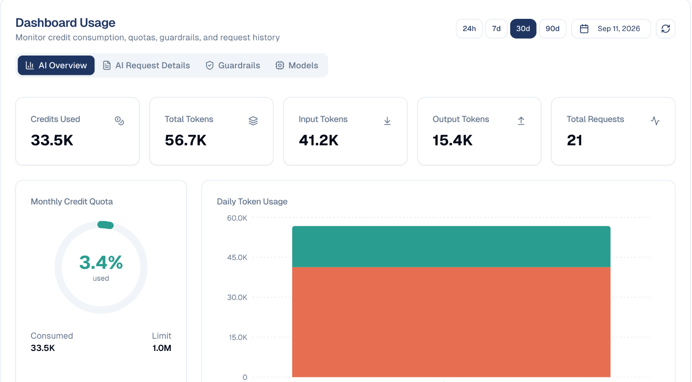

# Usage & Billing

Track what your team has used against your plan, so nothing stops working
unexpectedly.

## What it's for

AI features consume **credits**. Generating copy, creating an image, running an
agent — each uses some of your monthly allowance. This screen shows how much you
have used and what has been driving it.

Worth checking monthly. Running out mid-campaign is avoidable if you can see it
coming.

## How to check your usage

1. Open your account menu (your picture, top right), then choose **Tenant Usage**.
2. Pick a period — **24h**, **7d**, **30d** or **90d**.

## What the numbers mean

| Figure | What it tells you |
| --- | --- |
| **Credits Used** | Your consumption in the selected period. |
| **Total Requests** | How many times an AI feature was called. |
| **Monthly Credit Quota** | The percentage of your monthly allowance used, with consumed and limit below. |
| **Daily Token Usage** | Day-by-day consumption, so you can see which days were heavy. |

The **Monthly Credit Quota** dial is the one to watch. At 5% with three weeks to
go you have plenty of room; at 80% with a week left, plan accordingly.

!!! tip "Tokens are a unit of AI text"
    Input tokens are what you send the AI, output tokens are what it returns.
    Longer prompts and longer responses both cost more. You do not need to manage
    tokens directly — the credit quota is the number that matters.

## The other tabs

| Tab | What it shows |
| --- | --- |
| **AI Overview** | The summary described above. |
| **AI Request Details** | Individual requests, useful for tracing a spike. |
| **Guardrails** | Your plan's limits and how much of each you use: monthly AI credits, messages per conversation, storage, users, API keys, sub-workspaces, posts published and emails sent this month, contacts and chat agents. |
| **Models** | Which AI models were used, and how much. |

Check **Guardrails** before a big campaign: if a limit is close (for example
emails sent this month), the send stops when it is reached.

## Good to know

- **Usage is shared across your team.** The quota belongs to your company, not to
  each person, so a colleague's heavy week shows here too.
- **Check before a big campaign.** Generating a large batch of content uses
  noticeably more than day-to-day work.
- **Investigate spikes.** A sudden jump usually means a bulk generation job;
  **AI Request Details** will show what it was.

---

*Still stuck? [Contact support](../contact.md).*
