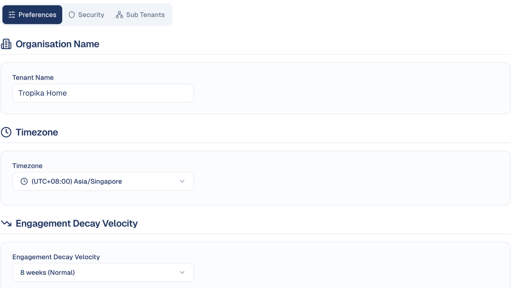

# Sub-Workspaces

Run separate workspaces underneath your own — one per client, brand or business
unit.

!!! note "The app calls these sub tenants"
    You will see the word **tenant** on this screen. A *tenant* is simply a
    workspace — a self-contained account with its own data. This page uses
    "workspace", but the buttons say "tenant".

## What it's for

An agency running marketing for several clients does not want all that work in
one pile. A sub-workspace is a self-contained space with its own contacts,
campaigns and content, sitting under your main account.

Each has its own plan tier and its own credit allowance, so one client's heavy
month does not consume another's.

If you run marketing for a single business, you will not need this.

## How to create a sub-workspace

1. Open your account menu (your picture, top right), then choose **Tenant Settings**.
2. Open the **Sub Tenants** tab.
3. Choose **Create Sub Tenant**.
4. Give it a name and set its tier.

## Reading the list

Each row shows:

| Column | What it tells you |
| --- | --- |
| **Name** | The sub-workspace. Choose it to open. |
| **Tier** | Its plan — for example **Pro**. |
| **Users** | Who has access. |
| **Credit Usage** | Consumption against that workspace's own allowance. |

The bar at the top right shows how many sub-workspaces you have against your
limit — for example *1 / 5 tenants*.

## Switching between workspaces

Use the workspace name at the top of the screen. Anything you then do — creating
a campaign, adding contacts — happens inside the workspace you have selected.

!!! warning "Check which workspace you are in"
    The name at the top is the only thing distinguishing one from another.
    Before sending an email or publishing a post, confirm you are in the right
    workspace — content sent from the wrong one goes to the wrong audience.

## The other tabs

| Tab | What it holds |
| --- | --- |
| **Preferences** | The workspace's name, timezone, engagement decay and badge format (below). |
| **Security** | Users, roles, contact ownership and API keys. See [Users, roles & permissions](users-roles.md). |
| **Sub Tenants** | The sub-workspaces described on this page. |

### Preferences

- **Organisation Name:** the workspace name everyone sees in the top bar.
- **Timezone:** the workspace's timezone, used for schedules and reports.
- **Engagement Decay Velocity:** how fast old engagement stops counting in the
  decay score, for example *8 weeks (Normal)*. Shorter suits fast buying cycles,
  longer suits long B2B ones. See [Lead scoring](../audience/lead-scoring.md).
- **Attendee Badge Format:** the default label size for event badges, with a
  preview and **Print Test Badge**. Badges under 80 mm wide print a compact
  layout. Each event can override it. See
  [Check-in and badges](../events/check-in.md).

## Good to know

- **Data does not leak between workspaces.** Contacts and campaigns in one are
  invisible to another. This is deliberate — it is what makes the separation
  safe for client work.
- **Each has its own credits.** Check usage per workspace rather than assuming a
  shared pool.
- **Your limit depends on your plan.** The counter at the top right shows how many
  more you may create.

---

*Still stuck? [Contact support](../contact.md).*
