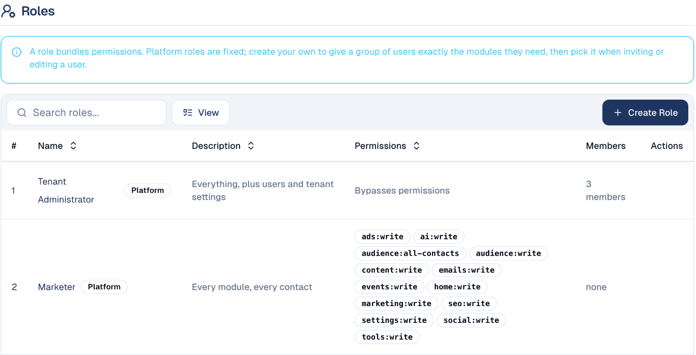
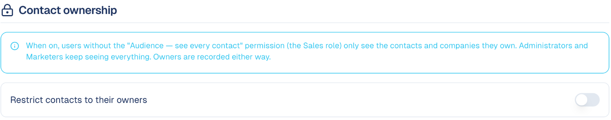

# Users, roles & permissions

Invite your colleagues and decide, module by module, what each one can see and
change.

## What it's for

Not everyone in your company needs everything. A sales colleague needs the
contacts, not the ad budget; an agency client may only need the reports.
GoodBards gives access per **module**, each in read-only or read-and-write, and
bundles those permissions into **roles** you give to people.

## Before you start

- You need to be an administrator or the owner of your company account.

## The 12 modules

Access is given per module. They match the sections of the sidebar and of this
documentation.

| Module | What it covers |
| --- | --- |
| **Home** | Home, the Daily Pulse, Actions, Calendar |
| **Audience** | Contacts, companies, segments, mailing lists |
| **Marketing** | Campaigns and tactics |
| **Emails and forms** | Emails, email designs, forms |
| **Events** | Event Management |
| **Social media** | Social posts and analysis |
| **Digital ads** | Digital Ads |
| **Content hub** | Content Workspace, Research & Plan, Content Repository, Translator |
| **Website and SEO** | Organic Visibility, Google Analytics, Google Trends |
| **AI studio** | Agentic AI |
| **Tool box** | QR codes, short links, chatbot, scheduler, image editor |
| **Settings** | Brand & Context, Brand Kit, connectors, AI settings |

Each module is either **read** (see only) or **write** (see and change). A module
someone has no access to disappears from their sidebar. Their own **Personal
Settings** are always open to them.

## How to invite a user

1. Open **Tenant Settings** from your account menu, then the **Security** tab.
2. Under **Users**, choose **Invite User**, enter their email and pick their role.
3. They receive an invitation by email. The number of users your plan allows is
   shown above the list.

To change someone's role later, use the pencil next to their roles.

## The roles

Under **Roles**, the **Platform** roles are ready to use:

| Role | What they can do |
| --- | --- |
| **Tenant Owner** | Everything, plus billing and transferring ownership. |
| **Tenant Administrator** | Everything, plus users and company settings. |
| **Marketer** | Every module in read and write, and every contact. The usual role for your marketing team. Contacts' emails and phones stay hidden until you give them [*Access sensitive data*](#additional-permissions). |
| **Sales** | Home and the Audience only, with *Access sensitive data*. With contact ownership on, they see only the contacts they own. |

To give a group exactly the modules it needs, choose **Create Role**, name it,
and pick the permissions. For example, a *Reporting* role with read access to
Home, Marketing and Website and SEO, for a client who only follows results.

## Additional permissions

Three permissions are not tied to a module. They are given to a person, not to
a role, and no role grants them except **Sales**, which includes *Access
sensitive data*. A **Marketer** or an **administrator** does not have them until
you tick them.

| Permission | What it gives |
| --- | --- |
| **Access sensitive data** | See contacts' email addresses, phone numbers and other personal details, and add or import contacts. Without it, these fields are hidden everywhere: lists, contact pages, exports and the assistant. |
| **Recipient for daily report emails** | Receive the [Daily Pulse](../home/home.md) by email each morning: what changed, what needs attention, and the state of your connectors. |
| **Recipient for lead capture alert emails** | Receive an email each time your chatbot captures a new lead, with their details and a summary of the conversation. |

To give one of them:

1. Open **Tenant Settings** from your account menu, then the **Security** tab.
2. Under **Users**, choose the pencil in the person's **Permissions** column
   (**Edit permissions**).
3. Under **Additional permissions**, tick the ones they need, then choose
   **Update Permissions**.

The change applies at their next login, or when they switch workspace.

!!! warning "Nobody receives the emails until you choose who"
    If no one in your company has *Recipient for daily report emails*, the Daily
    Pulse email is not sent. If no one has *Recipient for lead capture alert
    emails*, new chatbot leads are still saved as contacts, but nobody is told.
    Give each to at least one person.

!!! tip "Keep sensitive data to the people who need it"
    *Access sensitive data* is what lets someone read and download personal
    details. Under Singapore's PDPA and similar laws, give it only to colleagues
    who work with contacts directly.

## Contact ownership

Each contact can have owners: the colleagues responsible for them. Turn on
**Restrict contacts to their owners** to make people without the *see every
contact* permission (the **Sales** role) see only the contacts and companies they
own. Administrators and Marketers keep seeing everything.

Owners are assigned on the contacts list: select contacts, then
**Assign Owners**. See [Contacts](../audience/contacts.md).

## Good to know

- **Write includes read.** Someone with *write* on a module can also see it.
- **Owners and administrators are never restricted.** Their access cannot be
  reduced by a role.
- **Owners are recorded even when the restriction is off**, so you can turn it on
  later without reassigning anyone.
- **API keys** for connecting your own tools are on the same tab, below the
  roles. See [Use the GoodBards API](../guides/use-the-api.md).

---

*Still stuck? [Contact support](../contact.md).*
