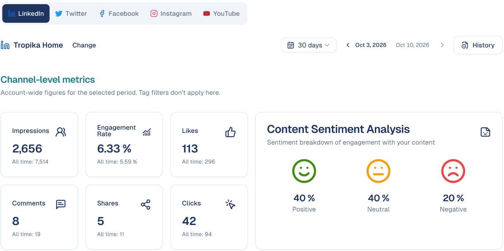
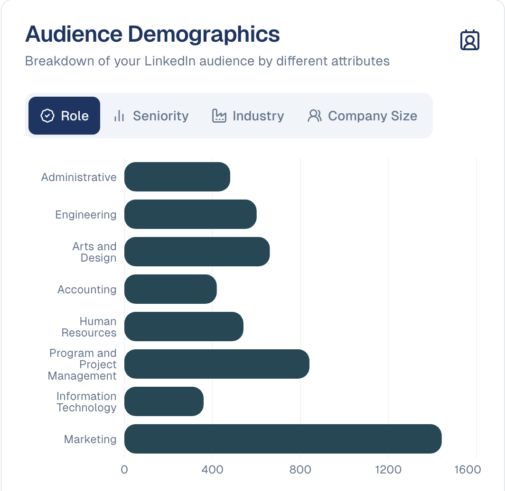

# Analysis

See how your social content performed — reach, engagement, and how people
reacted to it.

## What it's for

Posting is only half the job. This is where you find out whether anyone saw a
post, whether they engaged with it, and whether the reaction was positive.

Use it to decide what to do more of. A post with high impressions but almost no
clicks tells you something different from one with few impressions and strong
engagement.

## Before you start

Your social account must be connected — see
[Connections](../settings/connections.md).

!!! warning "LinkedIn organisation pages only"
    Report generation and analysis currently support **LinkedIn organisation
    pages**. Personal LinkedIn accounts are not supported, and the other channel
    tabs may have no report available yet.

## How to review social performance

1. In the sidebar, choose **Social Media → Analysis**.
2. Pick a channel from the tabs across the top.
3. Choose which organisation page to report on.
4. Use the arrows beside the date to move between reporting days.

Choose **Change** beside the organisation name to switch to a different page.

## What the numbers mean

| Metric | What it counts | What to read into it |
| --- | --- | --- |
| **Impressions** | How many times your content was shown. | Reach. Low impressions mean a distribution problem, not a content problem. |
| **Engagement Rate** | The share of people who interacted. | The single most useful number here — it is reach-independent. |
| **Likes** | Straightforward approval. | Easy to earn, weak signal. |
| **Comments** | People who wrote something. | Far stronger than a like: it costs effort. |
| **Shares** | People who passed it on. | The strongest signal of all. |
| **Clicks** | People who followed your link. | The one that matters when the post has a destination. |

Judge posts on **engagement rate** rather than raw likes. A post seen by 500
people with 50 interactions is doing better than one seen by 30,000 with 100.

!!! note "Facebook pages"
    Impressions, clicks and the **Channel Engagements** chart come from
    Facebook's insights, which the page connection has to allow. When it does
    not, those figures are left out of the report rather than shown as zero.
    Likes, comments, shares and **Fans** are always available. Reconnect the
    page to add insights access.

## Content Sentiment Analysis

Beside the metrics, sentiment splits engagement into **Positive**, **Neutral** and
**Negative**.

This is worth watching over time rather than per post. A shift towards negative
sentiment is worth investigating early — it is easier to address a small
complaint than a pattern.

## Who your audience is (LinkedIn)

**Audience Demographics** breaks down the people who follow your LinkedIn page
by **Role**, **Seniority**, **Industry** and **Company Size**. Check that it
matches who you sell to: a B2B brand followed mostly by students has a reach
problem, not a content problem.

Next to it, **Channel Engagements** shows the account's daily activity over the
period, straight from the network: engagement (split by type on LinkedIn) and
impressions.

## Top Posts Performance

Below the summary, your best-performing content is listed with its engagement
figures. This is the fastest route to understanding what your audience responds
to: look for what the top posts have in common — format, topic, tone, time of day.

## History

**History**, at the top right, holds previous reports so you can compare periods
rather than judging a single day in isolation.

## Good to know

- **One day is not a trend.** Social performance is noisy. Compare across several
  reports before changing your approach.
- **Impressions depend on the platform.** Reach is decided by each network's
  algorithm, so a drop is not necessarily about your content.
- **Match the metric to the goal.** For awareness, watch impressions; for traffic,
  watch clicks; for community, watch comments and shares.

---

*Still stuck? [Contact support](../contact.md).*
