# Conversation Compass

All your social networks on one page: how big your audience is, how it reacts,
and when and what to post. Mostly charts, short on text.

## What it's for

Each network has its own report. The Compass puts them side by side so you can
answer the questions that span them: which network deserves more effort, when your
audience is listening, which content works everywhere and which only works on one
network.

## Before you start

- **Your plan.** Social Media is included in the **Pro** and **Full** plans. The
  **AI Strategy Compass** at the bottom of the page is not available on the free plan.
- **At least one connected network**, under **Connectors**. See
  [Connections](../settings/connections.md).
- **One night.** The Compass reads what the nightly report of each network collected.
  A network connected today appears tomorrow morning.

!!! info "Nothing is fetched when you open the page"
    The Compass only reads the figures GoodBards already collected overnight, so it
    opens quickly and never uses your networks' daily limits.

## How to read the Compass

1. In the sidebar, choose **Social Media → Analysis**. The **Conversation Compass**
   tab opens first.
2. Choose the period at the top right: **7 days**, **30 days** or **90 days**. The
   same period applies to the network tabs.
3. Read the page from top to bottom: the headline numbers, then the charts.

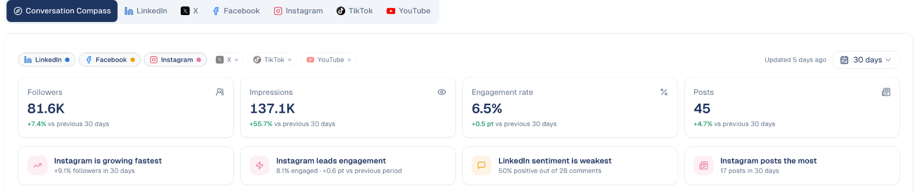

### Choose the networks

The chips at the top list your networks. Every network with data is ticked. Click a
chip to take that network out of **every** number and chart on the page; click it
again to bring it back, or choose **Show all**.

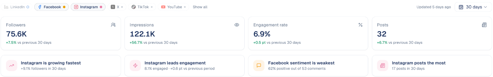

A chip with a dashed outline is a network without data: an amber dot means it is
connected and waiting for its first nightly report, a grey dot means it is not
connected. Clicking it opens that network's tab, where you can connect it.

### The headline numbers

**Followers**, **Impressions**, **Engagement rate** and **Posts** add up your networks.
Under each one, the change against the previous period of the same length, in green
when it went up and red when it went down. The four cards below name the network
that grew fastest, the one that engages best, the one with the weakest sentiment and
the one that posts the most.

!!! note "One engagement rate for every network"
    Engagement rate is likes, comments, shares and saves divided by impressions, the
    same way for every network so you can compare them. On TikTok and YouTube,
    impressions are views.

### Across networks

**Follower growth** shows each network's followers over the period, as a % change
(so a small network and a big one fit on the same chart) or as a count.
**Engagement over time** shows engagement or impressions per day, as a 7-day average
or per month, as values or **Indexed** (each network starts at 100).

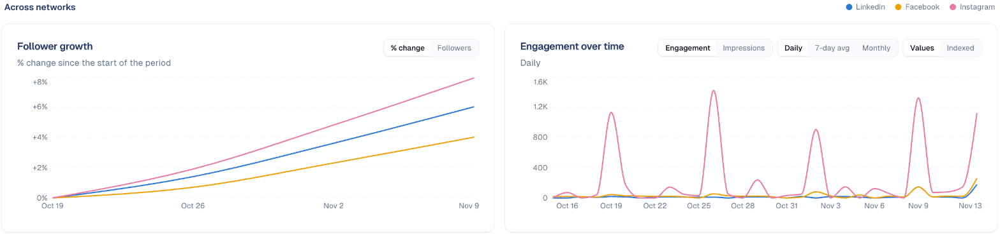

## When to post

**Best time to post** is a week grid: days across, 3-hour slots down, in your own
time zone. It is built from **your** posts, not from an industry average.

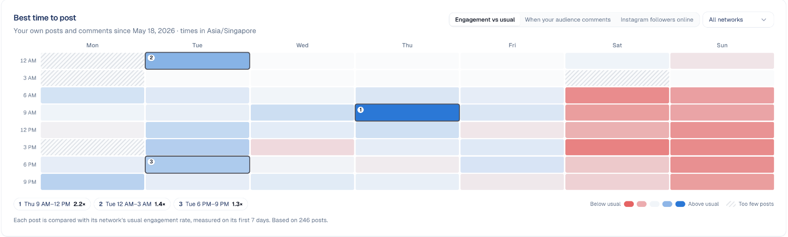

- Each post is compared with the **usual engagement of its network**, measured on
  its first 7 days. **Blue** slots do better than usual, **red** slots worse, grey
  ones about the same. This way a LinkedIn post and an Instagram post can share the
  grid fairly.
- The 3 best slots are numbered on the grid and listed below it.
- A **hatched** slot has only one post: too few to judge.
- **All networks** lets you look at one network at a time.

Hover a slot to see its figure and how many posts it is based on.

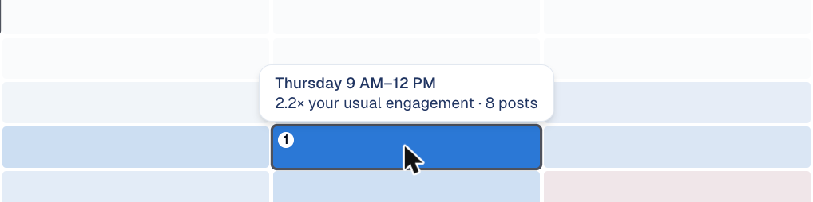{ width="40%" }

!!! info "It needs 30 posts"
    The grid looks back at least 6 months and judges posts once they are 7 days old.
    Below 30 such posts it shows a message instead of a grid that would mislead you.

**When your audience comments** shows when people comment on your posts, so you can
see when your audience is around. A dot marks the slots where you actually posted.

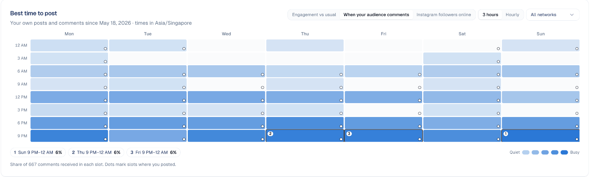

**Instagram followers online** shows, hour by hour, how many of your Instagram
followers are online, as reported by Instagram and averaged over the last 30 days.

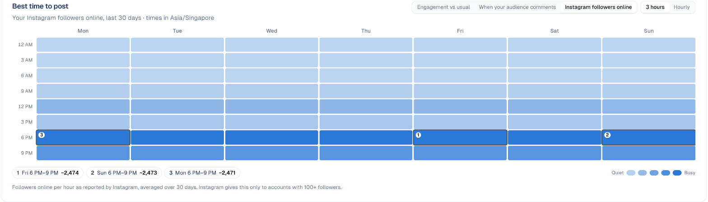

!!! note "Instagram only, 100 followers and more"
    Instagram gives this figure only to accounts with at least 100 followers, and
    keeps 30 days. GoodBards stores it every night, so the view appears the day after
    the first nightly report.

## What you post and what people say

**Posting activity** counts your posts per week (per day on a 7-day period), one
colour per network. **Sentiment by network** shows the share of negative, neutral
and positive comments on each network; the **net score** at the top right is
positive minus negative, over all comments.

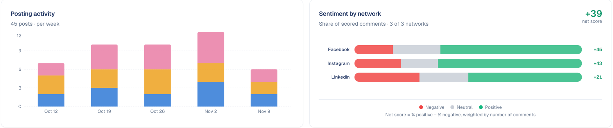

!!! note "Comments not collected"
    GoodBards reads the comments of LinkedIn, Facebook, Instagram and YouTube. X and
    TikTok only give a number of comments, so their sentiment shows **Comments not
    collected for this network**.

## Where to invest

**Effort vs return** puts each network's share of your posts next to its share of the
engagement you received. A network that takes a third of your posts and brings a tenth
of your engagement is worth a second look.

**Channel map** shows one bubble per network: posts per week across, engagement rate
up, bubble size for followers. Top right is where a network works hard and well.

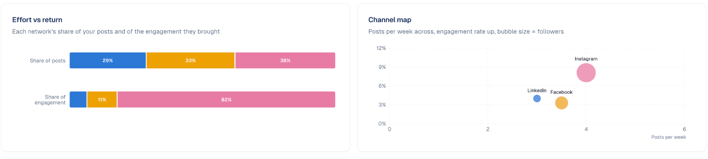

**Conversation volume** counts the comments you received per week, coloured by
sentiment, for all networks or one. **Format performance** compares video, image and
text-only posts, each against its network's usual level: a bar above the dashed line
does better than usual.

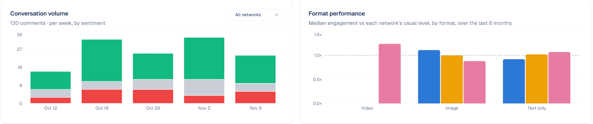

## What works

**Top posts across networks** shows your 5 best posts, each compared with the usual
engagement of its own network, so a strong LinkedIn post can rank above an Instagram
post that simply has more likes. Click a post to open it on its network.

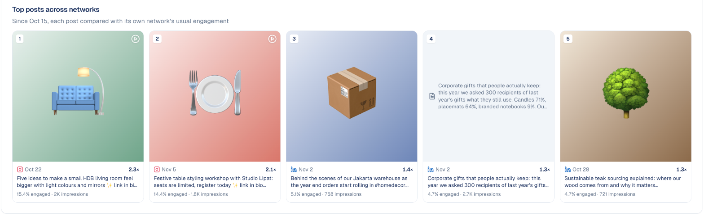

**Same content, different networks** finds posts with similar text published on
several networks within 3 days, and shows how each network did against its own usual
level. Bars to the right of **Usual** did better, to the left worse.

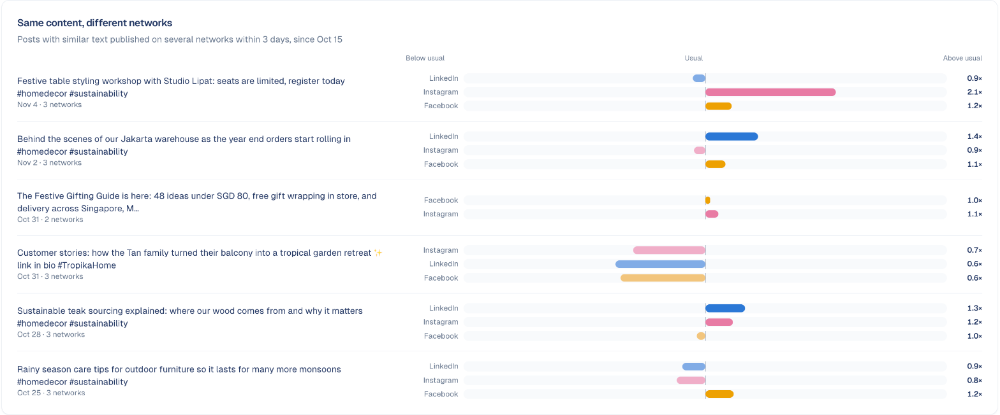

## AI Strategy Compass

At the bottom of the page, the AI reads the numbers above and writes advice, only
when you ask:

- **3 action items**: three things to do this week, each based on a figure.
- **Full report**: a summary, a diagnosis network by network, content opportunities,
  a sentiment watch, a posting schedule and the 3 actions.

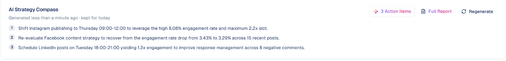

The reading is kept for the rest of the day, in your language: opening the page again
shows it at no cost. **Regenerate** asks the AI again and uses your AI credits.

!!! info "What the AI sees"
    Only the totals and rates shown on this page. It never sees the text of your posts
    or comments. It covers all your networks, whatever chips are unticked.

## Good to know

- **Figures are from last night.** **Updated …** at the top shows when the networks
  were last read.
- **A new connection starts from zero.** Follower history, daily engagement and the
  first-week figures of a post begin the day GoodBards first reads the account.
- **Only company accounts count.** LinkedIn personal profiles stay in the LinkedIn tab.
- **Times follow your profile's time zone**, set in your personal preferences.
- **Small numbers move a lot.** A slot or a format based on 2 or 3 posts is a hint,
  not a rule: the tooltip always says how many posts are behind a figure.

---

*Still stuck? [Contact support](../contact.md).*
