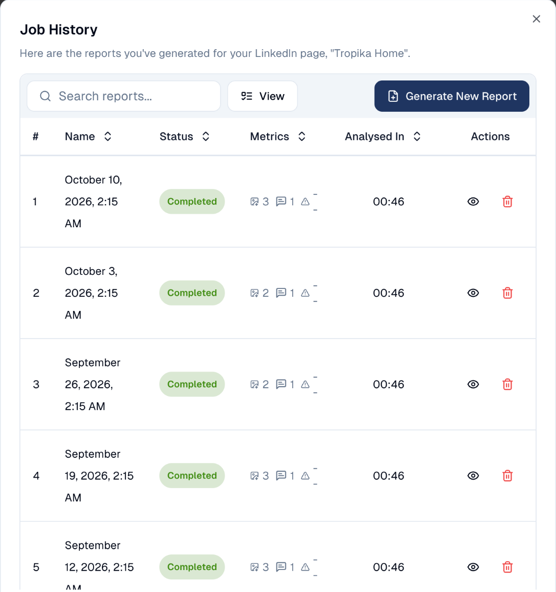

# Social reports

A report per social account and period, kept in a history so you can compare
weeks, and sent to you on a schedule if you want.

## What it's for

Network figures change every day. A report freezes them for a period: what was
posted, how it did, and what people said. Kept week after week, the reports show
the trend; sent automatically, they save someone collecting the figures by hand
for the Monday meeting or for a client.

## Before you start

- The social account connected under **Connections**. See
  [Connections](../settings/connections.md).

## How to read past reports

1. In the sidebar, choose **Social Media → Analysis**, then the network's tab, for
   example **LinkedIn**.
2. Choose **History** at the top right. Each line is one report, with its date,
   status and what it covers.

    

3. Choose the eye icon to open a report. The **Analysis** screen then shows that
   period.

To make a report now, for example after a big campaign week, choose **Generate
New Report**. It takes about a minute.

## How to receive reports automatically

1. Choose **Tool Box → Scheduler**, then **New Task**.
2. Pick **Social report** as the task type, then the account.
3. Set how often, for example every Monday at 9:00, and who receives it.

See [Scheduler](../tool-box/scheduler.md).

## Good to know

- **One report per account.** A company with a LinkedIn page and an Instagram
  account gets two reports.
- **Channel-level figures are for the whole account.** Tag filters on the
  Analysis screen apply to posts, not to those account-wide totals.
- **Deleting a report only removes it from the history.** The posts and the
  network's own figures are not affected.

---

*Still stuck? [Contact support](../contact.md).*
