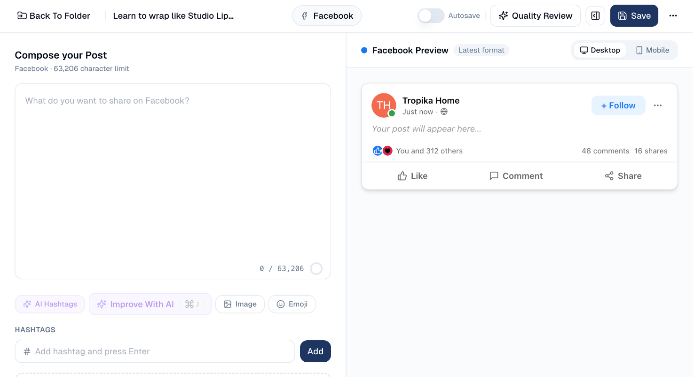
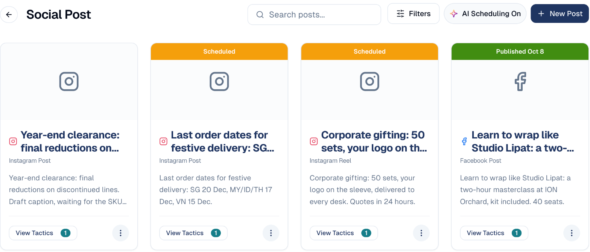

# Social Post

Write social posts with AI or from your articles, attach them to a campaign, then
publish or schedule them to your connected accounts.

## What it's for

A social post usually starts from something you already have, a blog article or a
press release, or from a short idea. GoodBards drafts the post for each channel,
checks it against the channel's limits and your brand, and publishes it from the
campaign it belongs to, so its results show up in the campaign report.

## Before you start

- **A connected account.** Connect LinkedIn, Facebook, Instagram, X or TikTok
  under **Connectors** (in the menu behind your avatar), and choose the page to
  publish to in **Destination**. Without it, **Publish** and **Schedule** stay
  greyed out.
- **A campaign** with a social tactic, to publish from.

## How to create posts from an article

Turn one article into a series of posts for several channels at once.

1. In the sidebar, choose **Content Hub → Content Repository**.
2. On the article, open the **⋮** menu and choose **Create social posts**.
3. Under **Campaign**, choose the campaign the posts belong to, then **Next**.
4. Tick the posts you want: **Launch**, **Key figure**, **Question**, **In case you
   missed it**. Each one shows when it is suggested to go out. Tick the channels.
5. Check **Link to the article**. Add anything to emphasise under **Anything to
   stress? (optional)**.
6. Choose **Write the brief**, check it, then choose **Generate**.
7. Click a post to review it, change its picture or plan it. You can close the
   window while the posts are written.

Nothing is published: every post waits on its channel as a draft for you to review.

## How to write a post yourself

Choose **New Post**, pick the **Asset Type**, keep **New Empty** as the
**Creation Method**, give it a **Title** and choose **Create**. Type the post,
save it, then add it to a campaign and publish or schedule it. The full
walkthrough, with screenshots, is in
[Create a social post from scratch](../guides/create-social-post.md).

## How to write a post with AI

1. In the sidebar, choose **Social Media → Social Post**, then **New Post**.
2. Pick the **Asset Type**, for example a LinkedIn post.
3. Under **Creation Method**, choose **Write with AI**, then **Continue**.
4. Fill in **What is it about?**. Optionally tell the AI how to write it in
   **Instructions for the AI**: the angle, what to stress or leave out, the
   length or the hashtags (for example *"Focus on the ROI for agencies, under
   150 words, end with a question"*). Then add **Source and materials**: the
   facts the post may use, typed in **Notes & facts**, web pages, or files
   from your Content Repository. Finish with **Tuning** (audience, tone,
   language, keywords).

    !!! tip "Instructions or notes?"
        **Instructions** say *how* to write the post; the AI follows them.
        **Notes & facts** say *what* is true; the AI only uses them as facts
        to cite, and never takes orders from them.
5. Choose **Write the brief**, check it, then **Generate**. The AI drafts the post,
   reviews it and revises it once.
6. Read the score and the checks. Apply the suggestions you agree with, or use
   **Ask for a change**. Then choose **Save as asset**.

In the post editor, **Improve With AI** opens a small chat with the AI: ask for
a change (*more punchy, add three hashtags*) and the post is rewritten within
the channel's character limit, with **Revert** to undo. Paste a link (*write a
post about https://…*) and the page is read first, so the post draws on what it
actually says. **AI Hashtags** suggests hashtags once the post has ten words. The
preview on the right shows the post as it will appear on the network, on desktop
or mobile.

## Videos, documents, Reels and stories

A post can carry a video or a document instead of pictures. The file comes from
your [Content Repository](../workspace/drive.md): upload it there first, with
**+ New → Video** or **Upload**. Videos up to 2 GB are accepted, and a progress
bar shows the upload.

A post holds **one kind of media**: pictures, one video, or one document. Adding
one removes the other, and with a video or a document attached, no link preview
card is shown.

### A video on LinkedIn

1. In the post editor, open **Insert → Video…** and pick the video.
2. Check the **title** under it: LinkedIn prints it under the video. It starts
   as the file's name.
3. The preview on the right plays the video.

LinkedIn takes **MP4** files from 75 KB to 500 MB, between 3 seconds and 30
minutes long. Videos it does not take are greyed out in the list, with the
reason.

### A document on LinkedIn

A PDF, PowerPoint or Word file is shown on LinkedIn as a document people swipe
through, page by page. It is the way to post a **carousel** on a company page:
put one slide per page in a PDF.

1. In the post editor, open **Insert → Document (PDF, PowerPoint, Word)…** and
   pick the file.
2. Check the **title**: LinkedIn prints it above the document.

LinkedIn takes files up to 100 MB and 300 pages.

### Instagram: Post or Reel

Instagram has two asset types. Choose the right one in **New Post**:

| Asset type | Holds |
| --- | --- |
| **Instagram Post (images)** | One picture, or a carousel of 2 to 10 pictures. |
| **Instagram Reel (video)** | One video, published as a Reel and also shown in your grid. |

For a Reel, choose **Pick the Reel video from the Drive** (or **Insert → Reel
video…**), then set the **Cover frame at**, in seconds: the moment of the video
shown as its cover. The preview plays the video in the vertical 9:16 frame.

Instagram takes Reels in **MP4 or MOV**, up to 300 MB, between 3 seconds and 15
minutes. Vertical 9:16 videos look best.

### Publish to Instagram as a story

Any Instagram post or Reel can go out as a **story** instead: in the **Publish**
or **Schedule** window, set **Publish as** to **Story**.

- A story shows for **24 hours**. It shows the **main picture**, or the video,
  without the caption.
- A video story must be under 100 MB, and 60 seconds at most.
- Its numbers (views, reach, replies) are collected every 2 hours while it is
  live, and appear on the **Stories** card of your Instagram report. See
  [Social Media Analysis](analysis.md).

## How to publish or schedule a post

**Social Media → Social Post** lists your posts as cards. The band on top shows
whether a post is **Scheduled** or **Published**, and on which date.

1. On **Social Post**, choose **View Tactics** on the post's card, then **Add to
   Tactic**. Choose the campaign and a compatible tactic, then **Add to Tactic**.
   *(Or, from the campaign's social tactic, choose **Import Asset** and pick the
   post.)*
2. In the tactic, open the post's **⋮** menu:
    - **Publish**: choose the **Destination** and confirm.
    - **Schedule**: choose a **Date & Time**, or use **AI Recommendations** for
      the best slot, then **Confirm Schedule**.
3. The card shows **Scheduled** or **Published** with the date.

A post with a video or a document takes longer: the file is sent to the network,
which then processes it. The post shows **Sending** in the tactic, then
**Published**, usually within a few minutes. You can leave the page meanwhile.
If the network refuses the file, the post shows **Error**: hover it to read the
network's reason, fix the file, and publish again.

## Good to know

- **Character limits are per channel**: 3,000 on LinkedIn, 280 on X, 2,200 on
  Instagram and TikTok. The text box turns red past the limit.
- **Media or link preview, not both.** With a picture, a video or a document
  attached, LinkedIn and Facebook do not show the link's preview card. Without
  one, the preview card shows, but Instagram still needs a picture or a video.
- **Videos and documents are for LinkedIn and Instagram.** Documents are for
  LinkedIn only. Instagram carousels hold pictures only, not videos.
- **Published posts are locked.** You cannot edit or delete them from GoodBards.
- **Posted outside GoodBards?** In the tactic, choose **Link published post** and
  paste its link: its results then count in the campaign report.
- **LinkedIn personal profiles** do not give analytics; publish to a company page
  if you want results.

---

*Still stuck? [Contact support](../contact.md).*
