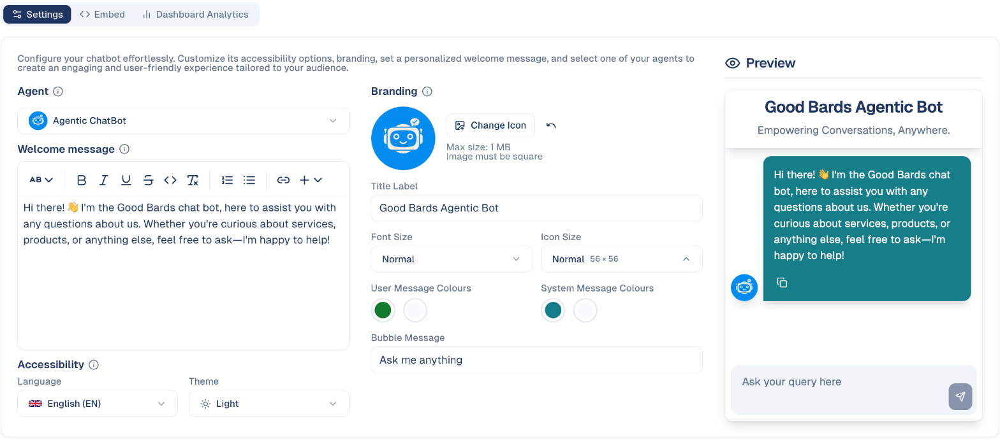
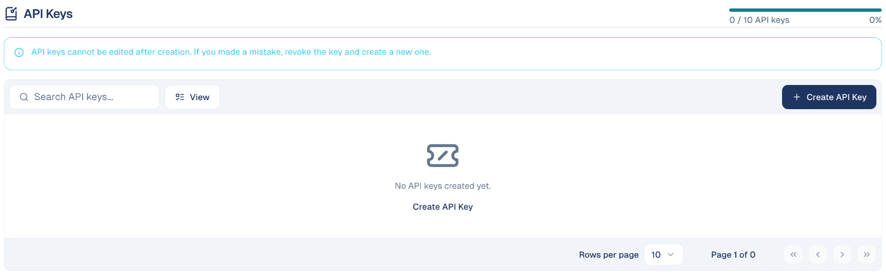
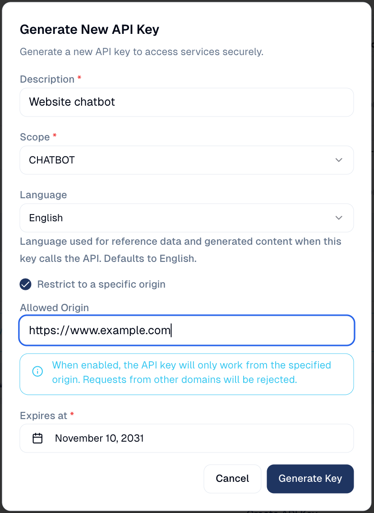
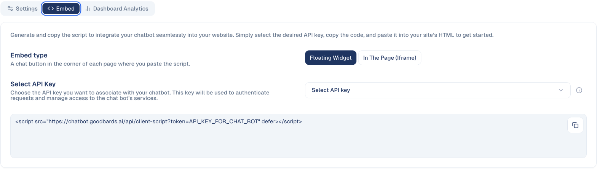
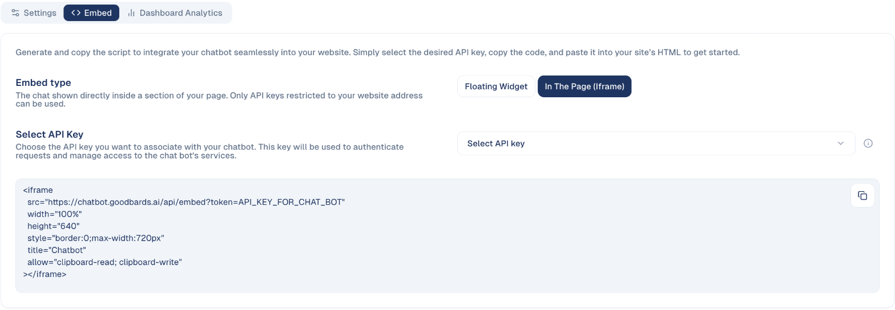
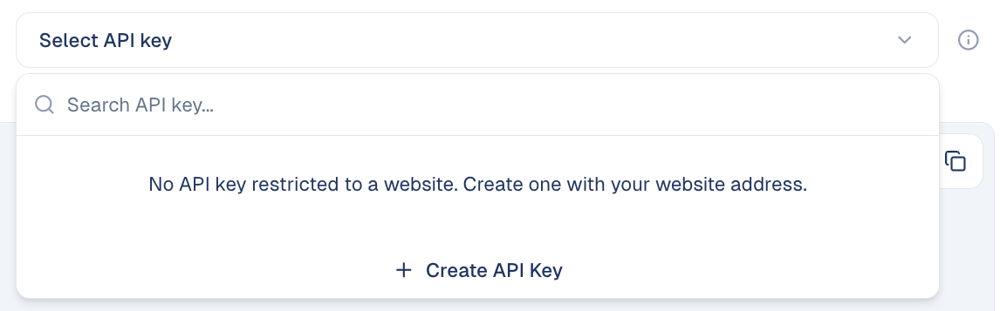
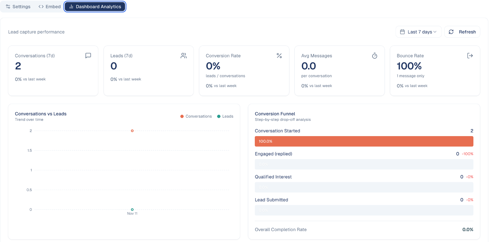

# External Chatbot

Put a GoodBards agent on your own website, to answer visitors' questions around
the clock.

## What it's for

Visitors ask the same questions at all hours — opening times, pricing, whether
you serve their industry. The external chatbot puts one of your
[chat agents](../agentic-ai/chat-agents.md) on your website to answer them, styled
to match your brand.

Because it is one of your agents, it knows your business rather than reciting a
scripted FAQ.

!!! abstract "In short: three steps"
    1. **Configure** the chatbot: agent, welcome message, colours.
    2. **Create a key** that only works on your website.
    3. **Paste the code** into your site, as a floating button or inside a page.

## Before you start

- A chat agent to put on the site. See
  [Chat Agents](../agentic-ai/chat-agents.md).
- A company administrator, to create the key in step 2.
- Your website's exact address, for example `https://www.example.com`.
- Someone who can add a snippet of code to your website.

## How to configure the chatbot

1. In the sidebar, choose **Tool Box → External Chatbot**.
2. On the **Settings** tab, choose which **Agent** answers visitors.
3. Write the **Welcome message** shown when the chat opens.
4. Set the branding — icon, title, colours and sizes.
5. Watch the **Preview** on the right update as you go.

## What you can change

| Setting | What it controls |
| --- | --- |
| **Agent** | Which of your agents answers. |
| **Welcome message** | The greeting when someone opens the chat. |
| **Language** | The interface language of the widget. |
| **Theme** | Light or dark. |
| **Change Icon** | Your logo on the chat bubble. Square, up to 1 MB. |
| **Title Label** | The name at the top of the window. |
| **Font Size** / **Icon Size** | How large the widget appears. |
| **User / System Message Colours** | Colours for visitor and bot messages. |
| **Bubble Message** | The prompt on the closed bubble — for example *Hi there! Need help?* |

!!! tip "The preview is live"
    The panel on the right shows exactly what visitors will see. Check it in both
    light and dark themes before publishing — colour choices that work in one can
    be unreadable in the other.

## How to create a key for your website

The chatbot on your site needs an **API key**: it tells GoodBards which company
the chat belongs to. Create one for the chatbot only, and tie it to your website.

1. Open **Tenant Settings** from your account menu, then the **Security** tab.
2. Under **API Keys**, choose **Create API Key**. The number of keys your plan
   allows is shown above the list.

    

3. Fill in the window:

    | Field | What to put |
    | --- | --- |
    | **Description** | What the key is for, for example *Website chatbot*. |
    | **Scope** | **CHATBOT**: the key can only drive the chatbot, nothing else. |
    | **Restrict to a specific origin** | Tick it, then type your website's address under **Allowed Origin**. |
    | **Expires at** | When the key stops working. It is set five years ahead. |

    { width="420" }

4. Choose **Generate key**. The key appears in the list, with its scope and its
   website under **Origin**.

!!! warning "Type the address exactly"
    Use only the address, with `https://` and nothing after it:
    `https://www.example.com`. No page, no `/` at the end. `https://example.com`
    and `https://www.example.com` are two different addresses: use the one
    visitors see in their browser.

!!! info "Why tie the key to your website"
    The key sits in your page's code, where anyone can read it. Tied to your
    website, it only works there: copied to another site, it is refused.

## How to put it on your website

The **Embed** tab gives you the code to add to your site. Send it to whoever
maintains your website, or paste it in yourself if you manage the site.

### As a floating button

A chat button in the corner of every page where you paste the code.

1. On the **Embed** tab, under **Embed type**, choose **Floating widget**.
2. Under **Select API Key**, pick your key. Only keys with the **CHATBOT** scope
   are listed.
3. Choose the copy button at the top right of the code, and paste the code into
   each page where the button should appear.

### Inside a page

The chat shown directly in a section of a page, for example on a *Contact us* or
*Help* page.

1. Under **Embed type**, choose **In the page (iframe)**.
2. Under **Select API Key**, pick your key. Only keys tied to a website are
   listed here.
3. Copy the code and paste it where the chat should appear in the page. You can
   change `height` and `max-width` in the code to fit your layout.

No key in the list? It means none of your keys is tied to a website. Choose
**Create API Key** at the bottom of the list: the same window opens, with the
scope already set to **CHATBOT**.

{ width="560" }

!!! note "The chat only shows on the key's website"
    Inside a page, the chat appears only on the website the key is tied to. On
    any other address, including a test copy of your site, the frame stays empty.

If the frame shows a message instead of the chat:

| What you see | What to do |
| --- | --- |
| *This API key is not restricted to a website…* | The key has no website. Create a new one with **Restrict to a specific origin** ticked. |
| *The website address on this API key is not valid…* | The address has a page or a `/` at the end. Create a new key with only the address. |
| *API key not provided.* | The code was cut when pasting. Copy it again from the **Embed** tab. |
| An empty frame | The page is not on the key's website. Check `www`, `https://` and the spelling. |

## How to see how it performs

The **Dashboard Analytics** tab shows how much the chatbot is used and whether
conversations turn into leads. Choose the period at the top right, from the last
24 hours to the last 90 days.

| Block | What it tells you |
| --- | --- |
| **Conversations** / **Leads** | How many chats started, and in how many the visitor left their contact details. |
| **Conversion Rate** | Leads divided by conversations. |
| **Avg Messages** | How long a conversation lasts. |
| **Bounce Rate** | Chats where the visitor sent one message and left. |
| **Conversion Funnel** | Where visitors drop off, from the first message to a lead. |
| **Conversations by Hour** | When visitors chat most. |
| **Visitor Metadata** | Their language, browser and platform. |

Each figure is compared with the period before. The dashboard stays empty until
an agent is chosen on the **Settings** tab and visitors start chatting.

## Good to know

- **Test it before launch.** Ask the questions your customers actually ask and
  check the answers are right.
- **Your agent's knowledge is the bot's knowledge.** If it cannot answer, improve
  the agent or your [Brand & Context](../settings/company-settings.md) rather than
  the widget.
- **Say it is a bot.** Visitors dislike discovering late that they were not
  talking to a person.
- **Keep a route to a human.** Some questions need one — make sure the bot does not
  become a dead end.
- **A key cannot be edited.** If the website address is wrong, revoke the key
  under **Tenant Settings → Security** and create a new one, then paste the new
  code into your site.
- **Revoking a key turns the chat off** on every page that uses it, at once.
- **Keys expire.** When the date is reached the chat stops answering. Note the
  date, and replace the key before it.
- **Visitors on a computer can enlarge the chat.** The floating button's window
  has an expand button at the top. It is not shown on phones, or inside a page.
- **Changes on the Settings tab apply without touching your website.** The code
  you pasted stays the same.

---

*Still stuck? [Contact support](../contact.md).*
