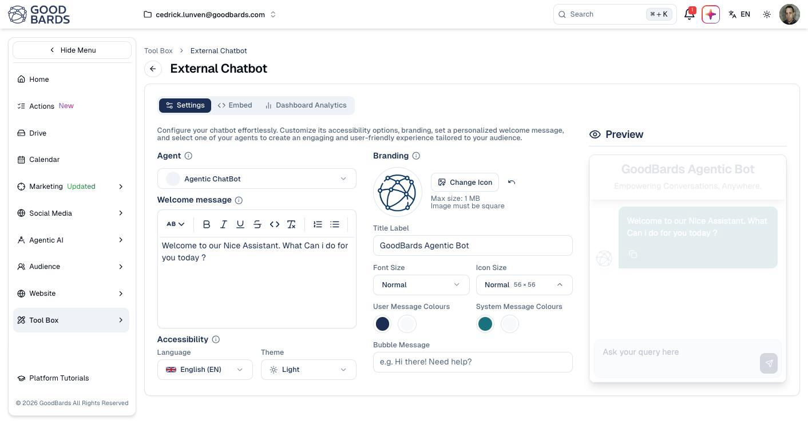

# External Chatbot

Put a GoodBards agent on your own website, to answer visitors' questions around
the clock.

## What it's for

Visitors ask the same questions at all hours — opening times, pricing, whether
you serve their industry. The external chatbot puts one of your
[chat agents](../agentic-ai/chat-agents.md) on your website to answer them, styled
to match your brand.

Because it is one of your agents, it knows your business rather than reciting a
scripted FAQ.

## Before you start

- A chat agent to put on the site. See
  [Chat Agents](../agentic-ai/chat-agents.md).
- Someone who can add a snippet of code to your website.

## How to configure the chatbot

1. In the sidebar, choose **Tool Box → External Chatbot**.
2. On the **Settings** tab, choose which **Agent** answers visitors.
3. Write the **Welcome message** shown when the chat opens.
4. Set the branding — icon, title, colours and sizes.
5. Watch the **Preview** on the right update as you go.

## What you can change

| Setting | What it controls |
| --- | --- |
| **Agent** | Which of your agents answers. |
| **Welcome message** | The greeting when someone opens the chat. |
| **Language** | The interface language of the widget. |
| **Theme** | Light or dark. |
| **Change Icon** | Your logo on the chat bubble. Square, up to 1 MB. |
| **Title Label** | The name at the top of the window. |
| **Font Size** / **Icon Size** | How large the widget appears. |
| **User / System Message Colours** | Colours for visitor and bot messages. |
| **Bubble Message** | The prompt on the closed bubble — for example *Hi there! Need help?* |

!!! tip "The preview is live"
    The panel on the right shows exactly what visitors will see. Check it in both
    light and dark themes before publishing — colour choices that work in one can
    be unreadable in the other.

## Putting it on your website

The **Embed** tab gives you the code to add to your site. Send it to whoever
maintains your website, or paste it in yourself if you manage the site.

## Seeing how it performs

**Dashboard Analytics** shows what visitors have been asking. Worth reviewing
regularly — recurring questions usually mean something is unclear on your website,
and the answer is often to fix the page rather than the bot.

## Good to know

- **Test it before launch.** Ask the questions your customers actually ask and
  check the answers are right.
- **Your agent's knowledge is the bot's knowledge.** If it cannot answer, improve
  the agent or your [Brand & Context](../settings/company-settings.md) rather than
  the widget.
- **Say it is a bot.** Visitors dislike discovering late that they were not
  talking to a person.
- **Keep a route to a human.** Some questions need one — make sure the bot does not
  become a dead end.

---

*Still stuck? [Contact support](../contact.md).*
