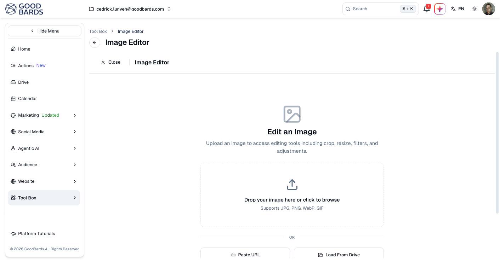

# Image Editor

Crop, resize and adjust images without leaving the platform.

## What it's for

Marketing images rarely arrive the right size. A photo needs cropping for a
banner, a logo needs resizing for an email header, a picture needs brightening
before it goes out.

Small jobs like these do not warrant design software, and the editor handles them
in place — so you are not exporting files back and forth.

## How to edit an image

1. In the sidebar, choose **Tool Box → Image Editor**.
2. Load your image one of three ways:
   - **Drop it** on the upload area, or choose it to browse.
   - **Paste URL** to pull an image from the web.
   - **Load From Drive** to use a file you already hold in
     [Drive](../workspace/drive.md).
3. Use the editing tools — crop, resize, filters and adjustments.
4. Save the result.

## Supported formats

**JPG**, **PNG**, **WebP** and **GIF**.

!!! tip "Load from Drive to keep things tidy"
    If the image is already in Drive, use **Load From Drive** rather than
    downloading and re-uploading it. Fewer copies means less confusion later about
    which version is current.

## Good to know

- **Crop for the destination.** An email header, an Instagram post and a website
  banner all want different shapes. Crop a copy for each rather than compromising
  with one.
- **Resize down, not up.** Making a small image larger makes it blurry; the detail
  is not there to recover.
- **Keep the original.** Save edits as a new file so you can go back if a later
  campaign needs a different crop.

---

*Still stuck? [Contact support](../contact.md).*
