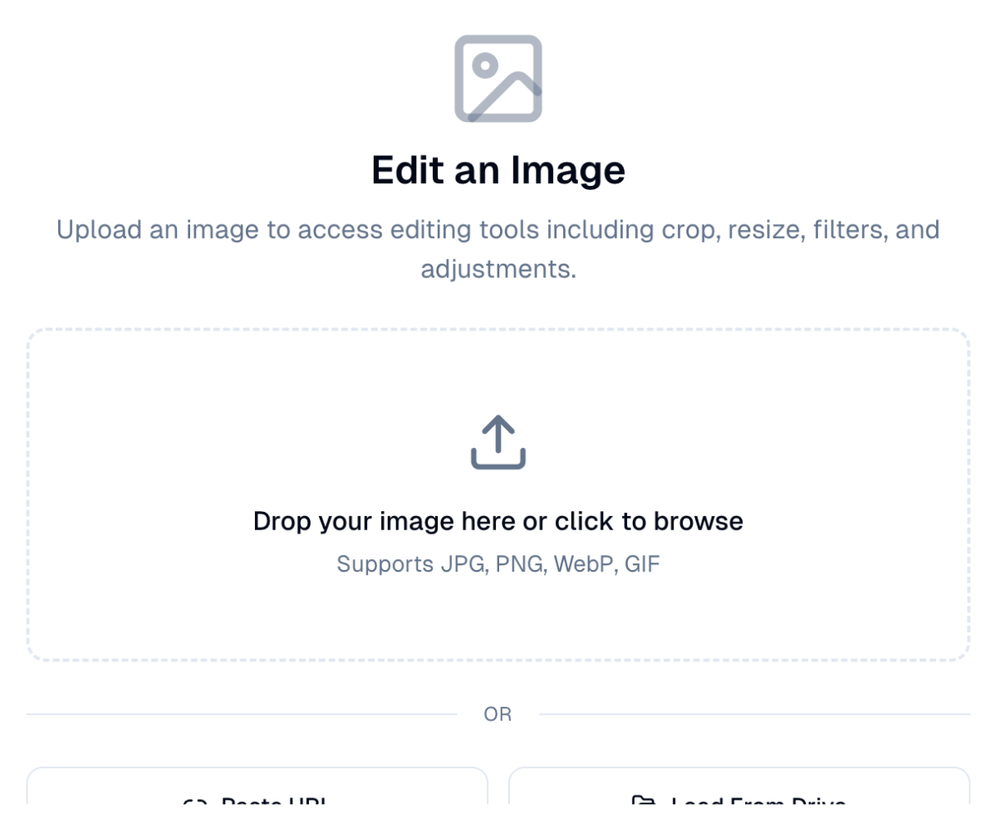

# Image Editor

Crop, resize and adjust images without leaving the platform.

## What it's for

Marketing images rarely arrive the right size. A photo needs cropping for a
banner, a logo needs resizing for an email header, a picture needs brightening
before it goes out.

Small jobs like these do not warrant design software, and the editor handles them
in place, so you are not exporting files back and forth.

## Before you start

- **Your plan.** The Image Editor is included in the **Lite**, **Pro** and
  **Full** plans.

## How to edit an image

1. In the sidebar, choose **Tool Box → Image Editor**.
2. Load your image one of three ways:
   - **Drop it** on the upload area, or choose it to browse.
   - **Paste URL** to pull an image from the web.
   - **Load From Drive** to use a file you already hold in your
     [Content Repository](../workspace/drive.md).
3. Use the editing tools: crop, resize, filters and adjustments.
4. Choose **Save** to keep the result in your Content Repository, or
   **Download** it.

{ width="50%" }

## The editing tabs

Once an image is loaded, the panel on the right has five tabs:

| Tab | What you can do |
| --- | --- |
| **Style** | Filters, and adjustments such as brightness, contrast and saturation. |
| **Transform** | Crop, rotate and zoom. |
| **Resize** | Resize to a preset for each social network, or to your own size. |
| **Logo** | Place your brand kit's logo on the image. See below. |
| **AI** | Describe the change in words, for example *remove the background* or *add a sunset sky*, and the AI edits the image. With no image loaded, it generates one from your description. |

## Adding your logo

Works on any image you load, not only AI-generated ones.

1. Open the **Logo** tab and choose the brand kit.
2. Turn on **Add logo**. The logo appears on the image.
3. Leave the logo on **Auto**, or pick one yourself. **Auto** starts with your
   usual logo and switches to another one from the kit if that one would be hard
   to read on the background.
4. Choose a **Position** and **Size**, or drag the logo anywhere on the image.
   You can also move it with the arrow keys.
5. Choose **Apply Logo**.

!!! note "Apply the logo before you save"
    Save and download are off while you place the logo, so choose **Apply Logo**
    or **Cancel** first. Once applied, **Undo** removes it.

!!! tip "Add the logo last"
    Filters and rotations are applied when you download, so they would change the
    logo too. Finish those first.

If an amber message says the logo may be hard to read, try another position or
logo. Adding a lighter or darker version to your
[brand kit](../settings/brand-kit.md) gives **Auto** more to choose from.

If you open an image from Image Generation that already has your logo, the tab
warns you, so you don't end up with two logos.

## Supported formats

**JPG**, **PNG**, **WebP** and **GIF**.

!!! tip "Load from Drive to keep things tidy"
    If the image is already in your Content Repository, use **Load From Drive**
    rather than downloading and re-uploading it. Fewer copies means less confusion later about
    which version is current.

## Good to know

- **Crop for the destination.** An email header, an Instagram post and a website
  banner all want different shapes. Crop a copy for each rather than compromising
  with one.
- **Resize down, not up.** Making a small image larger makes it blurry; the detail
  is not there to recover.
- **Keep the original.** Save edits as a new file so you can go back if a later
  campaign needs a different crop.

---

*Still stuck? [Contact support](../contact.md).*
