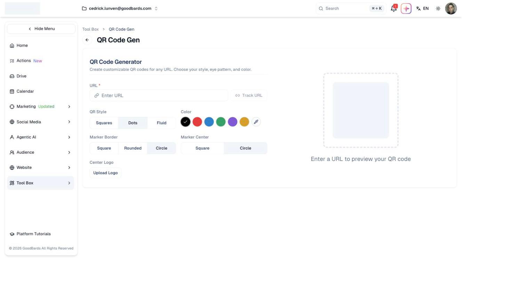

# QR Code Generator

Create QR codes for print, packaging and events — styled to match your brand.

## What it's for

A QR code turns a printed thing into a link: a poster into a sign-up page, a
business card into your website, a table tent into a feedback form. This tool
makes them without a third-party site, and can track how often each one is
scanned.

## How to generate a QR code

1. In the sidebar, choose **Tool Box → QR Code Generator**.
2. Enter the destination in **URL**. The preview appears once the URL is valid.
3. Style it to match your brand using the options below.
4. Download the finished code.

## Styling options

| Option | Choices |
| --- | --- |
| **QR Style** | Squares, Dots, Fluid — how the code's dots are drawn. |
| **Color** | A set of preset colours, or the picker for your own. |
| **Marker Border** | Square, Rounded, Circle — the outer shape of the three corner markers. |
| **Marker Center** | Square, Circle — the inner shape of those markers. |
| **Center Logo** | **Upload Logo** places your logo in the middle. |

!!! warning "Test before you print"
    Heavy styling can make a code harder to scan — pale colours, a large centre
    logo, or the Fluid style on a small print size. Always scan the finished code
    with a real phone before sending anything to print.

## Tracking scans

**Track URL** beside the URL field turns the code into a tracked link, so you can
see how many people scanned it. This uses the
[URL Shortener](url-shortener.md) behind the scenes.

Worth doing whenever the QR code goes somewhere you cannot otherwise measure —
a printed flyer, a conference banner, product packaging.

## Good to know

- **The code points at a URL, not a file.** If the destination page moves, the
  printed code breaks. Use a tracked link so you can repoint it later.
- **Contrast matters.** Dark code on a light background scans most reliably.
- **Size for the distance.** A code on a poster read from across a room needs to
  be far larger than one on a business card.

---

*Still stuck? [Contact support](../contact.md).*
