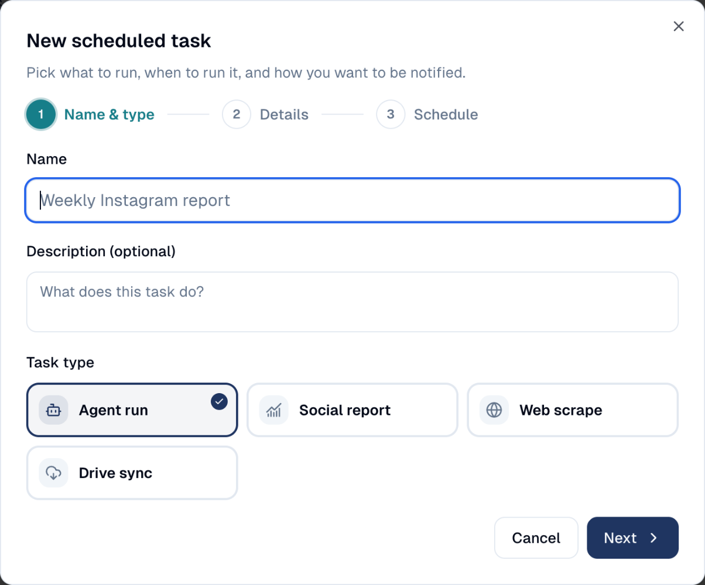

# Scheduler

Run recurring work on a schedule: an AI agent's report every Monday, a social
report every month, a web page checked every morning.

## What it's for

Some work is the same every week: summarise last week's results, check a
competitor's page, collect the social figures for a client. The Scheduler does
it for you at the time you choose, and sends you the result by email or saves it
in your Content Repository.

## How to schedule a task

1. In the sidebar, choose **Tool Box → Scheduler**, then **New Task**.
2. Give the task a **Name** and, if you like, a **Description**, then pick the
   **Task type**:

    

    | Task type | What it does |
    | --- | --- |
    | **Agent run** | Asks one of your AI agents a question, for example *"Summarise last week's campaign results"*. |
    | **Social report** | Builds the period report of one of your social accounts. |
    | **Web scrape** | Reads a web page, for example a competitor's pricing page. |
    | **Drive sync** | Brings files from a connected storage into your Content Repository. |

3. Choose **Next**, then fill in the **Details**: which agent and what to ask,
   which social account, which page. For an agent run, choose where the answer
   goes: an **email** to you or your colleagues, a document in your **Content
   Repository**, or both.
4. Choose **Next**, then set the **Schedule**: how often and at what time.
5. Save. The task appears in the list with its next run; open it to see the
   history of its runs.

## Good to know

- **A task runs as the person who created it**, with that person's access. An
  administrator can choose to run it as another member.
- **If the delivery fails, the run still counts.** For example, the agent answers
  but the email cannot be sent: the history shows the run in amber with the
  reason.
- **A scheduled agent does not act on its own.** When it runs unattended, it will
  not send a campaign email or publish content; it can prepare them for you.

---

*Still stuck? [Contact support](../contact.md).*
