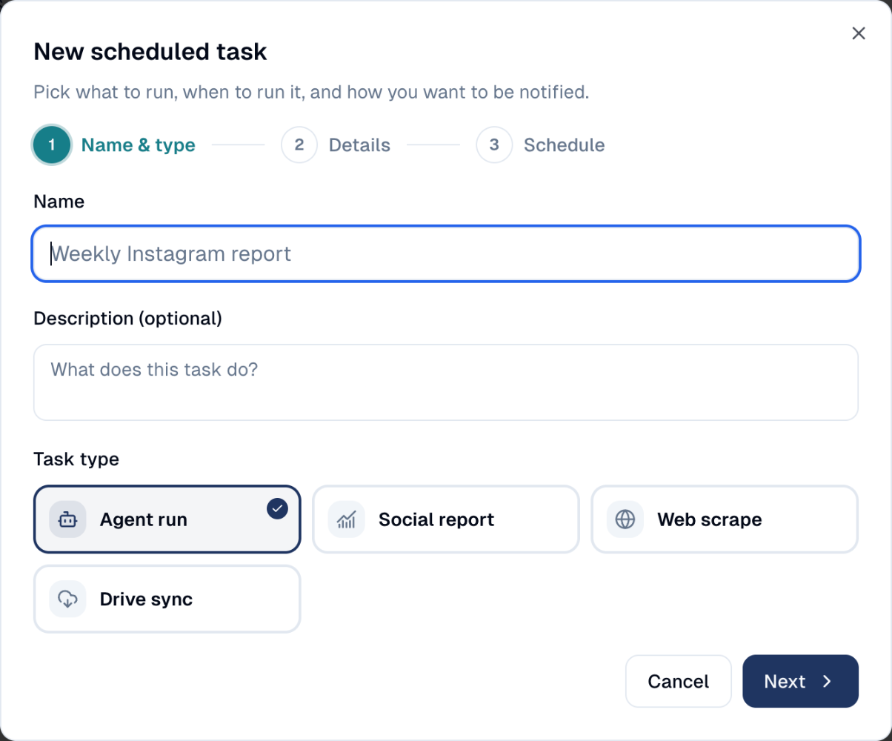

# Scheduler

Run recurring work on a schedule: an AI agent's report every Monday, a social
report every month, a web page checked every morning.

## What it's for

Some work is the same every week: summarise last week's results, check a
competitor's page, collect the social figures for a client. The Scheduler does
it for you at the time you choose, and sends you the result by email or saves it
in your Content Repository.

## Before you start

- **Your plan.** The Scheduler is included in the **Pro** and **Full** plans.
- **What the task needs.** An agent for an agent run, a connected social
  account for a social report, a connected Google Drive for a Drive sync. See
  [Connections](../settings/connections.md).

## How to schedule a task

1. In the sidebar, choose **Tool Box → Scheduler**, then **New Task**.
2. Give the task a **Name** and, if you like, a **Description**, then pick the
   **Task type**:

    { width="65%" }

    | Task type | What it does |
    | --- | --- |
    | **Agent run** | Asks one of your AI agents, chat or workflow, a question, for example *"Summarise last week's campaign results"*. |
    | **Social report** | Builds the period report of one of your social accounts. |
    | **Web scrape** | Scrapes a page, crawls a website or reads a feed into your Content Repository, for example a competitor's pricing page. |
    | **Drive sync** | Keeps a Google Drive folder in sync with your Content Repository. |

3. Choose **Next**, then fill in the **Details**: which agent and what to ask,
   which social account, which page. For an agent run, choose where the answer
   goes: an **email** to you or your colleagues, a document in your **Content
   Repository**, or both.
4. Choose **Next**, then set the **Schedule**: how often and at what time.
5. Choose **Create Task**. The task appears in the list with its schedule.

From the task's menu, **Run now** starts it straight away, **History** shows
its past runs, and **Edit** or **Delete** change or remove it.

!!! warning "Deleting a task also deletes its history"
    The task and its run history are removed, and this cannot be undone. To
    pause a task instead, turn off **Enabled**.

## Good to know

!!! info "A scheduled agent does not act on its own"
    When it runs unattended, it will not send a campaign email or publish
    content; it can prepare them for you.

- **A task runs as the person who created it**, with that person's access. An
  administrator can choose someone else under **Run as**.
- **If the delivery fails, the run still counts.** For example, the agent answers
  but the email cannot be sent: the history shows the run in amber with the
  reason.

---

*Still stuck? [Contact support](../contact.md).*
