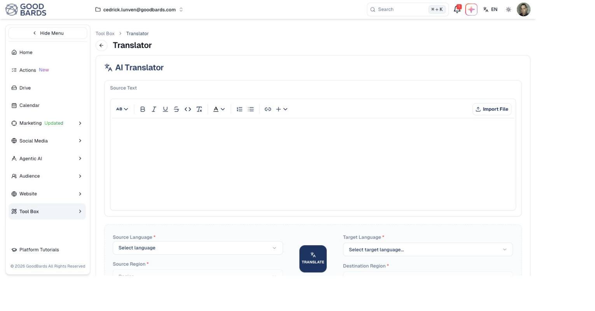

# Translator

Translate marketing copy between the languages your markets speak, keeping the
formatting intact.

## What it's for

Southeast Asia is not one audience. The same campaign may need English in
Singapore, Bahasa in Indonesia and Chinese in Taiwan — and a translation that
reads naturally in each.

The Translator works on formatted text, so headings, bold, lists and links
survive. You can paste copy in or import a file.

## How to translate content

1. In the sidebar, choose **Tool Box → Translator**.
2. Put your copy into **Source Text** — type it, paste it, or use **Import File**.
3. Set **Source Language** and **Source Region**.
4. Set **Target Language** and **Destination Region**.
5. Choose **TRANSLATE**.

## Why region matters as well as language

The tool asks for a **region** alongside each language, and the pairing changes
the result. Chinese for Singapore is not Chinese for Taiwan; English for Malaysia
carries different conventions from English for the United States.

Setting both means you get copy that reads as though it were written locally,
rather than a literal translation.

!!! tip "Formatting is preserved"
    Because the source box is a full editor, bold, headings, lists and links come
    through the translation. Format your copy before translating rather than
    reformatting afterwards.

## Good to know

- **Have a native speaker check anything important.** AI translation is strong on
  fluency but can miss tone, idiom and cultural nuance — exactly the things that
  matter in marketing copy.
- **Translate the finished copy.** Translating a draft you go on to edit means
  doing the work twice.
- **Watch length.** Translated text often runs longer or shorter than the
  original, which can break a layout — check email and ad designs after
  translating.

---

*Still stuck? [Contact support](../contact.md).*
