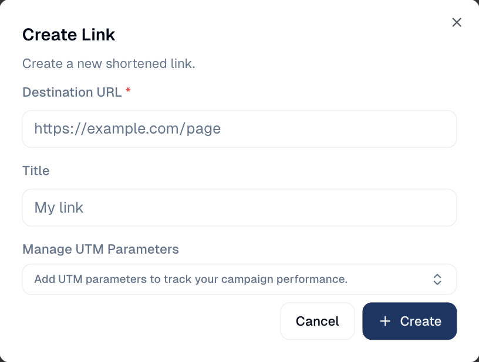
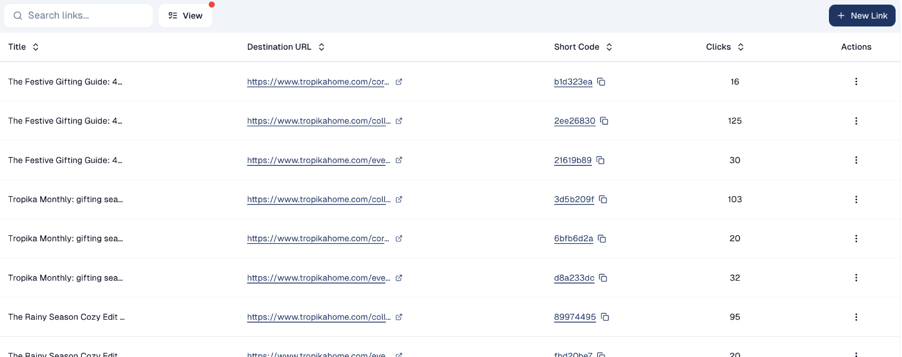
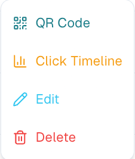

# URL Shortener

Turn long links into short ones, and see how often each is clicked.

## What it's for

Two reasons to shorten a link. It looks tidier in a social post, an SMS or on
print. More usefully, a shortened link is a **tracked** link: you can see how
many people clicked, which tells you whether a channel is working.

## How to shorten a link

1. In the sidebar, choose **Tool Box → URL Shortener**.
2. Choose **+ New Link**.
3. Paste the address under **Destination URL** and give the link a **Title**.
4. Optionally, open **Manage UTM Parameters** to tag the campaign, source and
   medium. **Final URL Preview** shows the result.

    { width="40%" }

5. Choose **Create**, then copy the short link and use it wherever you need.

Every link you create appears in the list with its short code and click count.
Choose the copy icon next to a **Short Code** to copy the link.

## Finding a link later

Use **Search links...** to find one by name or destination, and **View** to
change which columns are shown.

## A link's menu

The menu at the end of each row offers:

{ width="20%" }

- **QR Code**: a QR code for the short link, to print on a flyer or in a store.
- **Click Timeline**: the link's clicks day by day.
- **Edit**: change the title, the destination or the UTM tags. The short code
  stays the same, so links already shared keep working.
- **Delete**.

!!! warning "Deleting a link breaks it everywhere"
    Once printed or posted, a short link cannot be taken back. Delete one only
    when it is no longer in circulation; to send people elsewhere, **Edit** its
    destination instead.

## Where shortened links are used

Beyond links you create by hand, the shortener is used elsewhere in the platform:

- The [QR Code Generator](qr-code-gen.md) uses it when you enable **Track URL**.
- Links in emails can be tracked the same way, which is what click reporting is
  built on.

## Good to know

- **Name links so you recognise them.** *Q4 flyer, Orchard Road* beats a row of
  identical-looking codes.
- **One link per placement.** Using a separate link for the flyer and the poster
  tells you which one worked. Reusing one link for both tells you nothing.

---

*Still stuck? [Contact support](../contact.md).*
