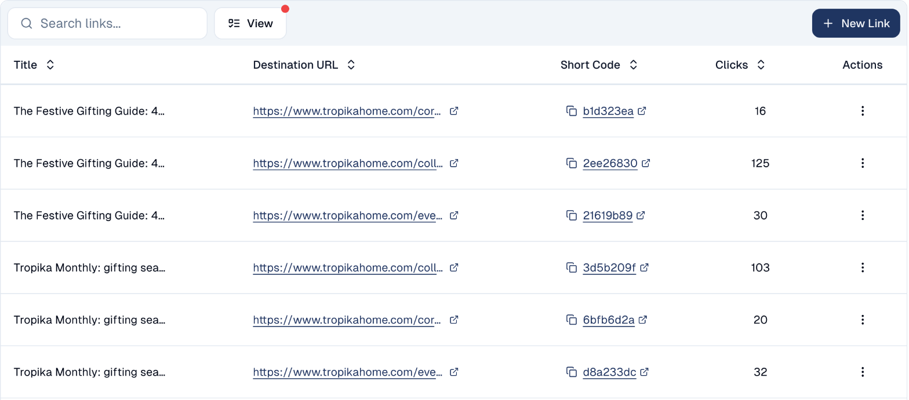

# URL Shortener

Turn long links into short ones, and see how often each is clicked.

## What it's for

Two reasons to shorten a link. It looks tidier in a social post, an SMS or on
print. More usefully, a shortened link is a **tracked** link — you can see how
many people clicked, which tells you whether a channel is working.

## How to shorten a link

1. In the sidebar, choose **Tool Box → URL Shortener**.
2. Choose **+ New Link**.
3. Paste the destination URL and save.
4. Copy the short link and use it wherever you need.

Before you create your first link, the list is empty — as above. Every link you
create appears here with its click count.

## Finding a link later

Use **Search links…** to find one by name or destination, and **View** to change
which columns are shown.

## A link's menu

The menu at the end of each row offers:

- **QR code**: a QR code for the short link, to print on a flyer or in a store.
- **Click timeline**: the link's clicks day by day.
- **Edit**: change the title, the destination or the UTM tags. The short code
  stays the same, so links already shared keep working.
- **Delete**.

## Where shortened links are used

Beyond links you create by hand, the shortener is used elsewhere in the platform:

- The [QR Code Generator](qr-code-gen.md) uses it when you enable **Track URL**.
- Links in emails can be tracked the same way, which is what click reporting is
  built on.

## Good to know

- **Shortened links are permanent-ish.** Once printed or posted, you cannot take
  them back — so do not delete a link that is still in circulation.
- **Name links so you recognise them.** `Q4 flyer — Orchard Road` beats a row of
  identical-looking codes.
- **One link per placement.** Using a separate link for the flyer and the poster
  tells you which one worked. Reusing one link for both tells you nothing.

---

*Still stuck? [Contact support](../contact.md).*
