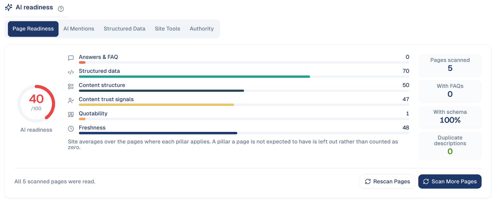

# AI Readiness & Authority

Whether AI assistants such as ChatGPT, Gemini or Perplexity can read, trust and
quote your pages, and how often they mention you.

## What it's for

More and more people ask an AI assistant instead of searching. The assistant
quotes pages that answer clearly, show who wrote them, use structured data and
stay up to date. This screen scores your pages on those points and tells you
what to fix first.

## How to read it

1. In the sidebar, choose **Organic Visibility → AI Readiness & Authority**.
2. The **Page Readiness** tab gives the overall score out of 100 and one score
   per pillar.

| Pillar | What it checks |
| --- | --- |
| **Answers & FAQ** | Questions answered plainly on the page. |
| **Structured data** | Schema markup that tells machines what the page is. |
| **Content structure** | Clear headings, lists and short sections. |
| **Content trust signals** | Author, sources, dates, contact details. |
| **Quotability** | Sentences an assistant can quote as they are. |
| **Freshness** | How recently the page was updated. |

3. Under **Recommendations**, work through the items in order; each one can go
   to the Action Queue.

**Scan More Pages** adds pages to the scan; **Rescan Pages** updates the scores
after you changed them.

## The tabs

| Tab | What it shows |
| --- | --- |
| **Page Readiness** | The scores above. |
| **AI Mentions** | Whether AI assistants mention your brand. |
| **Structured Data** | The schema markup on your pages. |
| **Site Tools** | Site-wide checks and tools for AI crawlers. |
| **Authority** | Who finds you by name and who finds you without knowing you, and the trust signals (experience, expertise, authority) you assess yourself. |

## Good to know

- **A pillar that does not apply is left out**, not counted as zero. A contact
  page is not expected to have an FAQ.
- **Start with Answers & FAQ.** It is usually the lowest score and the fastest to
  raise: add the questions your customers really ask, with short answers.

---

*Still stuck? [Contact support](../contact.md).*
