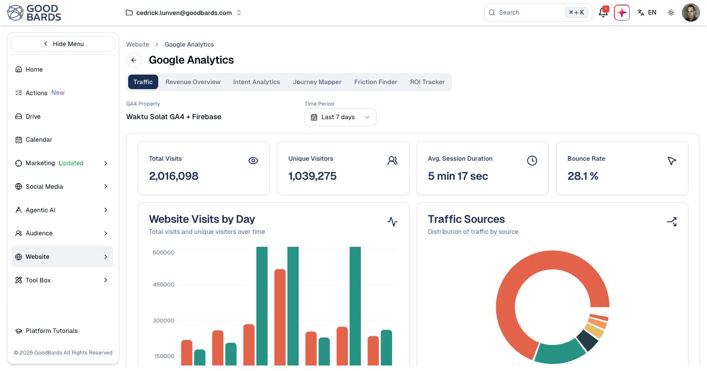

# Google Analytics

See how many people visit your website, where they come from, and what they do
when they arrive.

## What it's for

Your website is usually where marketing ends up — the click from an email, the
link in a social post, the QR code on a flyer. Google Analytics tells you whether
any of it worked.

Bringing it into GoodBards means you can read your traffic beside your campaigns,
rather than switching to a separate tool.

## Before you start

You need Google Analytics connected, and a **GA4 property** chosen. If this page
tells you that you are not connected, start at
[Connections](../settings/connections.md).

## How to read your traffic report

1. In the sidebar, choose **Website → Google Analytics**.
2. Check the **GA4 Property** shown — this is the website being reported on.
3. Pick a **Time Period**, such as *Last 7 days*.

!!! note "Give it a moment"
    This page pulls live data from Google and can take several seconds to fill in.
    Empty charts usually mean it is still loading, not that there is no data.

## The four headline numbers

| Metric | What it means | What to watch for |
| --- | --- | --- |
| **Total Visits** | Every visit, including repeat visits by the same person. | Sudden drops usually mean a technical problem. |
| **Unique Visitors** | How many different people visited. | The gap between this and total visits shows how often people return. |
| **Avg. Session Duration** | How long a visit lasts. | Very short sessions suggest visitors are not finding what they expected. |
| **Bounce Rate** | The share who left without going any further. | High bounce on a campaign landing page means the page is not matching the promise that brought them there. |

## The charts

**Website Visits by Day** plots visits and unique visitors over time. Use it to
check whether a campaign moved the numbers — look for the lift on the days you
published.

**Traffic Sources** breaks visits down by where they came from: search, social,
direct, referral. This is the chart that tells you which channel is actually
delivering.

## The other tabs

| Tab | What it shows |
| --- | --- |
| **Traffic** | Visits, visitors and sources, as above. |
| **Revenue Overview** | Revenue attributed to your website. |
| **Intent Analytics** | What visitors appear to be looking for. |
| **Journey Mapper** | The paths visitors take through your site. |
| **Friction Finder** | Where visitors get stuck or drop out. |
| **ROI Tracker** | Return on your marketing spend. |

**Friction Finder** and **Journey Mapper** are the two worth returning to. Traffic
tells you how many arrived; these tell you why they left.

## Good to know

- **Check the property.** If the figures look wrong, confirm the **GA4 Property**
  is the site you meant — an account can hold several.
- **Compare like with like.** Traffic has weekly rhythms, so compare a week with a
  week rather than a weekend with a Tuesday.
- **Analytics data lags slightly.** Today's numbers may still be settling; judge
  campaigns after a few days.

---

*Still stuck? [Contact support](../contact.md).*
