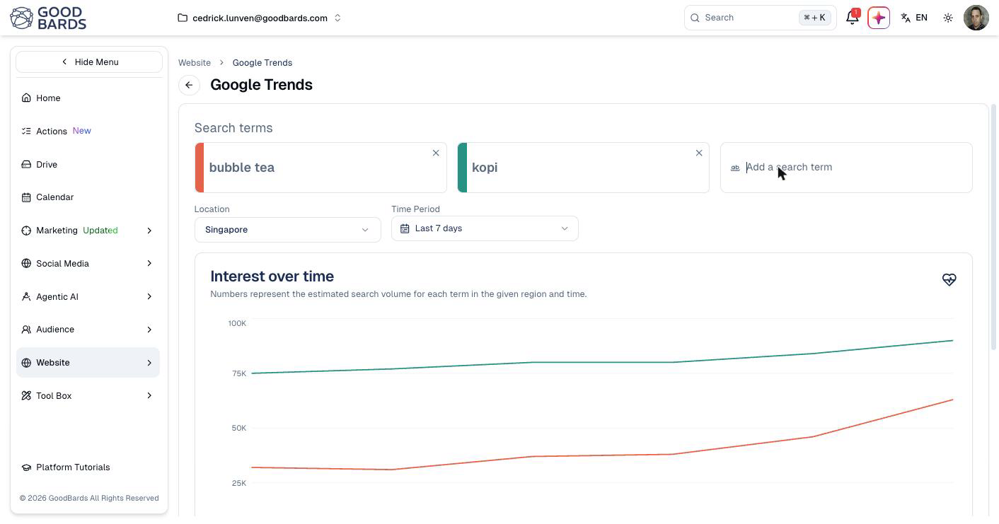

# Google Trends

See what your market is searching for, when interest peaks, and how two ideas
compare.

## What it's for

Before committing to a campaign it helps to know whether anyone is looking for
what you are about to promote. Google Trends shows search interest over time, so
you can spot a rising topic, catch a seasonal peak while it is still climbing, or
settle an argument about which of two product names people actually search for.

## Before you start

Google Trends must be connected. If the page says you are not connected, go to
[Connections](../settings/connections.md).

## How to compare search interest

1. In the sidebar, choose **Organic Visibility → Google Trends**.
2. Type a term into **Add a search term** and press ++enter++.
3. Add a second term to compare against the first.
4. Set **Location** and **Time Period**.

Each term gets its own colour, matching its line on the chart. Remove one with
the **×** on its card.

## Reading the chart

**Interest over time** plots each term across the period. Hover any point to see
the figures for that day.

!!! note "One term and two terms are measured differently"
    With a single term, the numbers are *relative* — 100 is that term's own peak
    for the period, not an absolute count. Add a second term and the chart shows
    *estimated search volume* instead, which is what makes comparison meaningful.

The shape matters more than the numbers. A line climbing steadily is a topic
worth being early on; a sharp spike that falls away is a moment that has passed.

## Breakdown by location

Below the chart, **Breakdown by location** shows where your terms were most
popular, sorted by whichever term you choose.

!!! warning "No sub-region data for Singapore"
    Google does not provide a sub-region breakdown for every location. For
    Singapore it returns nothing — the section tells you to pick another location
    or Worldwide. This is a limitation of Google's data, not a fault in GoodBards.

## Choosing a location

**Location** sets the market you are looking at, and it changes the answer
completely. A term that is rising in Singapore may be flat in Indonesia. If you
market across Southeast Asia, check each market separately rather than assuming
one stands for the others.

## Good to know

- **Compare like with like.** Two terms on one chart is more useful than one term
  in isolation, because it gives you a sense of scale.
- **Interest is not intent.** People searching a term are not necessarily ready to
  buy — pair this with your own [analytics](google-analytics.md).
- **Watch for seasonality.** Widen the time period before concluding a rise is
  new; it may be the same peak that happens every year.
- **Recent days may be incomplete.** Google's most recent figures are still
  settling, so treat the last point on the chart with caution.

---

*Still stuck? [Contact support](../contact.md).*
