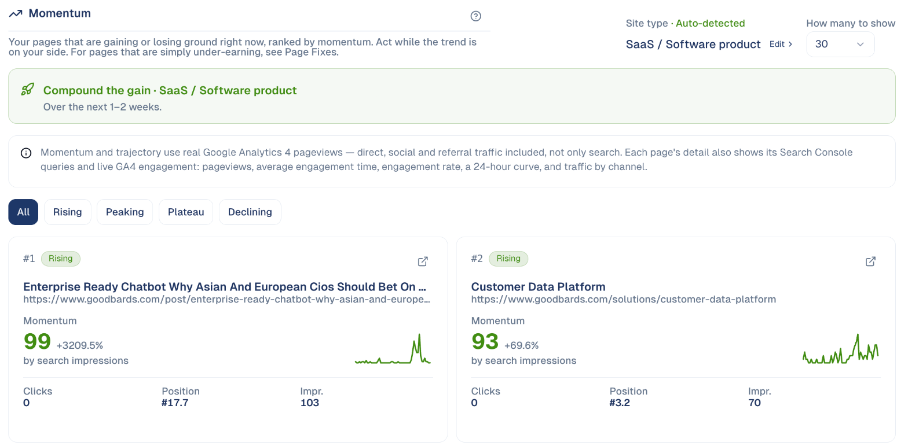

# Momentum

Your pages that are gaining or losing ground right now, so you can act while the
trend is on your side.

## What it's for

A page that suddenly gets more attention is worth a push now, not next quarter:
a link from your newsletter, a social post, an update. A page that is losing
ground needs a look before it disappears. Momentum ranks your pages by how fast
they are moving.

## Before you start

- **Google Search Console** and **Google Analytics** connected under
  **Connections**.

## How to read it

1. In the sidebar, choose **Content Hub → Momentum**.
2. Filter by stage: **Rising**, **Peaking**, **Plateau** or **Declining**.

Each card shows the page, its momentum score out of 100 with the change, the
trend line, and its clicks, position and impressions. Open a card for the search
queries behind it and the visitors' engagement.

## Good to know

- **Momentum counts all visits**, from search, social, email and other sites, not
  only Google search.
- **The advice at the top depends on your site type**, detected automatically;
  choose **Edit** to correct it.
- **For pages that rank but under-perform**, use
  [Page Fixes](page-fixes.md) instead.

---

*Still stuck? [Contact support](../contact.md).*
