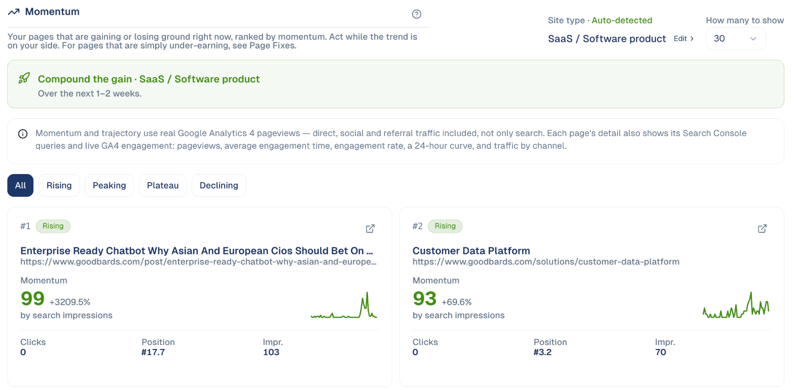

# Momentum

Your pages that are gaining or losing ground right now, so you can act while the
trend is on your side.

## What it's for

A page that suddenly gets more attention is worth a push now, not next quarter:
a link from your newsletter, a social post, an update. A page that is losing
ground needs a look before it disappears. Momentum ranks your pages by how fast
they are moving.

## Before you start

- **Google Search Console** and **Google Analytics** connected under
  **Connections**.

## How to read it

1. In the sidebar, choose **Content Hub → Momentum**.
2. Filter by stage: **Rising**, **Peaking**, **Plateau** or **Declining**.

Each card shows the page, its momentum score out of 100 with the change, the
trend line, and its clicks, position and impressions. Open a card for the search
queries behind it and the visitors' engagement.

## Write a follow-up article

For a **Rising** or **Peaking** page, the AI can suggest follow-up articles built
on what people are searching for more and more on that page. It reads the page
first, so the articles stay on the page's subject.

1. Open the page's card.
2. Under **Next logical development**, choose **Suggest articles**.
3. Each suggestion shows a working title, why it is worth writing, and the
   **rising searches** it is built on.
4. Choose **Create** to open the article writer with the title, the suggestion's
   description (under **Instructions for the AI**, where you can edit it), the
   searches as keywords and your page as source material already filled in.
   Check the brief, then choose **Generate**. Credits are used only from that
   point.
   Or choose **Add to Action Queue** to write it later.

The suggestions stay on the page until you choose **Suggest again**.

## Good to know

- **Rising searches come from your own Search Console**: the searches this page
  gained over the last 28 days compared with the 28 days before. For a
  **News / Media** site the comparison is over 7 days, because news searches rise
  and fall within days. Check your site type under
  **Settings → Company → Brand Context → Website**.
- **The last 3 days are not counted yet.** Google Search Console publishes its
  figures about 3 days late, so a search that took off yesterday shows up in
  Momentum a few days later.
- **Searches for your company name are left out**, because an article about your
  own name rarely brings new readers. Make sure your company name is filled in
  under **Settings → Company → Brand Context**.
- **No suggestions?** If no search is growing on the page, there is nothing to
  build a follow-up on, and Momentum says so instead of guessing. The same
  happens when the growing searches mean something else than the page: a page
  about AI tools for founders can show up for "ai startup accelerator", which
  people mostly use for accelerator programmes.
- **Low confidence** means the growing searches add up to fewer than 50
  impressions. Treat those suggestions as ideas to check, not a plan.
- **Fill in your company description** under **Settings → Company → Brand
  Context**. Without it the AI only knows what the page says, and Momentum
  reminds you next to the suggestions.
- **The page could not be read?** If your site blocks it (robots.txt) or does
  not answer, the suggestions are built on the searches alone, and Momentum
  says so.
- **Plateau and Declining pages** get **Add refresh task** instead: a page that
  is losing ground needs an update, not a new article next to it.
- **Create** needs the article writer (Content Workspace) in your plan.

- **Momentum counts all visits**, from search, social, email and other sites, not
  only Google search.
- **The advice at the top depends on your site type**, detected automatically;
  choose **Edit** to correct it.
- **For pages that rank but under-perform**, use
  [Page Fixes](page-fixes.md) instead.

---

*Still stuck? [Contact support](../contact.md).*
