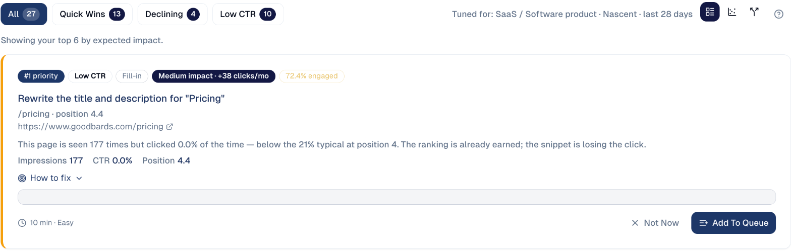
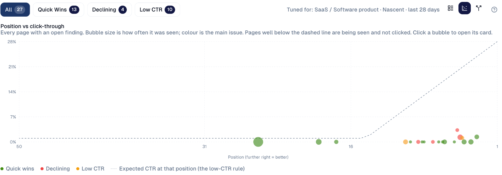
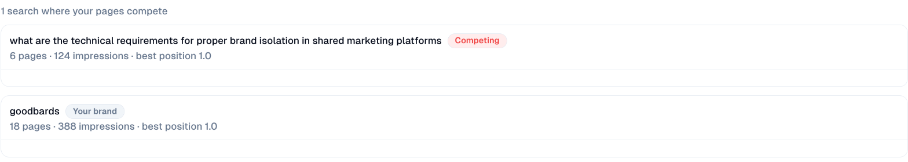

# Page Fixes

The pages worth fixing first, ranked by the clicks the fix could bring, each
with what to change.

## What it's for

Most sites have a few pages that already rank but lose the click, or that are
close to the first page. Fixing those is the quickest search win there is. Page
Fixes finds them in your Search Console data and puts the biggest ones first.

## Before you start

- **Google Search Console** connected under **Connections**.

## How to use it

1. In the sidebar, choose **Organic Visibility → Page Fixes**.
2. Pick a filter at the top:

    | Filter | The pages it shows |
    | --- | --- |
    | **Quick Wins** | Pages just below the top results, where a small push moves them up. |
    | **Declining** | Pages losing traffic. |
    | **Low CTR** | Pages people see but rarely click. |

3. Read the first card: the page, why it is listed, its impressions, click rate
   and position, and the expected impact.

    

4. Open **How to fix** for the steps, then choose **Add To Queue** to put the work
   in [Actions](../workspace/actions.md), or **Not Now** to set it aside.

## Three ways to look

The three icons at the top right switch the view:

- **List**: the cards above, ranked by expected impact.
- **Chart**: every page with an open finding, by position (further right is
  better) and click rate. Bubble size is how often the page was seen, colour is
  its main issue. Pages well below the dashed line are seen but not clicked.
  Click a bubble to open its card.

    

- **Competing pages**: searches where several of your own pages compete for the
  same query, so neither ranks as well as one would. Searches on your brand name
  are marked **Your brand**: competing there is normal.

    

## Good to know

- **The ranking is tuned to your business.** The line at the top right, such as
  *SaaS / Software product*, shows the site type used to judge what is normal.
- **Low CTR fixes are cheap.** A better title and description take minutes and
  need no new content.
- **Check the result after a few weeks.** Search Console needs time to show the
  effect; **Performance & Report → Impact** shows it.

---

*Still stuck? [Contact support](../contact.md).*
