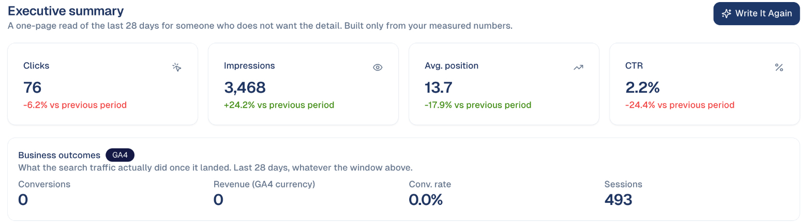
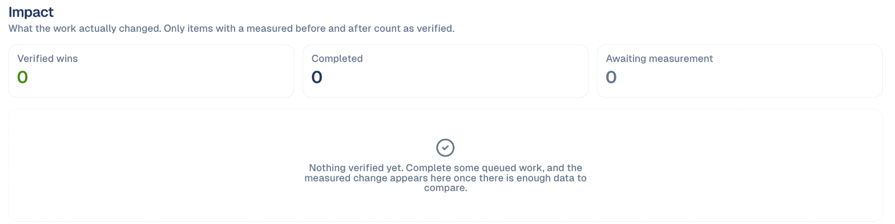

# Performance & Report

How your site does in Google search: clicks, impressions, position and click
rate, the trend, and a one-page report to share.

## What it's for

Search traffic moves slowly and in waves, so a single day says little. This
screen shows the period against the one before, the trend line with a short
forecast, and the patterns worth knowing about, such as a week below average.

## Before you start

- **Google Search Console** connected under **Connections**, for your website.
- For the business results (conversions, sessions), **Google Analytics** too.

## How to read it

1. In the sidebar, choose **Organic Visibility → Performance & Report**.
2. Pick the period at the top right, for example **Last 28 days**.

| Figure | What it means |
| --- | --- |
| **Clicks** | Visits from Google search results. |
| **Impressions** | How often your pages appeared in results. |
| **Avg. position** | Where you appear on average; lower is better (1 is the top). |
| **CTR** | Clicks divided by impressions. |

Under the trend, **Patterns detected** points out runs of days above or below
average.

## The tabs

| Tab | What it shows |
| --- | --- |
| **Overview** | The figures above and the trend. |
| **Executive Report** | A one-page read for someone who does not want the detail, with business outcomes from Google Analytics and a written summary. |
| **Impact** | What your work actually changed. Only items with a measured before and after count as verified. |
| **Signals** | Patterns in your figures that are unlikely to be chance. Most weeks have none, and that is a result too. |
| **Site Health & Settings** | Your site's type and language, which tune what the screens show and the advice they give. |
| **Diagnostics** | Which site and analytics property the screens read, and whether each Google connection works. Check it when a screen looks empty. |

**Write It Again** rewrites the summary for your manager from the latest
numbers.

### Impact: did the work pay off?

Every fix you complete from **Actions** is measured: the page's figures before
the change against after. **Verified wins** are fixes with a measured
improvement; **Awaiting measurement** are fixes too recent to judge yet.

## Good to know

- **Position going down is good news.** A drop from 17.5 to 13.7 means you moved
  up the results.
- **Impressions up, clicks flat** usually means you rank for more searches but
  the titles do not make people click. See [Page Fixes](page-fixes.md).
- **Search Console data is two to three days behind.** The last days of the
  period are not complete yet.

---

*Still stuck? [Contact support](../contact.md).*
