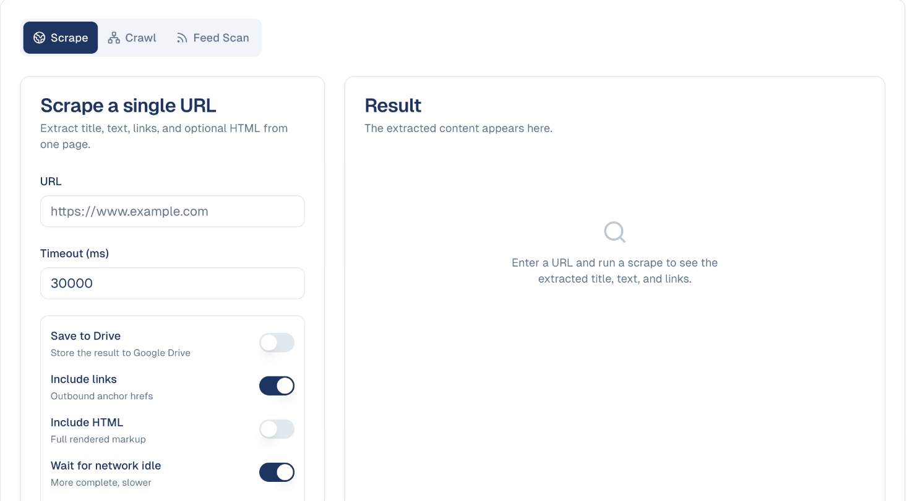

# Web Scraping

Pull the content of a web page into GoodBards so you can work with it.

## What it's for

Sometimes the information you need is on a page rather than in a file — a
competitor's pricing, a partner's announcement, an article you want summarised.
Scraping extracts the text so an agent can read it or you can store it.

Three ways to gather content, on the tabs across the top:

| Tab | What it does |
| --- | --- |
| **Scrape** | One page, once. |
| **Crawl** | Follows links to gather several pages. |
| **Feed Scan** | Watches an RSS feed for new items. |

## How to scrape a page

1. In the sidebar, choose **Tool Box → Web Scraping**.
2. On the **Scrape** tab, paste the address into **URL**.
3. Adjust the options if you need to.
4. Run the scrape. The text appears under **Result**.

## The options

| Option | What it does | When to change it |
| --- | --- | --- |
| **Timeout (ms)** | How long to wait before giving up. Defaults to 30,000 (30 seconds). | Raise it for slow sites. |
| **Save to Drive** | Stores the result as a file. | When you want to keep it rather than read it once. |
| **Include links** | Captures outbound links as well as text. | On by default; useful for finding related pages. |
| **Include HTML** | Returns the full markup, not just the text. | Rarely needed — the text is usually what you want. |
| **Wait for network idle** | Waits for the page to finish loading. | On by default. More complete, but slower. |
| **Force refresh** | Fetches again rather than reusing a cached copy. | When checking a page you know has just changed. |

!!! tip "Leave the defaults alone to start"
    The default settings work for most pages. If a scrape comes back empty or
    incomplete, raise the timeout first — slow-loading pages are the usual cause.

## Crawling a whole site

On the **Crawl** tab, give a **Start URL**: GoodBards follows the links from that
page, up to a **Max depth** (how many clicks away) and **Max pages**. Keep
**Same domain only** on to stay on that website. Choose **Start Crawl**; a crawl
runs in the background and can take several minutes. **Crawl jobs** lists your
crawls, newest first; expand a finished one to see its pages.

## Following a news feed

On the **Feed Scan** tab, give an RSS or Atom feed (or a page that has one) and
how many entries to read, then **Start Feed Scan**. With **Save to Drive** on,
each entry is saved in your Content Repository, so your agents can use it. Use it
to follow an industry blog or a competitor's news.

## Good to know

- **Some sites cannot be scraped.** Pages behind a login, or ones that block
  automated access, will not return content.
- **Scrape responsibly.** Check the site's terms before pulling content
  repeatedly, and do not republish what you collect as your own.
- **Content is a snapshot.** A scrape captures the page as it was at that moment;
  re-run it if you need current information.
- **Text, not layout.** Extraction gives you the words. Design, images and
  formatting are not preserved.

---

*Still stuck? [Contact support](../contact.md).*
