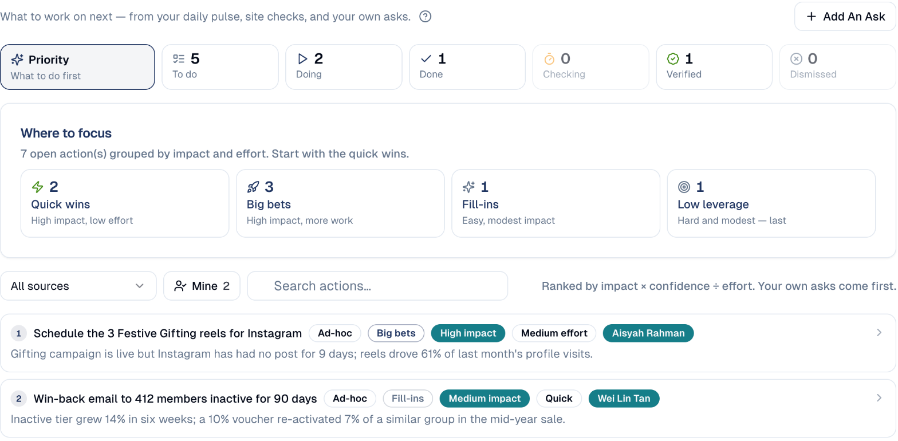
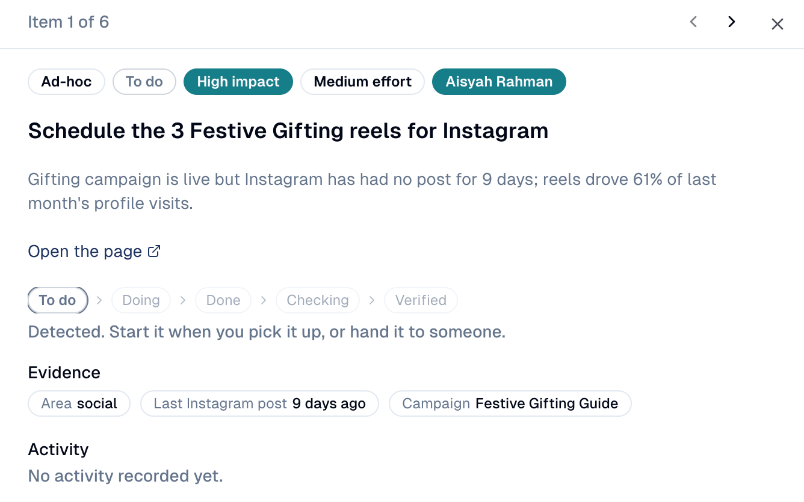

# Actions

Your to-do list: what is worth doing next, ranked, with the evidence behind
each item.

## What it's for

Reports tell you what happened; Actions tells you what to do about it. Each
daily check (your website, social channels, emails and events) turns what it
finds into an action, ranked by impact and effort. Your team adds its own asks
to the same list, so everything worth doing is in one place, and every action
is measured once it is done.

## How to work through your actions

1. In the sidebar, choose **Actions**. It opens on **Priority**: what to do
   first.
2. **Where to focus** groups the open actions by impact and effort. Start with
   the **Quick wins** (high impact, low effort), then the **Big bets**.
3. Below, the list is ranked by impact, confidence and effort. Narrow it with
   **All sources**, **Mine** (assigned to you) or the search box.

4. Click an action to open it: what was found, the evidence, and where it stands.

    

5. Choose **Take Over** to start it, assign it to a colleague, **Mark As Done**
   when finished, or **Dismiss** it if it does not apply. Use the arrows at the
   top to move to the next action.

To add your own, choose **Add An Ask**.

## How an action moves

| Stage | Meaning |
| --- | --- |
| **To do** | Found, not started yet. |
| **Doing** | Someone is on it. |
| **Done** | Finished. GoodBards then measures the effect. |
| **Checking** | The effect is being measured. |
| **Verified** | The change worked. |
| **Dismissed** | Not relevant to you; set aside. |

## Good to know

- **Your own asks come first** in the ranking, ahead of the automatic ones.
- **An empty list is good news.** The checks have run and found nothing needing
  attention. New actions appear as they run.
- **Actions depend on your connections.** With nothing connected, there is little
  for the checks to read. See [Connections](../settings/connections.md).

---

*Still stuck? [Contact support](../contact.md).*
