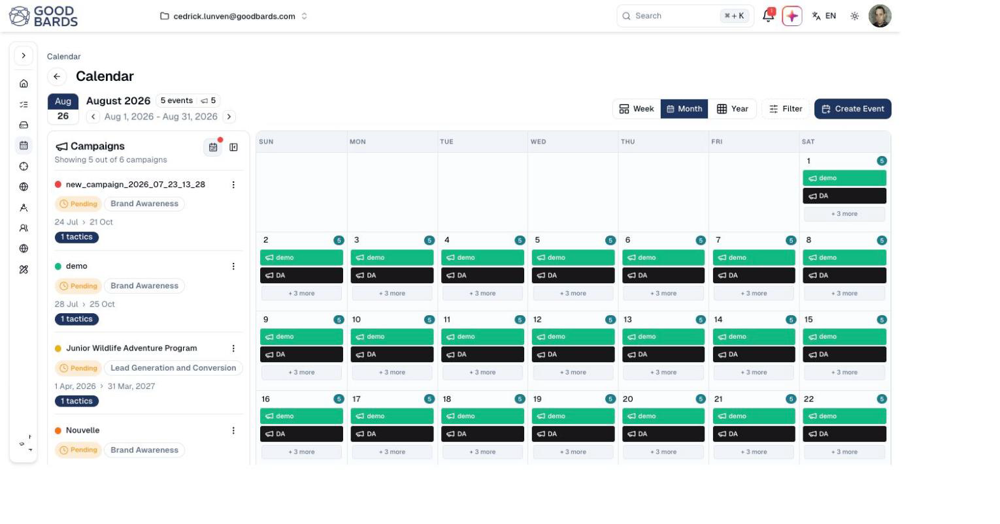

# Calendar

Everything you have planned, across every channel, on one timeline.

## What it's for

Marketing goes wrong in the gaps: two emails on the same morning, a campaign that
quietly has nothing scheduled for three weeks, a launch post that clashes with a
public holiday. The calendar shows all of it together so you can see those
problems before your audience does.

Anything scheduled — social posts, emails, events, campaign tactics — appears
here automatically. You do not maintain it separately.

## How to read your calendar

1. In the sidebar, choose **Calendar**.
2. Switch between **Week**, **Month** and **Year** depending on how far ahead you
   are looking.
3. Use the arrows beside the date range to move through time.

The header tells you what is in view — for example *August 2026, 5 events*.

## The campaigns panel

Down the left is every campaign overlapping the period you are viewing, each
with its status, objective, date range and how many tactics it contains.

Each campaign has a coloured dot, and that colour is how its items appear in the
grid — so you can see at a glance which campaign is driving a busy week.

!!! tip "Showing 5 out of 6 campaigns"
    The panel says how many campaigns it is displaying. If that number is lower
    than your total, some are filtered out — check **Filter** before concluding
    something is missing.

## Days with more than fits

A day with several items shows the first few and then **+ 3 more**. Choose that
to see everything scheduled for the day.

## Adding to the calendar

**Create Event** adds an event directly. Most things arrive here on their own,
though — schedule an email or a social post and it appears without further work.

## Good to know

- **The calendar reflects, it does not control.** Move a post by editing the post,
  not by dragging it here.
- **Look for gaps as well as clashes.** A month with nothing in it is as much a
  problem as a day with six things.
- **Check before you schedule.** A quick look at the week you are aiming for
  avoids stacking three emails on the same morning.

---

*Still stuck? [Contact support](../contact.md).*
