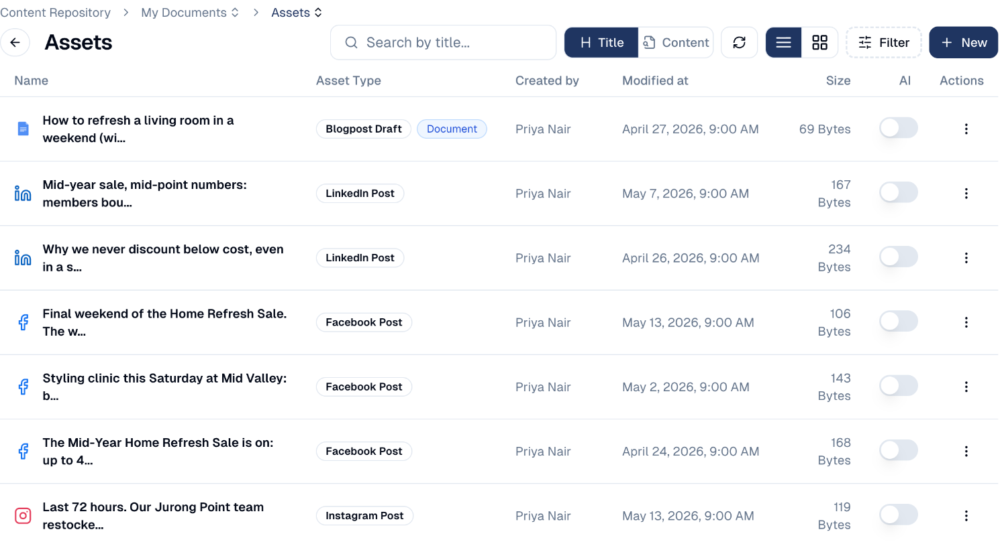
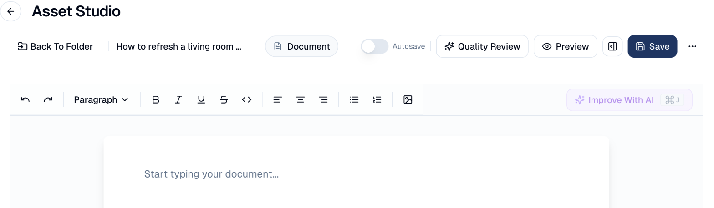

# Content Repository

Where the images, documents and files your marketing uses are stored. It used to
be called **Drive**.

## What it's for

Marketing runs on files — logos, product photography, brochures, the PDF you
attach to a follow-up email. Drive keeps them in one place, so anything you use in
a campaign, email or social post is already to hand rather than sitting on
someone's laptop.

Files here are available to your whole team, and to the AI features that need
them.

## How to upload and organise files

1. In the sidebar, choose **Content Hub → Content Repository**, or the
   repository icon in the top bar.
2. Open a folder to work inside it.
3. Choose **+ New**:

    | Option | What it does |
    | --- | --- |
    | **Upload** | Adds a file from your computer. Give it a marketing stage and, if it should not be used after a date, an expiration date. |
    | **Add Website** | Adds a web page by its address; GoodBards reads its content so the AI can use it. |
    | **Import WordPress** | Brings in your existing WordPress articles. Connect WordPress first under **Connections**. |
    | **Folder** | Creates a folder. |

Each file's **Actions** menu lets you share, move, rename or delete it, and see
where it is used, for example in which campaigns and tactics.

## Editing an article or a post

Open an article or a post to edit it in the **Asset Studio**.

- **Improve With AI** (or ++cmd+j++) rewrites the whole document following your
  instruction, for example *shorter and warmer*. The change applies straight
  away; choose **Revert** to undo it.
- **Quality Review** scores the piece, as in the
  [Content Workspace](../content-hub/content-workspace.md), and says what to
  improve.
- **Preview** shows it as it will be published; **Autosave** saves as you type.
- The **⋯** menu offers **Create social posts** (a series of posts from an
  article), exports to HTML, Markdown or JSON, **Duplicate** and **Delete**.

## The default folders

A new account starts with three:

| Folder | What it holds |
| --- | --- |
| **My Documents** | Your team's content, in **Assets** (articles and posts), **Emails**, **Images**, **Audios** and **Videos**, plus anything you upload. |
| **Shared With Me** | What colleagues have shared with you. |
| **System** | Files GoodBards manages itself. Leave this alone. |

!!! warning "Do not reorganise System"
    The **System** folder holds files the platform depends on. Moving or deleting
    things here can break emails and campaigns that reference them.

## Finding files

- **Search by title…** finds a file by name. Switch from **Title** to
  **Content** to search inside documents instead.
- The **AI** switch on a file lets the AI agents read it as background, for
  example your brand guidelines.
- **Filter** narrows by file type and other attributes.
- The two buttons beside Filter switch between **list** and **grid** view. Grid
  shows thumbnails, which is quicker for images.
- The refresh button reloads the folder if you have just uploaded something
  elsewhere.

## Good to know

- **Name files so others can find them.** `logo-primary-dark.png` is findable;
  `Screenshot 2026-08-14 at 15.22.11.png` is not.
- **Upload once, use everywhere.** A file in Drive can be used in any email,
  campaign or post — no need to re-upload it each time.
- **Deleting affects everything using it.** If an email references an image and
  you delete that image, the email breaks. Check before removing anything.

---

*Still stuck? [Contact support](../contact.md).*
