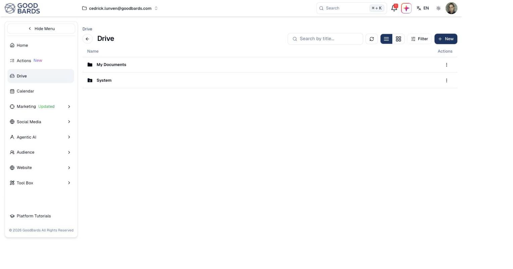

# Drive

Where the images, documents and files your marketing uses are stored.

## What it's for

Marketing runs on files — logos, product photography, brochures, the PDF you
attach to a follow-up email. Drive keeps them in one place, so anything you use in
a campaign, email or social post is already to hand rather than sitting on
someone's laptop.

Files here are available to your whole team, and to the AI features that need
them.

## How to upload and organise files

1. In the sidebar, choose **Drive**.
2. Choose **+ New** to upload a file or create a folder.
3. Open a folder to work inside it.

## The default folders

A new account starts with two:

| Folder | What it holds |
| --- | --- |
| **My Documents** | Your own uploads. Organise this however suits your team. |
| **System** | Files GoodBards manages itself. Leave this alone. |

!!! warning "Do not reorganise System"
    The **System** folder holds files the platform depends on. Moving or deleting
    things here can break emails and campaigns that reference them.

## Finding files

- **Search by title…** finds a file by name.
- **Filter** narrows by file type and other attributes.
- The two buttons beside Filter switch between **list** and **grid** view. Grid
  shows thumbnails, which is quicker for images.
- The refresh button reloads the folder if you have just uploaded something
  elsewhere.

## Good to know

- **Name files so others can find them.** `logo-primary-dark.png` is findable;
  `Screenshot 2026-08-14 at 15.22.11.png` is not.
- **Upload once, use everywhere.** A file in Drive can be used in any email,
  campaign or post — no need to re-upload it each time.
- **Deleting affects everything using it.** If an email references an image and
  you delete that image, the email breaks. Check before removing anything.

---

*Still stuck? [Contact support](../contact.md).*
